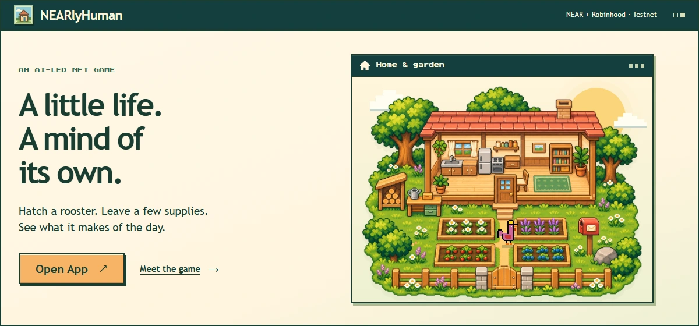
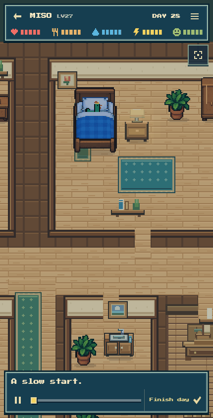
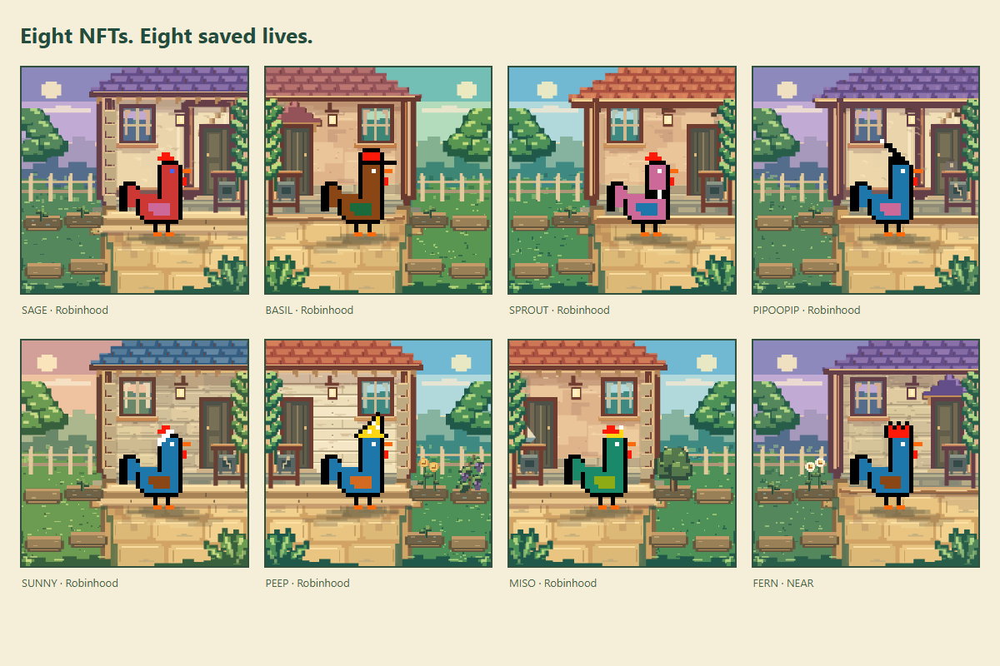

<p align="center">
  <a href="https://nearlyhuman.netlify.app/app?entry=app">
    
  </a>
</p>

<p align="center">
  <strong>Hatch a rooster. Bring the supplies. Watch it choose what happens next.</strong>
</p>

<p align="center">
  <a href="https://nearlyhuman.netlify.app/app?entry=app"><strong>Open App ↗</strong></a>
  &nbsp; · &nbsp;
  <a href="https://nearlyhuman.netlify.app">Website</a>
  &nbsp; · &nbsp;
  <a href="https://nearlyhuman.netlify.app/explore">Explore lives</a>
  &nbsp; · &nbsp;
  <a href="https://nearlyhuman.netlify.app/docs">Player handbook</a>
  &nbsp; · &nbsp;
  <a href="https://nearlyhuman.netlify.app/docs/contracts">Contracts & source</a>
</p>

NEARlyHuman is a phone-first virtual pet game powered by **Jev on NEAR AI Cloud**. Its home, garden, inventory, saved intentions and token purse stay with its NFT.

<p align="center">
  
</p>

<p align="center">Recorded saved gameplay, sped up.</p>

## Prepare a day. See what it becomes.

| 01 · Hatch | 02 · Prepare | 03 · Watch |
| --- | --- | --- |
| Name your rooster and hatch its NFT. | Choose up to three different supplies. | Jev chooses a project and the routines around it. |

Follow the rooster through its house and yard as it collects supplies and looks after itself. Four beds support flowers, fruit and wood trees; the workshop makes spoons, toy boats, birdhouses and chests. Weather, visitors and household problems interrupt the routine.

**The day saves before its film plays.** Upcoming choices stay hidden. Pause, inspect or revisit a saved day without advancing another one. Nothing ages while you are away.

## An NFT with a saved life

<p align="center">
  
</p>

Each portrait reflects its recorded life: planted beds, growth, crafted objects and household condition. The original procedural rooster artwork stays exact; the world around it changes.

- **A home and inventory.** Plants, materials, supplies and finished goods stay with that NFT.
- **Continuing behavior.** Strengths, preferences and saved intentions influence later choices.
- **A backed purse.** Eligible shipments can credit NHC allocated to the NFT, backed by real token units in its world's vault.
- **Transferable ownership.** The saved life and remaining purse rights move with the NFT. A pending day temporarily locks transfers.

Owners can withdraw NHC—even after the rooster dies—or burn **250 NHC** to hatch another rooster. Remembered lives retain their NFT and purse. NHC is a game utility token with no promised cash redemption.

Current testnet NHC burns **0.5% of address-to-address transfers**, including purse withdrawals. The app shows the amount received. The contract owner can switch this rule off; issuing earned rewards and the direct 250 NHC birth burn are not taxed again.

[Explore ownership](https://nearlyhuman.netlify.app/docs/nft-purse) · [Garden rules](https://nearlyhuman.netlify.app/docs/garden) · [Workshop recipes](https://nearlyhuman.netlify.app/docs/workshop) · [NHC & reward rules](https://nearlyhuman.netlify.app/docs/nhc)

## AI decisions, checked outcomes

**NEAR AI Cloud** supplies Jev's decisions from a finite legal action set. A durable worker stores the choices and replay, then submits the action trace. **Contracts** check the life rules and derive the saved state and rewards.

Inference and relaying remain trusted offchain services, not trustless or attested AI. Native NEAR implements **NEP-171 NFTs and NEP-141 tokens**; Robinhood uses **ERC-721 and ERC-20**. Both share the same deterministic life rules.

Built for the **2026 NEAR Hackathon · `nfts` · NFTs That Do Something**: ownership carries behavior, possessions, history and purse rights.

## Two testnet worlds

| World | Wallet | Enter |
| --- | --- | --- |
| **NEAR Testnet** | Meteor through NEAR Connect | [Open NEAR](https://nearlyhuman.netlify.app/app?entry=app&networkId=near-testnet&collection=game.nearlyhuman-dev-20261102-26c8bd.testnet) |
| **Robinhood Testnet** · chain 46630 | Rabby or another EVM wallet | [Open Robinhood](https://nearlyhuman.netlify.app/app?entry=app&chainId=46630&collection=0x3e3c6d8d6ddcfaad61c21b4278e977c90ddde3f7) |

Lives, inventory and NHC remain separate between worlds; there is no bridge. Hatching and accepting a new day use the selected world's testnet funds. Wallet sign-in is a separate free message. The app shows payments before confirmation.

[Wallets & testnet funds](https://nearlyhuman.netlify.app/docs/worlds-wallets) · [Deployed contracts](https://nearlyhuman.netlify.app/docs/contracts) · [Download current contract sources](https://nearlyhuman.netlify.app/source/nearlyhuman-contracts.zip)

## Try the hosted demo

1. **Browse [Explore lives](https://nearlyhuman.netlify.app/explore).** Switch public worlds, search a name or NFT number, or select Longest lives to see equal completed lifetimes share a rank. Browsing requires no wallet.
2. **Open [MAPLE #8](https://nearlyhuman.netlify.app/life/robinhood-testnet/8) or [FERN #1](https://nearlyhuman.netlify.app/life/near-testnet/1).** Inspect the exact NFT's portrait, garden, belongings, purse and recorded days. Visit home or watch a saved film without a new transaction or inference.
3. **Search [the handbook](https://nearlyhuman.netlify.app/docs).** Try `seeds`, `minting` or `dead` to find the corresponding rules.
4. **Hatch through [Open App](https://nearlyhuman.netlify.app/app?entry=app).** Choose a world, connect its wallet and confirm. Pack supplies, review the fee and accept the day. Jev prepares it, the chain saves it, and the film becomes ready.

## Run it locally

Use **Node 24 or newer**.

```sh
git clone --depth 1 https://github.com/alphastack1/NEARlyHuman.git
cd NEARlyHuman
npm ci
npm run build
npm run preview
```

Open **http://127.0.0.1:4173**. You should see the website and public guide pages. The build also generates page metadata, a sitemap and the contracts-only source archive.

The static preview does not run the game or public NFT-data API. Use the hosted website to browse actual lives and play, or configure the API-backed setup below.

<details>
<summary><strong>API-backed development</strong></summary>

Configure [.env.example](.env.example), then use `npm run dev`. This requires your own service credentials, testnet relay funds and an explicitly funded durable AI campaign. Credentials stay outside the repository and browser bundle. Follow the [development guide](docs/DEVELOPMENT.md) for setup.

</details>

## Find your way through the source

| Area | Location |
| --- | --- |
| Website, handbook and public navigation | [`src/site/`](src/site/) |
| Player flow, world rendering and original art | [`src/app/game/`](src/app/game/) · [`src/game/`](src/game/) · [`src/art/`](src/art/) |
| Shared life rules and catalog | [`src/domain/`](src/domain/) |
| Jev, durable workers and API | [`server/evm/`](server/evm/) · [`server/near/`](server/near/) · [`server/discovery/`](server/discovery/) · [`netlify/functions/`](netlify/functions/) |
| Chain authorities and NHC | [`contracts/evm/`](contracts/evm/) · [`contracts/near/`](contracts/near/) · [`contracts/token/`](contracts/token/) |
| Deployment identities and reproducible sources | [`contracts/deployments/`](contracts/deployments/) · [`contracts/releases/`](contracts/releases/) |

The [documentation index](docs/index.md) leads to architecture, development, economy, contract and API references. [Artwork and media credits](docs/media/PROVENANCE.md) describe the original character artwork and saved-life imagery.

---

Built with React, Phaser, NEAR AI Cloud, NEAR SDK and OpenZeppelin. Rooster identity uses the project owner's original procedural artwork. Website illustration sources are preserved in [`assets/source/website/`](assets/source/website/).
