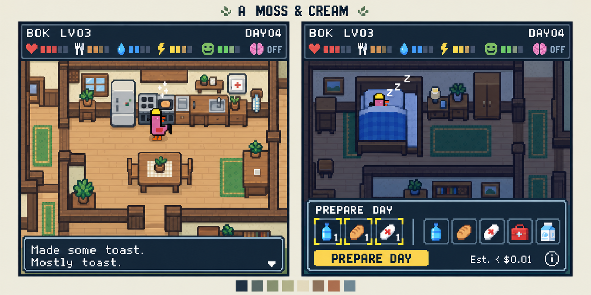

# NEARlyHuman — complete scene and interaction map

Revision: 1 November 2026. Status: complete mockup-guide package after generation, independent cross-review and reference reconciliation. Native source assets and game implementation remain separate work.

## 1. Authority and locked visual reference

The owner selected the original **Moss & Cream, top-down handheld RPG house** shown below. This exact image is the visual reference. Later recolors do not supersede it.

**At a glance:** one square game surface; six functional house zones; 121 UI states; 15 item-detail panels; all 35 action families; 26 world storyboard groups. Exact variants, reference sheets, asset work and future verification each have named assignments. The [complete guide gallery](mockups/index.html) and [every-state reference map](mockups/REFERENCE_MAP.md) are ready; the approved colors/camera stay fixed.

Read [the surface/flow](#2-product-surface-and-navigation), [house and camera](#4-connected-house-and-camera-map), [all UI states](#7-complete-screenstate-inventory), [world actions](#8-world-action-and-outcome-storyboards), [production assignments](#14-mockup-board-manifest), or [review corrections](#15-six-perspective-review-and-correction-register).

Reference ID: **VR-01**. SHA-256: `AE4EB20B06B18F6A236C92C83E41594E470060366A0B6DC9DC3118BFF0ABFF33`.

The permanent master [NEARlyHuman.md](../NEARlyHuman.md) owns game rules, economics, onchain state, and service guarantees. This companion owns the detailed UI inventory, world presentation map, and mockup-production coverage. If an illustration conflicts with a rule, correct the illustration; do not infer a new mechanic. The reference approves a direction, not every placeholder label or count. All fixture numbers, sample copy, coordinates, and production groupings below are design proposals unless explicitly identified as owner decisions.

### 1.1 Preserve these qualities

- Top-down Harvest Moon / GBA / DS era room framing, upright pixel characters, crisp tile edges, and simple readable silhouettes.
- Warm honey wood, cream walls, moss rugs/plants, blue bedding, dark navy frames, yellow primary buttons, and the original colorful semantic status accents. Preserve the richness of the approved image; do not desaturate it or make new palette variants.
- One square game surface. The image's two squares illustrate two moments; they are not a dual-screen device interface.
- A larger connected home extending past the camera. Ordinary play shows one useful area and its adjoining route, occasionally part of another area. The camera follows the rooster; the player does not select rooms from tabs.
- Rooster identity from the existing 24×24 procedural source. BOK, the magenta reference rooster with yellow cap, is the common illustrative fixture for this mockup set, not a fixed identity for every NFT.
- The kitchen activity composition on the left and sleeping care composition on the right are the two primary layout anchors.

### 1.2 Do not carry these incidental details into mechanics

The reference's swatches do not mandate eight total colors. The brain's OFF label means its inspection panel is closed, not that AI can be disabled. DAY04 must be disambiguated as saved day versus next day in each mode. Three displayed supplies are an example; an ordinary delivery may contain zero, one, two, or three distinct types. Illustrative stored quantities must match the selected fixture. The fee remains one quiet, readable, nonzero estimate near the action, with optional details. Scene colors and warm room lighting cannot invent an electrical-power bonus or nighttime decay.

## 2. Product surface and navigation

### 2.1 One surface, reusable compositions

There is one game route with network and selected-token context, not a site full of account pages. The following compositions recur over the house: entry, mint form, reveal, care/picker, progress, ready, replay, outcome, memorial, trial-complete, and shared detail/options/recovery card. A screen ID identifies a meaningful state, not a new route. Every mockup is a square panel; two compatible panels may share a presentation board.

Player interactions are wallet connection, naming/allocating stats, selecting deliveries, authorizing requests, reading, choosing a token, and controlling playback presentation. **Objects are dynamic because the NPC can use them in recorded actions. Tapping a stove, bed, or plot does not command the NPC.** Object inspection may explain an existing state; it does not consume a simulation slot, generate a choice, or change the save. There is no drag-and-drop furniture editor.

### 2.2 Main flow

First visit: Load → representative sleeping house → connect/network check → ownership discovery → mint draft → quote/reservation → wallet → submitted mint → confirmed identity → skippable birth → included first-day preparation → final save → Start day or View saved outcome → replay/skip → living care, memorial, or trial completion.

Returning owner: Load → reconcile account/network/token/request → active preparation, uncertain save, saved unplayed result, paused replay, living care, memorial, or trial completion. Never default to a fresh request merely because local browser data is missing.

Ordinary day: Care → choose 0–3 distinct additions → quote with capacity reservation → one owner approval → request confirmation → real Jev preparation → backend final save → Ready → replay or saved outcome → next care. Replaying and skipping require no signature.

Failure: accepted request → local failure awaiting chain terminal record → confirmed Failed/released lock → editable retry → fresh owner transaction. Failed automatic day one returns to its dedicated first-day retry, not ordinary delivery or repurchase.

Expiry: canonical pending request strictly past its stored deadline → gas-only release approval → release transaction reconciliation → confirmed release → fresh quote/request when eligible. A passing clock alone does not unlock the token.

### 2.3 Navigation and back behavior

| Context | Close / Back | Persistent work | Re-entry |
| --- | --- | --- | --- |
| Local form, item detail, help | Close to invoker; restore focus and scroll | Token/network-scoped draft only | Revalidate any price/capacity reservation before sending |
| Wallet approval before submission | Return from wallet, then check if anything was actually broadcast | Unsent draft, or discovered hash | If a hash exists, track it; do not treat a closed wallet as rejection |
| Submitted owner or release transaction | Close status to house/options, not Cancel transaction | Track same hash and replacement lineage | Reconcile canonical chain result |
| Accepted preparation | Leave / select another token | Durable token-bound job continues | Resume actual job phase and completed count |
| Ready | Leave / choose another token | Already saved outcome | Same saved day; no new charge |
| Replay detail or options | Close keeps presentation paused | Pinned receipt, time, message, camera | Explicit Resume; no simulation change |
| Summary | Next care, watch latest again, or token selector | Canonical saved day | Replaying cannot award level or stock again |
| Memorial / trial complete | Selector, fresh hatch, or available verified network entry | Retained save and identity | No inheritance, resurrection, or automatic migration |

External wallet/explorer links are labeled departures. Their native prompts, rejection dialogs, and funding pages are external dependencies, not game screens we pretend to design. Returning must reconcile the pending operation before enabling a new one. Browser refresh and deep links use the same resolver as a normal return.

## 3. Truth and display rules

The map uses these data labels. They constrain every row in the inventory.

| Label | Meaning | Appropriate visible use |
| --- | --- | --- |
| DEMO | Representative unowned house | Entry background; never implies an NFT has been minted |
| DRAFT | Local name/stats/delivery, scoped to account/token/network | Editable before acceptance; not yet stored stock |
| SAVE | Last canonical completed biological day | Care values, conditions, inventory, house, living/dead status |
| REQUEST | Confirmed owner request plus canonical lock/deadline and durable job | Progress and failure/release eligibility; not biological progress |
| WORK | Checkpointed preparation, not finalized | Actual decision count and optional spoiler detail; provisional house effects never silently replace SAVE |
| REPLAY | Verified saved receipt snapshot at playback index | Animated house/HUD/event/recorded choice, even when current SAVE is later |
| FINAL | Current finalized outcome | Ready details, summary, selector life status, memorial, trial counter |
| UNKNOWN | Last read is stale, inconsistent, provisional, or unreadable | Last-known label and checking/retry; never assert Failed or accept another day from uncertainty |

During replay, the main meters show REPLAY values and the replayed game day. Details distinguish these from the current final save. Ready/care and token badges remain truthful about a committed death even before the death animation is watched. Preparation normally keeps the last completed house still/dim; optional WORK inspection is labeled as upcoming-day spoilers. Pausing a film never pauses biological consequences: they have already been saved.

Counts are separate: survived-day level; committed biological days including a fatal day; request attempts including Failed/Expired; successful model decisions up to 60; 60 logical slots; and the three-committed-day testnet allowance. Do not substitute one count for another. No real-world absence advances any biological counter, need, illness deadline, plot growth, or object lifetime.

## 4. Connected house and camera map

### 4.1 Functional zones and routes

Use one fixed logical topology with safe seeded decoration/mirroring, not a separately generated floor plan for every image. The production reference home is **HOME-BOK-01**. A tile/anchor sheet must be approved before generating the room series so the kitchen, bedroom, doors, rugs, and windows recur in the same positions. World dimensions are a technical-art proposal, not a new gameplay rule: a starting study of 32×28 tiles at 16-pixel environment tiles is sufficient to explore a house larger than the view. Final dimensions depend on the 24-pixel rooster and phone review. Do not shrink a whole-house overview into the normal playfield to satisfy that number.

| Zone | Required content | Connectivity and route duty | Camera / primary mockup state |
| --- | --- | --- | --- |
| Z00 Hall / connectors | Open walking space, door openings, harmless decor | Links all six functional zones; no gameplay room or inventory added | CAM-HALL; UI-08B |
| Z01 Entrance / mailbox | Reachable mailbox, entry landing, interior transition | One connected route to kitchen stores; mailbox prelude does not teleport through walls | CAM-ENTRY; UI-08A |
| Z02 Kitchen | Fridge, pantry, preparation surface, stove, cutoff, window | Connects hall, food access, and wash route; safe direct food/drink remains accessible during damage/outage | CAM-KITCHEN; UI-08C |
| Z03 Living / leisure | Always-available base leisure, two validated optional-chair anchors | Neither chair position blocks a door or basic activity; visible link to hall/garden route | CAM-LIVING; UI-08E |
| Z04 Sleep / utility cupboard | Bed and grouped treatment/tool storage | Reachable while other fixtures fail; bed anchor matches approved sleeping crop | CAM-BEDROOM; UI-04A |
| Z05 Wash area | Soap-use basin/dry tap or limited cistern, body-wash position | Accessible from hall and kitchen; supplies no free drinking or irrigation water | CAM-WASH; UI-08E |
| Z06 Tiny garden | Exactly two plots, fixed wooden-shelter anchor, garden-view spot | Approach both plots without crossing plant collision; weather effects stay readable | CAM-GARDEN; UI-08D |

The populated HOME-BOK-01 plan in section 4.3 is the common provisional reference for every mockup. Its kitchen and bedroom occupy the upper wings, linked by a hall; living, wash, and garden occupy the lower side, with entry at the perimeter. Do not let image generation reinvent a doorway or add another room. The full-plan sheet is an authoring reference only, not an extra player map/menu.

### 4.2 Camera contract

| Camera | What must be visible | Framing and occlusion checks |
| --- | --- | --- |
| CAM-KITCHEN | Rooster feet, active stove/prep/storage target, approach space and exit | Closest match to VR-01 left; keep active utensil/condition outside message box |
| CAM-BEDROOM | Bed, rooster/cap, cupboard edge and adjoining hall | Closest match to VR-01 right; care card may cover lower inactive floor, not an urgent state label |
| CAM-ENTRY | Mailbox, arrival space, route into home | Zero delivery has no invented parcel; close-up never implies offchain inventory credit |
| CAM-HALL | Both sides of upcoming doorway and next destination cue | Gentle lead before threshold, no snap back at collision edge; no room-loading transition |
| CAM-LIVING | Base leisure and optional chair's active anchor | The two chair anchors read as the same object moved; no duplication |
| CAM-WASH | Basin/body position or exact cleaning target | Distinguish surface/body cleanup; water scenery does not imply free supply |
| CAM-GARDEN | Both plots when feasible; exact target plus other plot reference otherwise | Plot numbers/type/stage readable on inspect; shelter coverage unambiguous |
| CAM-BOUNDARY | Active prop and rooster at the world's limits | Clamp gracefully; neither overscan void nor excessive zoom to show whole home |

Normal framing shows a partial house, generally one functional area with a visible adjoining route. No percentage-of-house target remains. Keep collision and interaction anchors independent of the camera. Doorway travel, camera easing, and approach do not spend extra actions, ingredients, energy, random rolls, or Jev calls. A route-animation fallback reaches the recorded safe endpoint once and never repeats consumption.

Foreground walls/door lintels use a consistent cutaway or fade so they do not hide the rooster, held item, target, or dangerous state. Tall headgear is included in framing bounds. Camera movement stops while recorded detail is pinned. Reduced motion uses stable cuts or minimal eased movement, no shake or large sweeps, while preserving the same action/route meaning. The message card may compact or temporarily shift to a reviewed safe location; it may not hide the action it describes. No free-pan player camera is required in v1.

### 4.3 Populated production reference pack

These are **provisional mockup coordinates**, not executed collision/source-art tests or owner-selected technical numbers. All coordinates below are inclusive environment tile coordinates with origin at upper left. One environment tile is 16 logical pixels. The world is 32×28 tiles (512×448 logical pixels). This is larger than the visible world crop. Harmless dressing stays inside unused perimeter space and cannot create a seventh functional zone.

| Reference sheet | Populated content / assignment | Acceptance status |
| --- | --- | --- |
| RP-01 HOME-BOK-01 | [Permanent authoring plan](reference-pack/RP-01-home-bok-01-layout.svg), tables below; six zones, hall connectors, footprints, approaches and camera studies | Diagram created and visually inspected; all 17 approaches/six doors statically connected; actual sprite collision/contact still pending |
| RP-02 Square/HUD/card template | [Permanent bounds diagram](reference-pack/RP-02-square-hud-care-bounds.svg); 256×256 logical art study, HUD y0–39, world y40–219, message y220–255, care initially y160–255 expanding toward y40 | Diagram created/visually inspected; phone text reflow and actual source-contact checks still pending |
| RP-03 BOK identity/pose/contact | Same magenta BOK and source trait identity; right/left upright billboard convention; base feet pivot (12,23) in 24×24 source frame, enlarged transparent pose bounds where accessories require | Actual procedural trait match, pivot and compositing pending; generated redraw is reference only |
| RP-04 Camera/occlusion contacts | Bed, stove, both plots, threshold and world-edge crops; wall cutaway and held-prop visibility; reduced-motion equivalents | Named technical contact frames pending; covered further by WS-25 and ART-01 |

| Zone footprint | Door opening / connection | Required route |
| --- | --- | --- |
| Kitchen interior x2–13, y2–11 | (8,12), approaches (8,11)/(8,13) | Hall to storage/prep/stove/window |
| Bedroom interior x17–28, y2–11 | (22,12), approaches (22,11)/(22,13) | Hall to bed and cupboard |
| Cross-hall x2–29, y13–15; south connector x14–16, y15–26 | Open hall intersections, no room-load transition | Connect every listed doorway without furniture crossing |
| Living interior x2–13, y17–25 | (8,16), approaches (8,15)/(8,17) | Base leisure plus both optional-chair anchors |
| Wash interior x18–22, y17–21 | (20,16), approaches (20,15)/(20,17) | Basin/body wash and return to hall |
| Garden interior x24–29, y17–25 | (26,16), approaches (26,15)/(26,17) | Both plot approaches and garden-view anchor |
| Entry landing x18–22, y23–26 | (17,24), approaches (16,24)/(18,24) | Mailbox to south connector, cross-hall, kitchen stores |

| Fixed target / footprint in tiles | Interaction approach tile(s) | Contact / state scope |
| --- | --- | --- |
| Fridge (4,3)–(5,4); pantry (7,3)–(8,4) | (4,5); (7,5) | Access grouped stock once; doors animate into reserved nonblocking space |
| Stove (10,3)–(11,4); prep (12,3)–(13,4) | (10,5); (12,5) | Cutoff reachable from stove approach; cooking and cleanup share fixed targets |
| Kitchen window (8,1)–(9,1) | (8,2) | Damage/patch/brace/drip states on same window; no window relocation between images |
| Bed (18,3)–(20,6); cupboard (26,3)–(27,4) | (21,6); (26,5) | Bed side contact; storage separate from pose footprint |
| Base leisure (4,19)–(5,20) | (5,21) | Always available; never replaced by optional chair |
| Optional chair A (10,20); B (10,23) | (10,21); (10,24) | One object at one anchor, vacant alternate required |
| Wash basin (20,18)–(21,19); body wash spot (19,20) | (20,20); (19,21) | Soap/body/prep targets remain distinct; no free water |
| Plot 1 (25,20); plot 2 (28,20); garden view (26,23) | (25,21); (28,21); (26,24) | Covers/crop art can extend above tile but must not block target/route |
| Wooden shelter anchor (26,18) | (26,19) | Covers both plots mechanically; support art cannot obstruct approaches |
| Mailbox (21,24) | (20,24) | Entry route through (18,24) to south connector |

Unlisted room edge tiles are walls/openings or harmless dressing, not new systems. Reserve the hall and approach tiles above before adding decoration. Footprints are initial layout bindings, not a claim they have passed pathfinding. RP-01 must include a continuous route overlay and detect contact/door overlap before mockup room production. A mirrored house seed must transform every target, doorway, camera and approach consistently; use the unmirrored HOME-BOK-01 for this image collection.

World art uses one crisp nearest-neighbor pixel grid and stable zoom. The initial viewport shows 16 tiles across and roughly 11.25 tiles vertically; camera center is constrained to the world bounds, with a small doorway lead. Do not change tile/rooster scale between rooms to fit more furniture. Actual displayed source scale is checked at P320 and P390. Text uses independently readable DOM-sized type in the eventual implementation; the 256-pixel art template is not permission to render tiny bitmap labels below usable physical size. Enlarge/reflow the card rather than squeeze its text. A square can scroll within the visible phone viewport when the OS keyboard opens; the field and Back/action path remain reachable.

For this mockup pack use **upright left/right profile billboard sprites**: horizontal travel faces the travel direction; vertical travel keeps its prior horizontal facing, and contact uses the facing that exposes the prop/action. Do not invent front/rear/diagonal anatomy in isolated panels. If later source-art verification requires extra facings, add named AS-02 poses and compatibility evidence before shipping, preserving VR-01. Base feet are grounded consistently; pose/accessory bounds may expand around the fixed pivot rather than shrinking hats or cropping their top row. These are bounded technical defaults, still pending actual-source verification.

## 5. Dynamic fixture and object inventory

These are presentation states of existing rules, not additional mechanics. Every operable object needs a stable identifier, footprint/collision, approach tile, facing/contact anchor, depth/occlusion rule, state variants, and recorded-action binding. At least one approach position remains reachable through every allowed decor seed. One or two tiles of clear space are an initial art study, not a new path-length cost. Inspecting any object is read-only.

| Object | Required visible states | NPC uses / target binding | Limits and important distinction |
| --- | --- | --- | --- |
| OBJ-MAIL | Empty, parcel present, lid open, collected | Deterministic delivery prelude into grouped stores | Zero delivery shows empty; replay/failure cannot credit items |
| OBJ-FRIDGE | Closed/open, store counts, outage cue | Milk/steak/water access as defined by action | No automatic full spoilage; no fridge-repair action |
| OBJ-PANTRY | Closed/open, grouped food counts | Bread/coffee/seeds and other tagged stock access | Same inventory as picker; not a second stash |
| OBJ-PREP | Clean, Mess 1, Mess 2, contaminated surface, cleaning | K01–K06 preparation; H05–H07 exact target | Mess and contamination differ and can coexist; no extra illness from decorative crumbs |
| OBJ-STOVE | Intact, cooking, damaged, wood-patched, unpowered, backup heat, flame, shutdown, residual smoke | Cooking, H08/H10/H15/H16/H17 | Backup heat is the existing intact cooker; cutoff stays reachable; no electrical-fire branch |
| OBJ-WINDOW | Intact/damaged, forecast weather, drip, patch, brace, diversion | H08/H10/H12/H13/H14 weather response | Distinguish permanent repair, episode brace, damage-only cover and stock-only diversion |
| OBJ-BED | Empty/resting/sleeping/waking, equivalent capped-head silhouette | H03 rest, routine living bedtime | Decorative sleeping in menus is not offline simulation; never blocks basic rest |
| OBJ-CUPBOARD | Grouped medicine/bandage/soap/tool/material counts | H02 treatment; tool pickup before relevant actions | Toolkits are consumed inputs, not permanent equipment |
| OBJ-WASH | Dry basin/tap, washing/soap bubble state | H07 body variant or target-appropriate wipe | No refill, water bottle creation, or disease cure |
| OBJ-LEISURE | Base leisure available, garden-view pause | H04 base/view | No furniture required for baseline morale recovery |
| OBJ-CHAIR | Absent, anchor A/B, intact/damaged/bandage-braced, aging/expired | H04/H08/H09/H11/H20 | Five living bedtimes; H10 wood patch is stove/window only, not chair; brace expires current bedtime |
| OBJ-PLOT-1 / OBJ-PLOT-2 | Empty/rose/apple, growth, moisture, dry days, soil block, compost pending, maturity, harvest/wilt/abandon | G01–G07, H04 garden view | Exactly two; ripe harvest is immediate effect, not stored fruit supply |
| OBJ-SHELTER | Absent, construction, wooden cover, life remaining/expired | H09, covers both plots | Four living bedtimes; no moisture or growth bonus |
| OBJ-PLOT-COVER | Umbrella installed on plot 1 or 2, remaining life/expired | G06 | Three living bedtimes; one per plot; not offered redundantly under wooden shelter |
| OBJ-PEST | Active seed-eater / hungry visitor; bait, shoo, depart, failure/contact cue | H18/H19 exact episode | Fixed episode, not autonomous enemy simulation; bait gives no eating/planting benefit |
| OBJ-EFFECTS | Identified loss, wound/illness cue, drip, smoke, harmless dust, weather, sparkles | Bound to receipt and exact source | Dangerous visuals require a real state; flavor particles cause no new damage or random draw |
| OBJ-HELD | One food/drink/tool/material/treatment prop as needed | Atomic action start/use/end | Do not show a consumed item returned to inventory or animate a second spend |

Persistent output detail shows remaining **living bedtimes**, with creation day included. Real absence, Failed attempts and replay do not age outputs. Moving/repairing never renews age. Wood patch lasts two living bedtimes; bandage brace lasts current living bedtime; window brace/diversion lasts the episode at most to bedtime; exposure cover lasts one response; backup heat lasts current bedtime. Expiry visuals must remove only the expiring protection/output and retain underlying damage when applicable. A full wooden shelter and one-plot umbrella must read differently.

## 6. Shared UI anatomy and interactions

### 6.1 Status, message and house

Retain VR-01's compact navy top strip with name, level, game-day context, health and four needs, plus an accessible brain/detail affordance. The initial visual study may use the reference's five compact colored bars. At P320/enlarged text, compact these into an accessible status summary rather than squeezing unreadable meters. Color is reinforced by icons, text on inspect, and exact values. The brain affordance has an accessible name and comfortably sized hit area even if its visible glyph is small.

Use a maximum two short authored lines in the ordinary event box, around twenty characters per line as the initial writing target. Longer rules, warnings and explanations belong in scrollable detail, not truncated survival information. The message review list reads prior mechanically important recorded events; it does not call the model. Typewriter text has immediate reveal, adjustable reading behavior and reduced-motion equivalence. Only birth and death are special cinematics.

### 6.2 Care and delivery controls

The care card rests over the sleeping home. It presents a concise care priority, an expandable status, existing stock, the three delivery slots, catalog access, Prepare day and a quiet estimate. Distinguish **Stored** count from **Delivery +1**. Each selected type adds exactly one unit; repeated units of one type cannot occupy two slots. All fifteen icons remain reachable through the same overlay's catalog pages/scroll. Grouped stored counts support 65,535 per type. A full type cannot accept another unit; zero delivery remains valid even when all types are full.

An item has separate **Details** and **Add/Remove** controls. Opening/closing Details never selects/replaces an item. With three types selected, adding another requires an explicit removal; no silent replacement. Empty slots remain visually deliberate. The zero-item option says Use stored supplies and leaves Prepare day available when a fresh quote and all other eligibility checks pass. No compulsory filler, discard economy or drag requirement.

### 6.3 Detail and options layers

Use one modal/detail surface at a time, one main vertical scroll region, visible Close/Back, restored focus and catalog position. If the invoker disappears after Ready/Failed/release/account/ownership/network changes, keep the pinned reading view and announce the real transition once with its token/day context. On Close, restore the invoker only if still present and appropriate; otherwise focus the new mode heading or safe action after context reconciliation. Never land focus on a different token’s Prepare control, and never auto-resume replay. Optional fee details, request details, status, item detail, help, brain detail and token selector reuse this system. No nested tiny-scrolling panels. Opening options or detail during replay pauses the whole presentation; closing leaves it paused until Resume. During preparation, reading pins a completed choice while actual work continues.

Brain panels label provider telemetry **Model choice probability**. A rule-defined **Task success chance**, if displayed, is a separate value; neither number is a survival guarantee. Missing telemetry says unavailable. Authored thoughts are narrative, not hidden model reasoning. Before any genuine choice, the panel says No recorded choice yet. For a deterministic receipt it says This step did not require a model choice, while allowing separately indexed prior genuine choices when available. DEMO has no fictional actual choice.

Options contain audio/mute, motion, text/readability, short help, current network and request/chain details. Help explains choose supplies → prepare/save → watch, real time does not cause neglect, recorded choices cannot be changed, treatment may be used at Jev's discretion, death retains the NFT, and trial rules. Rules help is inline content, not another mandatory onboarding tour. Connection/network information and attributions can be reached here; there is no player API-key entry or developer dashboard.

### 6.4 Fees and confirmations

No separate required fee modal. Next to Hatch rooster / Prepare day, show one readable low-prominence estimated total, with optional detail for network and processing components. A positive subcent estimate can say Est. < $0.01 with exact ETH in details; never round it to $0.00 or Free. If fiat is stale, use a truthful ETH estimate. Mint conversion itself must fail closed when its required oracle quote is unavailable; fiat-display fallback is not permission to bypass mint pricing. The adjustable developer multiplier is a backend configuration, not a player slider. Accepted quotes are not repriced retrospectively.

Testnet authorization labels amounts as **test ETH (no real-world value)**, not an actual $1 purchase. Mainnet alone uses the approx. $1 mint wording. Mint states the first committed day uses allowance one; ordinary/retry surfaces show the canonical remaining committed days before submission, separate from wallet/global operating quotas. Failed/Expired attempts do not consume a committed day. No additional acknowledgment modal is introduced.

Capacity-backed quoting requires an authenticated wallet/session. A currently valid connector-backed authenticated session satisfies this without another prompt; connection alone is not assumed to prove it. When a fresh bounded message challenge is required, use UI-01K/L before issuing scarce holds. Explain that the signature authenticates a session and sends no transaction/payment. Declining returns to the unchanged scoped draft; expiry/account/network change invalidates the session scope. Ordinary successful days still have one payable owner transaction; occasional session authentication is not a second game transaction. Replay/status reads do not request a new signature just to watch.

## 7. Complete screen/state inventory

Every row is also a required **named mockup panel**. Its ID is the panel ID. The production manifest pairs at most two full square panels per board; it never squeezes the whole inventory into a contact sheet. A row with several variants requires labeled insets or additional panels before that row may be marked covered. Entry condition and safe exit are explicit below. Shared Back/Close/resume behavior is section 2.3; shared focus and data rules are sections 3 and 6. A row does not imply its image has already been generated.

### 7.1 Loading and entry

Data: DEMO until account/network/ownership reads establish a token; UNKNOWN never masquerades as an empty collection. Camera: CAM-BEDROOM, static/dim representative home. Primary task: connect or reach the reconciled owned context.

| Panel ID | Entry condition | Required visible content | Safe actions and exit |
| --- | --- | --- | --- |
| UI-00A | Initial app/assets loading | Quiet square, game identity, real loading phase; no fake owned rooster | Wait; once critical assets/context load, resolve entry/owned state |
| UI-00B | Critical art/font load failed | Text fallback, load problem, Retry; retain any known pending request ID | Reload assets; do not authorize another day as a repair |
| UI-00C | Returning/deep-linked token context resolving | Checking saved game, intended network/token, no active submission | Read ownership/request/save; route to exact current mode, not automatic mint |
| UI-01A | Disconnected visitor | Representative sleeping home, short premise, Connect wallet | Connect → chooser; Help/Options can close back here |
| UI-01B | Testnet entry | Testnet badge, three committed days including first, no real-money mint promise | Connect or choose verified available network; never auto-switch/pay mainnet |
| UI-01C | Supported wallet selection opened | Supported installed/mobile choices and Back | Choose wallet → external handoff; Back → entry |
| UI-01D | No compatible wallet available | Install/open compatible wallet guidance, no fake connection | External wallet help or Back; return rechecks availability |
| UI-01E | Connected to wrong chain | Actual versus required chain, Switch network | Request switch; decline remains here with draft preserved |
| UI-01F | Connect rejected or failed, no accepted session | Actual recoverable problem, Retry, Back | Reconnect; no mint/day transaction issued |
| UI-01G | Wallet app/tab handoff in progress | Return-to-wallet hint, Waiting for connection/approval as appropriate | Reopen wallet or Back; recheck before declaring cancellation |
| UI-01H | Connected wallet ownership still loading | Loading owned roosters, account/network, Retry on read problem | Resolve to selector/context or verified no-owned entry |
| UI-01I | Ownership read confirmed no NFTs | Hatch rooster over representative home; connected account | Open mint or reconnect; no claim that clearing browser erased an NFT |
| UI-01J | Only memorial tokens owned | Retained portraits and dead badges, Hatch another, selector | Inspect memorial or start fresh mint; no continue/dead-stock salvage |
| UI-01K | Quote needs session authentication and no valid session exists | Authenticate session, bounded message purpose/network, no transaction/payment, Back | Complete supported challenge or decline → same scoped draft; no hold/payment/Failed attempt invented |
| UI-01L | Session challenge declined, failed or expired | Actual authentication reason, preserved draft, Authenticate again | Retry authentication before fresh quote; account/network change invalidates old scope |

### 7.2 Mint and included day one

Data: DRAFT → mint transaction → confirmed identity/starter SAVE and REQUEST. Camera: representative bedroom until actual home identity is known; never invent confirmed traits before acceptance. Birth and preparation can overlap in time; a failure/ready signal remains reachable while reveal is open.

| Panel ID | Entry condition | Required visible content | Safe actions and exit |
| --- | --- | --- | --- |
| UI-02A | Connected, eligible mint draft | Name max 8, five points, Body/Wits/Spirit descriptions, remaining points | Edit; Hatch only after valid draft and fresh quote; Back preserves scoped draft |
| UI-02A-KEYBOARD | Phone OS keyboard open during name entry | Focused field/error and remaining points reachable within single scroller; safe-area/browser-height handling | Edit longest valid or invalid pasted name; Back/Hatch reachable; keyboard dismissal retains draft |
| UI-02B | Name/point validation fails | Error adjacent to affected field, clear remaining allocation | Correct field; retain other values; no wallet opens |
| UI-02C | Valid priced/reserved mint | Mainnet approx. $1 ETH mint OR testnet valueless test ETH; quiet total/detail, included first day/allowance, preparation then playback, retained death warning | Hatch → wallet; optional information closes back without another consent screen |
| UI-02D | Reliable balance below required mint total | Specific shortfall if known, funding/network context | Return/edit or external funding help; recheck after return |
| UI-02E | Mint awaiting signature | Exact network, submitted draft identity, awaiting approval | Wallet approve/decline; reconcile hash before returning to editable state |
| UI-02F | Mint hash submitted, not yet final | Hash/explorer, pending/checking; Hatch disabled | Recheck same transaction; leave and return safely |
| UI-02G | Mint outcome currently uncertain | Checking transaction; separate known hash and last observation | Reconcile existing hash/replacement; no second mint CTA |
| UI-02G-FAILED | Canonical mint revert/rejection established | Transaction failed/not accepted; actual charge facts | Return preserved draft and refresh quote before a genuinely new mint |
| UI-02H | Token minted but included preparation failed | Owned portrait/token, token retained, first-day retry; no repurchase | Only after chain failure/release, retry day one with fresh signature and original starter stock |
| UI-02I | Mint quote/reservation loading | Checking price and availability, form retained | Wait or Back; wallet remains unopened until valid quote/reservation |
| UI-02J | Mint oracle/admission unavailable or expired | Specific price-unavailable versus capacity/quote-expired reason | Refresh when eligible; block Hatch; no stale-price bypass |
| UI-02K | Zero committed days and first-day attempt canonically Failed/Expired with lock released, including cold return | Retry day 1, unchanged starter stock, no delivery/new gifts/new mint charge; actual fresh retry total and testnet remaining allowance | Obtain fresh capacity-backed retry quote, then approval; normal retry processing/network fees may apply |
| UI-02K-QUOTE | Dedicated first-day retry quote loading/stale/unavailable | Checking estimate/availability, or exact price/session/capacity/expiry problem; original starter stock unchanged | Authenticate/requote when eligible or leave; no ordinary delivery, repurchase or stale-price submission |
| UI-03A | Confirmed identity reveal begins | Actual rooster/name/home, Skip reveal, preparing status reachable | Skip or watch → reveal end/current preparation state |
| UI-03B | Reveal completes | Actual rooster settled, appropriate Preparing / Day saved status; Starting supplies affordance | Continue to actual phase or inspect starter stock; no automatic second owner approval |
| UI-03B-STARTER | Starting supplies opened during/after skipped reveal | Actual 3 bread +3 water +3 distinct utility gifts and uses; compost needs later planting if present | Close to actual job/result; keep reachable through first-day stock detail after Skip, no second credit or signature |
| UI-03C | Reduced-motion reveal | Quiet identity card/home and same Skip/Continue | Same actual status route without shaking/flashing |

### 7.3 Care, status and owned-token selection

Data: SAVE/FINAL, never an uncommitted WORK house. Camera: CAM-BEDROOM unless a specific saved condition needs another inspect crop. The card's ordinary size resembles VR-01 right; accessibility reflow can cover more inactive floor.

| Panel ID | Entry condition | Required visible content | Safe actions and exit |
| --- | --- | --- | --- |
| UI-04A | Living, eligible token, latest result acknowledged | Name/level, saved day, next game day, needs/health, stock, slots | Choose supplies/status/options/selector; Prepare after eligibility/quote |
| UI-04B | Nutrition/hydration priority or deficit | Written need priority; exact game-day deadline if active; useful stored stock | Inspect status/item or choose additions; no promise AI must consume them |
| UI-04C | Wound/Illness/Infection active | Condition and severity, due game day, distinct useful treatment | Inspect and choose medicine/bandage as appropriate; no combined cure claim |
| UI-04D | Several conditions at once | Prioritized complete warning bundle; all lethal due days reachable | Expand/read/choose; do not hide a fourth warning behind a visual card limit |
| UI-04D-LT | Same bundle at P320, 200% text | One vertical scroller, visible focus, readable warning summary, footer in flow | Reach every detail/control and Prepare without horizontal text scroll |
| UI-04E | Status expanded | Exact saved values, conditions/deadlines, plot/output remaining lives and mechanical explanations | Close → same care/scroll/focus; replay variant instead uses pinned REPLAY values |
| UI-04F | Identity selector opened with one or more owned tokens | Portrait/name/token, level, truthful life/pending/trial badges; selected row; quiet Hatch another | Choose token or existing mint form; Back restores context/draft; accepted jobs continue and wallets/global capacity still apply |
| UI-04G | Collection exceeds selector page | Bounded pages/search by token, selected context retained, Hatch another | Page/search/choose/hatch; no fetch of every historical replay required |
| UI-04G-KEYBOARD | Selector search with phone OS keyboard open | Search field, results/empty result, Back and current token context reachable | Search/dismiss keyboard/choose; preserve scoped draft and accepted work |
| UI-04H | Switching away from unsent draft or paused replay | Destination identity; draft is scoped, playback remains saved | Switch or Stay; restore destination's own draft/context, never copy items between NFTs |
| UI-04I | Inspect current house object/status | Read-only fixture/plot identifier, actual state, remaining life/due day where relevant | Close; no Use/Move/Harvest command, model call, or biological change |

### 7.4 Delivery catalog, selection and quote

Data: DRAFT additions separate from SAVE stock. Camera: sleeping CAM-BEDROOM. Item descriptions expose approved contextual uses without claiming arbitrary combinations are legal. Inspecting a tile remains possible when Add is disabled.

| Panel ID | Entry condition | Required visible content | Safe actions and exit |
| --- | --- | --- | --- |
| UI-05A | Zero selected additions | Three empty slots, fifteen-type catalog access, Use stored supplies | Keep zero or Add; valid Prepare once quote/eligibility pass |
| UI-05A-STOCK | Zero selected and a type/all types at 65,535 | Stored full count versus Delivery +0; full-type Add disabled | Inspect/remove another selection; zero request remains legal |
| UI-05B | One or two types selected | One unit per selected type, remaining slots, stored counts separate | Add distinct type/remove; selection does not credit stock yet |
| UI-05C | Valid 0–3 type selection | Enabled eligible Prepare with fresh quote, next game day, clear delivery | Prepare → reservation/wallet; no demand to fill three |
| UI-05D | Item Details opened | Icon/name, stored and proposed count, single-use meaning, uses, separate Add/Remove | Inspect/close with selection unchanged unless explicit Add/Remove |
| UI-05D-INSPECT | Open unselected item detail with three slots already filled | Add disabled and remove-first explanation; no silent replacement | Close returns exact focus/scroll; explicit Remove only on selected type |
| UI-05E | Selected type removed to replace it | Removed slot empty; remaining choices unchanged | Add new distinct type; Back preserves deliberate selection |
| UI-05F | Submission ready | Chosen additions, current care priority, quiet total/detail, testnet denomination and canonical remaining committed-day allowance when applicable | Prepare → one owner request approval, or edit selection |
| UI-05F-TINY | Positive subcent total / stale fiat display | Readable Est. < $0.01 or valid ETH-only estimate; exact components on demand | Same normal request; never label Free/$0.00 |
| UI-05G | Quote expired/stale/unaffordable | Actual reason and preserved selection, no misleading provider failure | Refresh estimate/re-reserve or edit; do not send stale signed quote |
| UI-05H | Obtaining capacity-backed quote | Checking estimate/availability, choices retained | Wait or edit/back; wallet opens only for valid unchanged base/selection |
| UI-05I | Base save, ownership, stock or network changed before acceptance | Selection needs review, affected change explained | Reconcile and review; no silent delivery mutation or auto-submit |
| UI-05J | Fee details opened voluntarily | Network estimate, processing component, total, currency/estimate limitations | Close to same draft; no required second fee confirmation |

### 7.5 Owner request, Jev work and final save

Data: REQUEST/WORK, then FINAL. Camera: still/dim last completed house. The job may continue while overlays are closed. Normal progress contains no fabricated activity, percentage or upcoming death spoiler. Inspection is a deliberate spoiler option.

| Panel ID | Entry condition | Required visible content | Safe actions and exit |
| --- | --- | --- | --- |
| UI-06A | Day request awaits wallet approval | Token, intended game day, delivery or no-delivery first-day retry, actual denomination/allowance treatment from UI-05F--MAINNET/TESTNET or UI-02K--MAINNET/TESTNET, Awaiting approval | Approve/decline externally; preserve unsent draft, discover any broadcast |
| UI-06B | Owner request broadcast, unconfirmed | Hash, awaiting confirmation, no duplicate Prepare | Check same hash; leave and return; do not claim AI has started |
| UI-06B-CANCELLED | Declined approval with no broadcast | Request not sent, delivery preserved | Edit or obtain fresh quote before retry; no Failed biological attempt invented |
| UI-06B-REVERTED | Canonical request revert | Request not accepted, actual chain facts | Return to valid draft/quote; no AI reroll or refund promise |
| UI-06B-UNKNOWN | Broadcast outcome/replacement unclear | Checking existing transaction, known hash/replacement lineage | Reconcile; no new owner request while outcome unknown |
| UI-06C | Request accepted, worker not started | Confirmed request, queued/starting status, leave-and-return guidance | Observe/recheck/select another token; no Cancel day |
| UI-06D | Real model preparation progressing | Completed successful choices, up to 60; genuine SEND → JEV → REPLY only during provider work | Wait or inspect completed choice; local routing/checkpointing has its own label |
| UI-06E | Completed preparation choice inspected | Spoiler notice, selected action/target, actual candidates/order, supplied probabilities or unavailable label | Pin/read/close; backend continues, no editing/reroll |
| UI-06E-EMPTY | No genuine completed choice exists yet, including failed-before-first-response | No recorded choice yet, actual preparation phase, no sample option/probability | Close to actual job/failure; no added AI call to populate panel |
| UI-06E-PIN | New choices arrive while earlier one inspected | Pinned completed index, stable options/values; quiet Newer decisions available | Explicitly choose newer result or close; no automatic content overwrite |
| UI-06F | Work slow but not terminal | Real last checkpoint/phase, elapsed wait, status explanation | Recheck same job or leave; no second paid request and no rooster-death countdown |
| UI-06G | Durable worker resumed | Previously completed count, actual resumed phase | Continue observed preparation; do not replay live-call indicators for old choices |
| UI-06H | Complete generation, settlement pending | Saving day, distinct backend transaction/hash when known | Track save; Start day disabled pending canonical save and packet checks |
| UI-06I | Final-save broadcast or canonical read uncertain | Checking saved day; distinguish from AI failure | Reconcile existing save; no reroll/retry payment to fix uncertainty |
| UI-06J | Failed recorded onchain and lock released | Attempt Failed, last completed save unchanged; old transaction retained | Fresh Try Again with new owner signature; preserve editable proposed kit |
| UI-06J-RELEASE | Local failure, terminal chain record not confirmed | Recording failed attempt / recovery pending; save safe | Recheck transition; fresh Try Again disabled until canonical terminal/release |
| UI-06K | Service/global or wallet operating capacity unavailable | Specific actual limit/reset policy if known; token's trial/life status separate | Return later/recheck or available network entry; no false Trial complete |
| UI-06L | Canonical state reorganized / provisional result quarantined | Checking chain confirmation; provisional result unavailable for action | Reconcile request/save by chain facts; never animate quarantined outcome |

### 7.6 Saved day and playback

Ready uses FINAL for truth and the verified saved packet for presentation. Replay uses REPLAY at its pinned index. Camera changes only to show recorded routes/actions. Every ready/paused path includes a low-prominence saved-outcome/skip route.

| Panel ID | Entry condition | Required visible content | Safe actions and exit |
| --- | --- | --- | --- |
| UI-07A | Day finalized and replay packet verified | Day saved, biological day, Start day, details, View saved outcome | Watch → replay; saved outcome → correct living/dead/trial summary without wallet |
| UI-07B | Return to an unplayed or partially watched saved day | Same saved day, Resume/Restart, truthful life badge; available older replay details retain original retention-end date where applicable | Resume/restart or View saved outcome; no new generation |
| UI-07A-SKIP | Unviewed living, terminal, or third-trial result | Neutral saved label plus truthful inspectable status, View saved outcome | Skip reaches care/memorial/trial as appropriate; outcomes/allowances unchanged |
| UI-08A | Recorded delivery prelude | CAM-ENTRY parcel collection and route to stores, actual additions | Pause/inspect/skip; zero-delivery derivative shows no parcel or invented gift |
| UI-08B | Recorded walking/domestic routine | CAM-HALL/room transition, current REPLAY HUD/message | Pause/read/skip; no movement steering or calls per footstep |
| UI-08C | Recorded kitchen action | CAM-KITCHEN exact recipe/held inputs/consumption and result | Inspect recorded event/choice; no player Use/Feed button |
| UI-08D | Recorded garden action | CAM-GARDEN plot target, stage/moisture/soil and relevant output | Inspect/pause/skip; no live harvest/plant/water command |
| UI-08E | Recorded home maintenance/leisure | CAM-LIVING/WASH/window exact target, state before/after | Read recorded effect; no fixture editor or implicit repair |
| UI-08F | Surprising safe approved use | Clear prop/action variant and short authored literal-compatible joke | Inspect actual result; surprise cannot imply unapproved recipe |
| UI-08G | Recorded injury/house incident | Exact danger/source and changed condition, legible cue | Pause/read/skip; no rescue/heal/reroll button |
| UI-08H | Recorded choice detail opened | Recorded Jev choice, immutable candidates/order/target/result and available telemetry | Read pinned receipt; close stays paused; Resume continues |
| UI-08H-DETERMINISTIC | Current recorded step needed no model choice | This step did not require a model choice; actual deterministic action/result; separately indexed prior genuine choices if available | Close stays paused; Explicit resume/skip; no invented telemetry or call |
| UI-08H-PIN | Detail held as time would otherwise advance | Frozen receipt/HUD/message/camera; Explicit resume | Resume same step; never update displayed values underneath reading |
| UI-08I | Presentation paused | Paused label, Resume, Skip to summary, options/detail | Resume/skip; no false claim that life consequences are suspended |
| UI-08J | Reduced-motion playback | Stable camera/action cuts, no shake/flashing, equivalent event information | Same pause/inspect/skip; no shortened mechanics or omitted important result |
| UI-08K | Earlier recorded event/message selected | Receipt index and historical snapshot, earlier line/effect | Read pinned; close paused, Resume from selected supported playback position without replaying mechanics |
| UI-08M | Recorded phase/boundary and living bedtime reached | Dawn→Morning→Midday→Afternoon→Evening→Bedtime context; final phase/conditions/deadlines before living recovery/garden/output expiry/level | Pause/read/skip as usual; replay applies no new mechanics |
| UI-08M-TERMINAL | Recorded lethal condition boundary reached | Exact condition/deadline/death; no later sleep/heal/growth/expiry/level gain | Continue/skip to memorial, ordinary reduced-motion equivalent |
| UI-08L | Replay interrupted by refresh/offline/return | Last local presentation position and known saved day; canonical recheck as needed | Resume/restart verified packet or View saved outcome; no new signature |

### 7.7 Outcome, death and trial completion

Data: FINAL. Summaries are compact house overlays, not dashboards. Birth and death alone receive special scene treatment. Death stops later actions/growth/maintenance/sleep/healing; the film cannot invent later events.

| Panel ID | Entry condition | Required visible content | Safe actions and exit |
| --- | --- | --- | --- |
| UI-09A | Living saved day acknowledged | Survived-day level, current saved needs, up to three highlights plus every actionable warning | Next care or replay latest if available; no extra day award |
| UI-09B | Living result with critical next-game-day conditions | Exact due game days and all relevant care priorities before decoration | Next care/status/item detail; no guaranteed rescue promise |
| UI-09C | Return after long real absence | Same canonical day/values; optional No time passed in-game explanation | Resume correct care/result; no neglect fee/decay |
| UI-10A | Terminal recorded replay event reached | Actual primary/contributing cause and final biological day, brief respectful dark humor | Continue/skip → memorial; no burn/try to revive |
| UI-10B | Dead token selected or result acknowledged | Retained collectible, final survived level, terminal day/cause, life summary | Selector/fresh hatch/replay if available; no play/salvage/inheritance |
| UI-10C | Reduced-motion terminal presentation | Same finality/cause without flashing/destructive motion | Continue → memorial |
| UI-10D | Living testnet token has 3 committed days | Trial complete, alive status, final trial summary, allowance ended | View/replay/select; verified mainnet link only when available, no migration claim |
| UI-10E | Third testnet committed day was fatal | Dead status/memorial primary; trial allowance ended as secondary access fact | Memorial actions; never show living Trial complete over a corpse |

### 7.8 Options, compatibility, ownership and recovery

Use shared navy detail/recovery composition over the relevant house. Actions must come from canonical state, even if service status is down. Stale data is labeled. A safe Retry read is different from a fresh paid Try Again request.

| Panel ID | Entry condition | Required visible content | Safe actions and exit |
| --- | --- | --- | --- |
| UI-11A | Options opened | Audio, reduced motion, text/readability, help, network/details | Save local preferences/close; during replay remain paused until Resume |
| UI-11A-ANNOUNCE | Assistive phase/failure/ready transition | Visible and once-only polite state announcement; no focus theft | Continue reading; no per-decision speech queue |
| UI-11B | Request/transaction/replay details opened | Token/network, request ID and real hashes, attempt versus biological day; current protected packet OR superseded retention-end date and compact-history fallback | Open labeled explorer or Close; no secrets/raw key display |
| UI-11C | RPC/offline read failure | Last known save marked stale, connection interrupted, Retry read | Reconcile before submission; never infer Failed or empty collection |
| UI-11D | Replay bytes retrieval fails | Day saved; replay unavailable, Retry retrieval, View saved outcome | Compact chain summary → care/memorial/trial; no new AI/payment |
| UI-11D-LATEST | Latest protected packet missing unexpectedly | Same fallback and actual availability problem; no false retention expiry | Retry storage/recovery or saved outcome; living token not trapped |
| UI-11D-VERIFY | Packet digest/receipt/version verification fails | Replay cannot be verified; no untrusted film shown as canonical | Retry supported retrieval/read compact chain history; no paid regeneration |
| UI-11D-OLD | Requested superseded packet past retention | Actual retention/availability fact, latest/compact history link | View available saved outcome; never imply chain state was deleted |
| UI-11E | Selected token no longer owned | New owner detected; future care/mint-on-this-token actions removed | Selector/entry; previously loaded public replay is not claimed erasable |
| UI-11F | Pending-day transfer lock inspected | Accepted pending request and deadline/status, temporarily locked | Status/recovery details; no game marketplace or in-app transfer form added |
| UI-11F-EXPIRED | Canonical pending request strictly after deadline | Recovery deadline passed; backend may be unavailable; last save unchanged | Release expired request via wallet; no processing fee; no automatic unlock |
| UI-11F-APPROVAL | Expiry release awaiting signature | Gas-only estimate, unchanged save/no earlier refund, target request | Approve/decline externally; decline returns lock/recovery state |
| UI-11F-PENDING | Release submitted/uncertain | Same release hash, checking request release | Recheck canonical request/hash; no duplicate release/fresh day |
| UI-11F-RELEASED | Release confirmed, including another caller | Lock released; last save unchanged; old attempt retained | Return to fresh quote/request (or day-one retry); no automatic charge |
| UI-11F-REVERTED | Release failed or race lost | Actual result; re-read whether already released/finalized/still pending | Route from canonical fact; reapprove only if still truly eligible |
| UI-11G | Wallet account/network changes | Actions immediately gated; checking current ownership/network | Resolve current context; retain drafts only under their original scope |
| UI-11H | Maintenance/admission paused | New requests unavailable; existing save safe; actual pending job state | Read existing save/job; direct chain expiry release still reachable |
| UI-11I | Unsupported rule/module/renderer version | Readable identity and compact chain outcome; incompatible presentation explanation | Supported update/reload or saved outcome; block unsafe new request |
| UI-11J | Help opened | Short loop/rules, offline-time explanation, recorded choice and retained death explanation | Close to invoker; no compulsory tour or separate guide site |

## 8. World action and outcome storyboards

All 35 existing action-family IDs must be visualized. Each row below is a **world storyboard panel group** with labeled variants; it is not a new game screen. Use no more than three simple world frames per generated storyboard sheet; split larger rows into numbered sheets. Every exact variant named here needs an inset/frame, not an unlabeled catch-all. The UI inventory covers the surrounding replay controls; these sheets resolve prop contact, target, consumption and before/after state.

| Storyboard ID | Action coverage and required variants | Target / camera | Visual truth to communicate |
| --- | --- | --- | --- |
| WS-01 | K01 toast; K02 cooked steak; K03 comfort bowl; K04 steak sandwich | Prep/stove; CAM-KITCHEN | Exact ingredients; bowl needs no heat; consume meal immediately, no new stored meal type |
| WS-02 | K05 coffee ritual; K06 milk coffee; K07 emergency raw steak | Prep/store; CAM-KITCHEN | Jitters cue; risky raw steak only when legal and never day one; no ingredient rewards added twice |
| WS-03 | H01 water, milk, bread, quick coffee | Household store; CAM-KITCHEN | Single unit consumed, correct direct effects; quick coffee differs from ritual |
| WS-04 | H02 medicine for Illness; medicine for Infection; bandage for Wound | Body/cupboard; CAM-BEDROOM | Targeted condition removed; wound and infection may still require separate treatment |
| WS-05 | H03 rest; H04 base leisure, garden view, crafted chair | Bed/living/garden | Rest versus leisure distinct; base always exists; chair is bounded improvement |
| WS-06 | H05 tidy; H06 deep clean; H07 surface wipe, body wash | Mess/prep/body; CAM-WASH/KITCHEN | Mess 2→1→0 separate from contamination; soap does not cure established disease |
| WS-07 | H08 repair stove/window/chair; H09 construct chair/shelter | Exact damaged fixture/output anchor | Repair removes damage without renewing output age; no duplicated active construction |
| WS-08 | H10 wood patch stove/window; H11 bandage chair brace; H12 window brace | Stove/window/chair | Temporary protection visibly distinct from permanent repair; underlying damage remains |
| WS-09 | H13 umbrella drip diversion; bandage diversion; H14 exposure umbrella | Threatened window/stock/body | Diversion prevents stock loss only; exposure cover prevents named physical exposure only |
| WS-10 | H15 backup heat; H16 water on flame; water on residual smoke; H17 shutdown | Existing stove/cutoff | Wood+matches mode, not new appliance; shutdown leaves residual smoke; water clears both eligible stages |
| WS-11 | H18 seed-eater bait (bread/rose/apple seeds); hungry-visitor bait (milk/steak); H19 shoo success/failure | Episode location, pantry/garden route | Exact bait spent without eating/planting; one shoo attempt; possible body contamination, not invented infection |
| WS-12 | G01 rose/apple planting; G02 watering plot 1/2 | Named plot; CAM-GARDEN | Growth 0 at planting, actual existing moisture, water sets 2; other plot unchanged |
| WS-13 | G03 fertilize; G04 restore blocked empty/occupied soil | Named plot | Compost pending bonus versus removing soil block; no simultaneous water/growth grant |
| WS-14 | G05 rose/apple harvest; G06 umbrella plot 1/2; G07 abandon | Named plot | Harvest immediate effect and empty plant, cover one plot, abandon no salvage and retain soil block |
| WS-15 | H20 chair anchor A→B/B→A; T01 safe idle | Living/hall/quiet context | Same age/damage/object; once/day meaningful move; idle advances slot without invented benefit |
| WS-16 | Cooking/build/repair/patch/ignition success versus competence failure; late-slot reduced harm set | Relevant fixture | Spent inputs, intended benefit absent; actual Mess/wound/contamination/fire outcome only; no decorative second accident |
| WS-17 | Minor/Serious Wound, mild/serious Illness, Infection, Jitters, contaminated body/surface | Character/state detail | Recognizable cues plus exact text; no duplicate wound severity cards or extra onset hits |
| WS-18 | Food deficit, Water deficit, Exhausted, Despondent; low warning versus active condition | Character/HUD/status | Game-day due dates, >30 threshold where relevant; coffee is not a full survival cure |
| WS-19 | Rain/window episode; outage; small fire→shutdown→smoke→water; fixture break | Window/kitchen | Profile-specific loss/harm; identified one milk loss, not whole fridge; no ongoing offline fire |
| WS-20 | Quiet/useful rain, seed-eater loss, hungry visitor loss, soil washout, mood setback, minor/major/rare-severe incident cues | Actual episode target | Fixed recorded profile, source/target/consequence; harmless flavor distinct from harm, no new autonomous enemy |
| WS-21 | Rose 0→1→mature 2; apple 0→1→2→mature 3; dry/wet/blocked/pending compost | Two-plot state sheet | Bedtime order; dry immature wilt after two dry boundaries; mature dry crop persists; no post-settlement harvest |
| WS-22 | Empty wet soil; immature dry-day 1/2/wilt; mature harvest/abandon; shelter prevention/expiry | Two-plot state sheet | Empty/mature soil also loses moisture; pending compost waits through dry/block; no offline growth |
| WS-23 | Chair life/expiry, wood shelter, plot umbrella, wood patch, chair brace, episode cover/diversion, backup heat | Output state sheets | Creation day counts; expiry removes only output; damage persists; repair/moving does not renew age |
| WS-24 | Mailbox zero/one/two/three additions; collection→grouped stores | Entry to kitchen route | Exact delivery distinct types and counts; no second credit on replay |
| WS-25 | Hall threshold, boundary, foreground occlusion, tall cap/accessory, reduced-motion route | CAM-HALL/BOUNDARY | Active feet/prop/target stay readable; no zoomed whole-house view or teleport through walls |
| WS-26 | Six phase contexts; final slot/phase→condition/deadline result→living sleep/health recovery→garden/output maintenance→level/summary; terminal-deadline derivative | Room routine/bedtime/status, normal and reduced motion | Exact master order; death stops all later effects; routine transition, not a third cinematic or repeated mechanics |

The weather sheet must distinguish the full rain profile: applicable repair/wood patch/window brace prevents that profile's exposure and identified stock-loss branch; exposure umbrella prevents its damage only; drip diversion prevents stock loss only. Use the master’s exact episode profile, rather than inventing a universal umbrella immunity. The fire sheet distinguishes active flame, safe shutdown, residual smoke's one scheduled five-physical-damage boundary effect and water suppression. These distinctions must be readable in text as well as pixels.

Routine event copy needs a literal receipt-matching fallback before jokes. For the approved toast example, “Made some toast. / Mostly toast.” is appropriate only for an outcome whose receipt supports it. Failed toast cannot appear successful because its generated picture contains a golden slice. No scene artwork may add a reward, fixture restriction, illness, crop stage or death absent from the record.

## 9. Fifteen-item detail coverage

Each item is shown in UI-05D's shared detail composition and its relevant world sheet. These are fixed catalog types, not player-editable instructions to Jev. All are whole single-use units; toolkit is displayed as Hammer & Nails where space permits.

| Item | Required distinct contextual explanation | World sheets |
| --- | --- | --- |
| Water | Drink versus one-plot watering versus eligible flame/smoke suppression; no water recipe/refill | WS-03, WS-10, WS-12 |
| Milk | Drink, comfort bowl, milk coffee, hungry-visitor diversion; loss profile affects one identified unit | WS-01–03, WS-11, WS-19 |
| Bread | Eat, toast, bowl, sandwich, seed-eater diversion | WS-01, WS-03, WS-11 |
| Steak | Cook, sandwich, narrowly eligible raw risk, hungry-visitor diversion | WS-01–02, WS-11 |
| Medicine | One Illness OR Infection target, not Wound | WS-04 |
| Coffee | Quick versus ritual/milk recipe; Jitters and bounded benefits | WS-02–03 |
| Wood | Build with toolkit, temporary stove/window patch, backup heat with matches | WS-07–08, WS-10 |
| Hammer & Nails | Consumed toolkit; fixture repair, construction with wood, episode window brace | WS-07–08 |
| Umbrella | One-response exposure cover, stock drip diversion, persistent one-plot cover | WS-09, WS-14 |
| Rose Seeds | Plant one rose or seed-eater diversion; harvest reward later, not instant | WS-11–12, WS-14 |
| Apple Seeds | Plant one apple or seed-eater diversion; cannot create compost | WS-11–12, WS-14 |
| Matches | Backup heat with wood at intact unpowered existing stove | WS-10 |
| Soap | Mess 2→1, or one body/surface contamination target; not disease cure | WS-06 |
| Bandage | Wound treatment, damaged-chair current-day brace, episode stock diversion | WS-04, WS-08–09 |
| Compost | Pending growth bonus OR soil restoration, distinct targets; no water grant | WS-13 |

## 10. Transition, recovery and state precedence

### 10.1 Resolver order

1. Establish supported app/assets and intended network. Show UNKNOWN instead of enabling unsafe actions on unreadable data.
2. Reconcile current account/ownership and canonical token/request state. Account/network change gates old actions immediately. An accepted job is not canceled by this gate.
3. Reconcile provisional/reorganized/uncertain request or finalization before offering anything paid. Known pending request routes to progress or eligible expiry release. If an owned living token has **zero committed days** and its first-day attempt is canonically Failed/Expired with the lock released, route to UI-02K and its fresh retry quote before ordinary care, including cold return with no browser data. It remains the original token/starter state, with no ordinary delivery or another mint charge.
4. If no pending request, life status wins: dead token → saved result/memorial. Fatal third testnet day remains dead, not a living trial-complete card.
5. For a living token, a saved unacknowledged latest result routes to Ready/Resume or compact saved outcome if presentation is unavailable. Local watched flags are convenience, not chain truth.
6. Once result acknowledged, testnet committed-day cap wins over ordinary care; operational capacity is a separate admission condition. Otherwise eligible care can quote a new day.
7. Mint entry is shown only after ownership discovery establishes no selected playable/retained context or the player explicitly chooses a new hatch. Never infer no NFTs from a failed read.

### 10.2 Required transition witnesses

| Trigger | Preserve / reconcile | Next state / forbidden shortcut |
| --- | --- | --- |
| Session authentication declined/expired before quote | Scoped draft; no scarce hold/payment/request assumed | UI-01L → authenticate or draft; no Failed day |
| Cold return after first-day Failed/Expired release | Canonical zero committed days, original token/starter stock and release | UI-02K/QUOTE, not ordinary picker; fresh reserved retry quote/fees, no new mint |
| Wallet declined before broadcast | Scoped form/delivery, unused quote status | UI-06B-CANCELLED / mint draft; no accepted request invented |
| Wallet closes after broadcast | Hash/replacement lineage | UI-06B/UNKNOWN; never immediately offer another Prepare |
| Quote expires while form/wallet open | Draft and actual broadcast facts | Reject stale unsent request/requote; reconcile accepted one rather than silently changing price |
| User closes tab mid-Jev | REQUEST, checkpoints, spend/quota records | UI-06G/F/H as actual; no new seed or duplicated paid steps |
| Local failure before chain record | Last SAVE and accepted lock | UI-06J-RELEASE; paid Try Again unavailable |
| Confirmed Failed | Last SAVE, attempt history, first-day identity if relevant | UI-06J or UI-02K; fresh request, no refund/delete/new gifts |
| Final save times out | Existing settlement identity/receipt | UI-06I; reconciliation, not a reroll |
| Deadline reached exactly | Canonical time and pending request | Still locked at equality; expiry release only strictly after deadline |
| Deadline passed, backend absent | Static frontend + wallet + chain reads | UI-11F-EXPIRED; separate gas-only owner recovery transaction |
| Another caller releases/finalizes during release | Canonical terminal state | UI-11F-RELEASED or actual finalized result; no second release fee |
| Reorganization affects request/final save | Quarantine provisional replay; reconcile chain identifiers | UI-06L; never promote orphaned WORK to life truth |
| Packet missing/bad/unsupported | Compact onchain summary/current save | UI-11D variants/UI-11I → care/memorial/trial; no pay-to-regenerate |
| Ownership lost mid-replay | Loaded public replay may remain readable; future actions removed | UI-11E; no care for old owner; new owner reconciles canonical state |
| Select another token with active job | Original token-bound work; separate draft/house/status | UI-04F/H → destination; no inherited stock/brain detail |
| Network/account changes in form/prep/replay | Scope drafts, pause presentation as needed, accepted job unaffected | UI-11G/E; correct-context revalidation before actions |
| Skip a saved death / trial day | Actual committed state and allowance | Memorial / trial complete; no signature, AI call or skipped outcome |
| Replay restart or repeated mailbox animation | Saved receipt only | No new inventory, level, growth, condition damage or output aging |
| Return months later | Same biological save, deadlines and outputs | UI-09C → actual mode; no real-time neglect |

### 10.3 No false destructive controls

Do not label an accepted job Cancel day, a network retry Try Again, a provider failure Death, or a retained dead token Burned. Repeated Prepare/Try Again taps are disabled while the same submission is active. Failure/release history remains inspectable; transactions cannot be deleted. A terminal operational failure advances no biological day and consumes no testnet committed-day slot, while its real spend can count toward operating quotas. Any fee retained is described according to the actual transaction outcome.

## 11. Responsive, accessibility and comprehension evidence

All base compositions need P320 (320 CSS pixels), P390 and desktop review, preserving the same square hierarchy. Also inspect 360 and 430 widths in implementation. Enlarged text is not accomplished by shrinking it back down. At 200% text, use one vertical overlay scroller, compress fixed status to identity/selection reference, put the fee/action footer in normal flow when necessary, retain every lethal deadline and control, and avoid horizontal text scrolling. Art may be partially hidden by the expanded menu; warnings may not be hidden by art.

| Evidence ID | Required composition / interaction witness |
| --- | --- |
| AX-01 | Entry→wallet→mint with keyboard, visible focus, external handoff and restored focus |
| AX-02 | UI-04D-LT urgent multi-condition care at P320/200%; all deadlines, item information and Prepare reachable |
| AX-03 | Zero/one/two/three selections; fourth-add disabled; inspect unselected tile with no mutation; close restores catalog position |
| AX-04 | Tiny positive total, voluntary exact fee details and ETH-only fallback remain readable at P320 |
| AX-05 | Progress changes announced once at phase/failure/ready; no per-call live-region queue, no focus theft |
| AX-06 | Preparation detail pinned while count advances; replay detail pins entire presentation; job becomes Ready/Failed or ownership/account changes while open, then Close focuses still-valid invoker or safe new heading/action |
| AX-07 | Reduced-motion birth, hall travel, accident, and death preserve meaning without shake/flashes/typewriter delay |
| AX-08 | Menu help/audio/motion/text preferences accessible and persisted locally; no sound-only critical cue |
| AX-09 | Missing latest packet and backend-down expiry release reach the correct safe outcome at phone size |
| AX-10 | Large owned selector with identical names/token identifiers, living/dead/pending/trial badges readable without color alone |
| AX-11 | Read status and current/previous event via UI-08K with assistive technology: action, exact target, units consumed, effect, health/needs/deadlines/plots/outputs; water drink versus plot versus fire and a dangerous event; deliberate reading, no per-frame speech |
| AX-12 | Skip living, fatal, and third-trial-day replay; correct next state without wallet, payment or reroll |
| AX-13 | UI-02A-KEYBOARD and UI-04G-KEYBOARD: P320 OS keyboard, safe areas, browser-height resize, longest/invalid pasted name and token search; focused field/error plus Back/action reachable, dismissal retains text/context |

Generated text in images is provisional layout evidence. Exact final UI strings, accessible labels, focus order, screen-reader behavior, dynamic reflow, and clickable hit areas require later implementation checks; a picture cannot prove them. Ordinary UI controls should target at least 44×44 CSS-pixel hit areas where feasible, with spacing and reviewed alternatives for compact HUD icons. Critical text must meet contrast/readability criteria even where the reference uses subtle decoration. Fee prominence stays low through hierarchy/spacing, not illegibility.

## 12. Mockup-production plan — after map review

### 12.1 Production order and continuity

The owner clarified during production that mockups are guides to appearance and placement, not pixel-perfect UI specifications. Keep momentum: record small text/icon mistakes as implementation notes rather than regenerating for them. Regenerate only when a material visual/layout or interaction impression would mislead the later build. The written design remains authoritative for exact strings, counts and behavior.

1. **Reference pack:** VR-01, HOME-BOK-01 logical floor plan and anchors, approved palette relationships, BOK identity sheet, common HUD/card/type specification. The plan sheet is a production reference, not a new player menu. No recolor/style comparison round.
2. **Anchor validation:** kitchen routine UI-08C and bedroom care UI-04A/UI-05F at phone scale. Match VR-01 and the same home identity. Fix continuity/legibility without inventing a new visual direction.
3. **Main loop:** entry/mint/birth, care/catalog, real preparation, Ready, replay and summary. Produce the full square panels in the inventory.
4. **Edge and terminal states:** failure, uncertainty, release, missing packet, ownership/network, death/memorial, trial cap and maintenance. Reuse the same frames and exact-state actions.
5. **World state sheets:** WS-01–WS-26, split into as many labeled ≤3-frame sheets as required. Match props, anchors, identity and state effects across all frames.
6. **Responsive evidence:** P320/P390/desktop and AX witnesses. Use crops/reflow studies rather than different desktop product designs. Reconcile every inventory ID against the generated panels and review findings.

Every prompt must reference the exact approved image, common home/rooster/context and correct state data. Specify camera crop, active target, hand/prop/contact, overlay mode, action/exit labels, allowed count/state and forbidden contradictory artifacts. Keep assets in the same coordinate relationships. Use labels outside the square for panel IDs and fixture provenance. Do not put production notes, receipt hashes or debugging language into ordinary product flows.

### 12.2 Scope accounting and reuse

The inventory below was reconciled mechanically against the state rows and checked during independent review. Each UI row receives an explicit board/panel assignment. Existing UI-01–UI-11 IDs and fourteen previously specified derivatives are retained. New UI-00 and letter/suffix IDs fill actual loading/recovery/context gaps. The owner requested smart grouping on 31 October 2026: two or three related scenes/pages/objects are welcome, without crowding. Production defaults to **two full square UI scenes**, or **up to three simple object/state closeups**. Split a dense board rather than shrinking its information. A board contains no more than two full square states. World storyboards use their own labeled sheets, not tiny square screens squeezed into a huge collage.

The fifteen item-detail variants reuse UI-05D but still require individually labeled coverage (ITEM-water, ITEM-milk, ITEM-bread, ITEM-steak, ITEM-medicine, ITEM-coffee, ITEM-wood, ITEM-toolkit, ITEM-umbrella, ITEM-rose_seeds, ITEM-apple_seeds, ITEM-matches, ITEM-soap, ITEM-bandage, ITEM-compost). Generate legible item-detail panels or structured exact-copy derivatives of the approved composition; do not call one generic bottle panel complete coverage of all fifteen descriptions. Likewise the world sheet row variants and recovery subcases need their own visible frames. Additional frames can be added without inventing product routes.

### 12.3 Assets are separate from mockups

The completed panel set is design evidence, not a tile atlas, animation sheet or implemented clickable UI. Future production assets need transparent boundaries, native scale, contact/feet anchors, pivots, occlusion/depth, state IDs, licensing and export rules. Existing right-facing profile art does not already include front/back/diagonal poses. Decide and verify a consistent upright/billboard facing convention or produce missing poses, preserving rooster identity. All thirty accessory shapes need compatibility across every shipping pose/facing, including tall hats, face-covering accessories, blink/sleep compositing and bounds. Do not promise a perspective requiring missing art without budgeting it.

The first implementation vertical slice later proves mailbox→stores→item use→garden/maintenance→doorway travel→bedroom/bedtime→summary with real source art, pixel scale, contact points, camera, reading pause, and reduced motion before expanding all content. No production code/assets/build may depend on TEMP.

### 12.4 Asset source/export bridge and named art evidence

All locations below are **planned permanent destinations**, not files falsely claimed to exist. The current provenance authority for the authorized CRYPTOCOCKS source paths, file notices and observed capabilities is master sections 17.2–17.8. Before porting, record the exact source revision and retain applicable file notices in the destination. Generated mockups/VR-01 are reference-only, not extracted shipping pixels. Hand-authored assets are created within this project. Runtime format/export details are pending the deterministic slice; each family must preserve native scale, transparency where needed, feet/contact pivots, stable state IDs and reproducible exports, without runtime dependence on the old checkout or TEMP.

| Family | Source/provenance and planned editable location | Planned output / conversion | Coverage and acceptance |
| --- | --- | --- | --- |
| AS-01 Rooster identity | Authorized procedural trait grids/palette/overlays → assets/source/rooster/; exact revision/notices pending port | Generated procedural data/pixels → public/assets/rooster/; transparent, fixed pivot, expanded accessory bounds | RP-03, ART-01–03; pending actual-source match, upward top-row crop fix and accessory-aware blink/sleep compositing |
| AS-02 Household poses | Source capabilities plus new authored poses → assets/source/rooster/poses/ | Reproducible pose/facing export → public/assets/rooster/; format pending | All 35 action families via shared poses; sleep/use/garden/hurt/death, left/right profile; ART-01–03 pending |
| AS-03 Home structure | VR-01 reference + authored grid/tiles → assets/source/home/ | Nearest-neighbor tiles/scene data → public/assets/home/; collision/anchor data separate | RP-01/02/04, WS-25; continuity/path/contact verification pending |
| AS-04 Furniture | Authored reference-consistent fixture states → assets/source/fixtures/ | Fixed-anchor transparent state assets → public/assets/fixtures/ | Section5 objects, RP-04, relevant WS; all state/occlusion checks pending |
| AS-05 Garden | Authored plot/crop/soil states → assets/source/garden/ | Per-state tile/prop export → public/assets/garden/ | WS-12–14/21–22; stage/moisture/target/readability pending |
| AS-06 Supplies | Authored15 icons and use props → assets/source/items/ | Icon/prop export with labels/IDs → public/assets/items/ | ITEM panels, ART-04, all exact uses; distinct shape/phone legibility pending |
| AS-07 Craft outputs | Authored chair/shelter/patch/brace/cover states → assets/source/outputs/ | Fixed-target state export → public/assets/outputs/ | WS-07–10/14–15/23; coverage/expiry identity pending |
| AS-08 Hazards/conditions | Authored receipt-bound indicators → assets/source/effects/conditions/ | State/effect assets → public/assets/effects/ | WS-16–20, ART-03; no unsupported harmful visuals; pending |
| AS-09 Feedback | Authored consume/repair/growth/damage/level cues → assets/source/effects/feedback/ | Bounded effect export → public/assets/effects/ | World sheets and WS-26; reduced motion/meaning checks pending |
| AS-10 Interface | Authored navy frames/icons, exact UI strings and readable font/license selection → assets/source/ui/ | Theme/icon/font exports → public/assets/ui/; text remains accessible | RP-02, UI/ITEM/AX panels; no fake generated-text verification; pending |
| AS-11 Birth/memorial | Authored reveal/death/portrait elements → assets/source/lifecycle/ | Lifecycle visuals → public/assets/lifecycle/ | UI-03 and UI-10; no burn semantics; motion/cause review pending |
| AS-12 Decoration | Authored harmless variants within VR-01 relationships → assets/source/decor/ | Seed-safe decor export → public/assets/decor/ | HOME-BOK-01 unmirrored for mockups; no new palette exploration; route/contrast checks pending |

| Art evidence ID | Assigned evidence, separate from full UI mockups | Status |
| --- | --- | --- |
| ART-01 | Actual 24×24 source identity at P320/P390 with bed/stove/mailbox/both plot/threshold contacts, pivot and UI present; no generated redraw substitute | Pending source-sample sheet and later slice verification |
| ART-02 | All 30 accessory shapes × every shipping pose/facing; principal palette extremes; tall/wide/face shapes, upward bob, sleep/blink compositing | Pending compatibility matrix; known crop/layer fixes assigned AS-01/02 |
| ART-03 | Dark rooster in dim room, danger-colored rooster against hazard, face/wide/tall accessory, foreground cutaway and world-edge contact; normal/reduced motion | Pending difficult-case sheets; not a palette comparison |
| ART-04 | All 15 icons at intended phone size; water versus milk, medicine versus bandage, seed types versus compost, hammer+nails and matches distinct by shape plus label | Pending icon strip and ITEM-panel review |

### 12.5 Pacing brief and future timing witnesses

**RP-05** is the assigned replay pacing brief. These master-derived normal-speed planning ranges are unmeasured defaults: mailbox/shelving around 8s total; routine move/tidy/rest/leisure/idle around 2–3s per shown receipt; consume/treat around 2–3s; cooking/craft/repair/garden around 3–5s for a coherent group; incident/response around 4–7s for a related sequence; living bedtime/summary around 7s total. A planning allocation of 8s prelude +165s logical-slot presentation +7s bedtime totals about 180s. Do not add every range independently or force sixty separate messages.

Literal important text initially dwells3–5s, can remain across the following reaction/travel beat, is immediately revealable, and remains available in event history. Reading holds and pinned detail may extend real viewing time. Group repeated travel/routine beats while preserving ordered receipt indices, consumed units, selected action/target/variant, intermediate snapshots and all mechanical outcomes. No invented explanation may replace actual distinct choices. Reduced motion and silent playback communicate the same information.

| Timing evidence | Future assignment / required coverage | Current status |
| --- | --- | --- |
| TIME-01 | First approved implementation slice: a full 60-slot living recorded fixture with long routes, deterministic and genuine-choice receipts, mailbox→stores→item use→garden/maintenance→bedtime→summary, multiple uses of one supply type and an allowed incident. Inspect normal unpaused duration, source art/contacts and HUD/message readability at P320/P390. | Not run; implementation starts after agreed scene/mockup approval |
| TIME-02 | Same slice: early-terminal and terminal-deadline fixtures stop remaining calls/actions, omit living-only sleep/heal/growth/expiry/level and reach correct memorial. | Not run |
| TIME-03 | Both fixtures in silent/reduced-motion and pinned brain/event reading modes, including explicit Resume/Skip, water drink/plot/fire distinctions and no new inference or second application of effects. | Not run |

If legible unpaused presentation misses the approximate 180s target, bring measured grouping/pacing or decision-budget choices to review rather than silently lowering the promised decision scale or hiding outcomes. The still-frame collection documents composition; it cannot prove temporal pacing.

## 13. Review and completion criteria

Independent review of the complete frozen draft has now run with six perspectives. The correction register below records dispositions. The review hats were: player journey/menu UX; world/action consistency; wallet/onchain recovery; accessibility/phone comprehension; pixel-art/camera production; and mockup/scope completeness. Ask reviewers to read this whole map with the master, identify exact missing/contradictory states and practical corrections, and report severity plus affected IDs. Root resolves findings and rechecks changed areas. Reviews critique the plan; they do not count as executed game tests.

The map is complete when all legacy states/derivatives remain assigned, all six functional zones and 35 action families have coverage, all fifteen item descriptions have production assignments, all true wallet/job/save/replay/ownership/terminal modes have safe exits, no ordinary interaction requires an unplanned page, camera and colors match VR-01, and all review findings have a disposition. The mockup-guide images and explicit derivative reference map are now complete. Production poses, balance coefficients, RPC behavior, actual costs, retention recovery and mainnet readiness remain future measured gates.

Temporary drafts, rejected generations, scripts, reports and manifests belong in TEMP. The reviewed scene map, approved reference and final accepted mockup/asset outputs belong in design/ or their later appropriate permanent location. No push or deployment is required to finish this map.

## 14. Mockup board manifest

The [complete mockup collection](mockups/index.html) contains 99 boards/215 panels, with generated references for all 121 named UI states. The [complete reference map](mockups/REFERENCE_MAP.md) assigns all 82 exact variants, 146 world frames and 15 item details to illustrated or explicit derivative references. Actual NH groupings reuse layouts/poses/props without pretending that a derivative is another independent image. Source art and runtime work remain implementation-stage gates.

This reviewed map assigns **121 UI state panels** and **15 item-detail panels** to **68 initial UI boards**, with at most two square panels per board. All 83 legacy UI states/derivatives are retained; 38 states make genuine loading, context, inspection and recovery distinctions explicit. These are assignments, not generated images. Multi-variant panels require labeled subframes/extra panels as specified; this is a minimum count, not a coverage cap. Every additional generated subpanel must retain its parent ID and fixture in the production tracker.

| Board | Panel A | Panel B |
| --- | --- | --- |
| MB-001 | UI-00A | UI-00B |
| MB-002 | UI-00C | UI-01A |
| MB-003 | UI-01B | UI-01C |
| MB-004 | UI-01D | UI-01E |
| MB-005 | UI-01F | UI-01G |
| MB-006 | UI-01H | UI-01I |
| MB-007 | UI-01J | UI-01K |
| MB-008 | UI-01L | UI-02A |
| MB-009 | UI-02A-KEYBOARD | UI-02B |
| MB-010 | UI-02C | UI-02D |
| MB-011 | UI-02E | UI-02F |
| MB-012 | UI-02G | UI-02G-FAILED |
| MB-013 | UI-02H | UI-02I |
| MB-014 | UI-02J | UI-02K |
| MB-015 | UI-02K-QUOTE | UI-03A |
| MB-016 | UI-03B | UI-03B-STARTER |
| MB-017 | UI-03C | UI-04A |
| MB-018 | UI-04B | UI-04C |
| MB-019 | UI-04D | UI-04D-LT |
| MB-020 | UI-04E | UI-04F |
| MB-021 | UI-04G | UI-04G-KEYBOARD |
| MB-022 | UI-04H | UI-04I |
| MB-023 | UI-05A | UI-05A-STOCK |
| MB-024 | UI-05B | UI-05C |
| MB-025 | UI-05D | UI-05D-INSPECT |
| MB-026 | UI-05E | UI-05F |
| MB-027 | UI-05F-TINY | UI-05G |
| MB-028 | UI-05H | UI-05I |
| MB-029 | UI-05J | UI-06A |
| MB-030 | UI-06B | UI-06B-CANCELLED |
| MB-031 | UI-06B-REVERTED | UI-06B-UNKNOWN |
| MB-032 | UI-06C | UI-06D |
| MB-033 | UI-06E | UI-06E-EMPTY |
| MB-034 | UI-06E-PIN | UI-06F |
| MB-035 | UI-06G | UI-06H |
| MB-036 | UI-06I | UI-06J |
| MB-037 | UI-06J-RELEASE | UI-06K |
| MB-038 | UI-06L | UI-07A |
| MB-039 | UI-07B | UI-07A-SKIP |
| MB-040 | UI-08A | UI-08B |
| MB-041 | UI-08C | UI-08D |
| MB-042 | UI-08E | UI-08F |
| MB-043 | UI-08G | UI-08H |
| MB-044 | UI-08H-DETERMINISTIC | UI-08H-PIN |
| MB-045 | UI-08I | UI-08J |
| MB-046 | UI-08K | UI-08M |
| MB-047 | UI-08M-TERMINAL | UI-08L |
| MB-048 | UI-09A | UI-09B |
| MB-049 | UI-09C | UI-10A |
| MB-050 | UI-10B | UI-10C |
| MB-051 | UI-10D | UI-10E |
| MB-052 | UI-11A | UI-11A-ANNOUNCE |
| MB-053 | UI-11B | UI-11C |
| MB-054 | UI-11D | UI-11D-LATEST |
| MB-055 | UI-11D-VERIFY | UI-11D-OLD |
| MB-056 | UI-11E | UI-11F |
| MB-057 | UI-11F-EXPIRED | UI-11F-APPROVAL |
| MB-058 | UI-11F-PENDING | UI-11F-RELEASED |
| MB-059 | UI-11F-REVERTED | UI-11G |
| MB-060 | UI-11H | UI-11I |
| MB-061 | UI-11J | ITEM-water |
| MB-062 | ITEM-milk | ITEM-bread |
| MB-063 | ITEM-steak | ITEM-medicine |
| MB-064 | ITEM-coffee | ITEM-wood |
| MB-065 | ITEM-toolkit | ITEM-umbrella |
| MB-066 | ITEM-rose_seeds | ITEM-apple_seeds |
| MB-067 | ITEM-matches | ITEM-soap |
| MB-068 | ITEM-bandage | ITEM-compost |

**Reference sheets:** RP-01–RP-04 precede the room series. **World sheets:** WS-01–WS-26 cover all 35 action families and exact context/outcome variants, with ≤3 labeled world frames per numbered sheet. **Art evidence:** ART-01–ART-04 and all 12 AS bridge rows track source identity/pose/accessory/icon work, still pending. **Responsive evidence:** AX-01–AX-13 plus P320/P390/D track the corresponding shared compositions; images do not prove dynamic behavior.

### 14.1 Shared fixture pack

| Fixture | Consistent data and use |
| --- | --- |
| FIX-ENTRY | Unowned representative HOME-BOK-01 sleeping home. Connect and verified no-owned entry must not claim BOK is already owned. |
| FIX-CARE | BOK alive, level 3, last committed day 3, next requested game day 4; HOME-BOK-01 and VR-01 colors. Replay of day 4 begins at level 3 and ends at level 4 only if survived. Need values/counts are explicitly representative snapshots, not observed game output. |
| FIX-BIRTH | BOK starts with health 100 and needs 80 each; already-credited 3 bread +3 water +toolkit +soap +compost for this illustrative seed. Explain compost needs a later planting. Same pack before/after skipped/reduced-motion reveal and first-day failure; no mailbox starter redelivery. |
| FIX-SELECT | Separate zero, one, two and three distinct additions; all fifteen catalog types; stock-full variant uses 65,535 with zero additions and no overflow. |
| FIX-WARN | Saved next-game-day warning bundle with Food deficit, Water deficit, Serious wound and Infection; show every exact stored due day. Include enough existing water/food/bandage/medicine to make the proposed next-day care physically possible; no invented natural cure. Fixture validity must be checked against master rules before using numerical values. |
| FIX-JOB | Owner request confirmed, 18 genuine completed choices, local slot index distinct; one pinned older choice and one later result. No fabricated probabilities or claim these are measured live provider records. Mockup telemetry is labeled representative. |
| FIX-RECOVERY | Same token/base day/request through pending → uncertain → confirmed Failed or Expired/released, including zero-committed-day cold return and fresh first-day retry quote loading/unavailable. Use visibly illustrative hashes, not made-up explorer links. Only a canonical terminal record enables a fresh request. |
| FIX-TERMINAL | Level 5 at start of fatal biological day 6; final level remains 5, committed days 6, terminal day 6. Request failures do not change these counters. Use distinct testnet fixtures for third-day alive and third-day fatal. |
| FIX-TRIAL | Testnet: two committed results and two Failed attempts means one committed day remains. Label valueless test ETH before submission. Living third-day result versus fatal third-day result have different terminal cards; no operating quota is mislabeled Trial complete. |
| FIX-RETENTION | Current latest packet protected; older superseded available packet shows original retention end date before expiry. Transfer/rewatch does not reset it. Also show expired older packet fallback without inventing a current-latest expiry. |
| FIX-GARDEN | Plot 1 rose, plot 2 apple with individually labeled stage/moisture/soil/compost. Paired frames follow master bedtime ordering rather than changing type/stage between images. |
| FIX-OUTPUT | One chair A/B, fixed two-plot shelter, per-plot umbrella and stove/window protection. Track exact remaining life and underlying damage across before/after frames. |

The fixture pack is illustrative design data. It cannot be reported as a passed simulation or real-Jev transcript. During implementation, replace numeric examples with valid deterministic fixtures and label real provider measurements separately.

### 14.2 Exact variant/frame ledger

A parent panel covers its first named variant below; that variant reuses its MB slot. Other meaningful UI alternatives receive explicit MX board positions, at most two full square panels per MX board. Thus **48 additional UI variant panels** occupy **24 MX boards**. The 68 MB boards remain the base minimum. Named variants with unchanged mechanics/control structure are exact copy/fixture derivatives, not additional player pages. Orthogonal combinations do not require a combinatorial image collection. Guide coverage is reconciled in mockups/REFERENCE_MAP.md: generated parents are illustrated references, and exact data/target/control variants are explicit derivative references. This does not imply another independently rendered image or executed test.

| Exact panel ID | Parent | Fixture / state | Assigned slot | Status |
| --- | --- | --- | --- | --- |
| UI-01F--DECLINED | UI-01F | connection declined before session | Reuse MB-005.A | Derivative reference — see complete reference map |
| UI-01F--FAILED | UI-01F | connection failed without accepted session | MX-001.A | Derivative reference — see complete reference map |
| UI-01L--DECLINED | UI-01L | authentication declined, draft unchanged | Reuse MB-008.A | Derivative reference — see complete reference map |
| UI-01L--EXPIRED | UI-01L | prior authenticated session expired | MX-001.B | Derivative reference — see complete reference map |
| UI-01L--FAILED | UI-01L | authentication verification unavailable or failed | MX-002.A | Derivative reference — see complete reference map |
| UI-02A-KEYBOARD--VALID | UI-02A-KEYBOARD | longest valid 8-character name with OS keyboard | Reuse MB-009.A | Derivative reference — see complete reference map |
| UI-02A-KEYBOARD--INVALID | UI-02A-KEYBOARD | invalid pasted name and inline error with OS keyboard | MX-002.B | Derivative reference — see complete reference map |
| UI-02B--NAME | UI-02B | invalid name | Reuse MB-009.B | Derivative reference — see complete reference map |
| UI-02B--POINTS | UI-02B | allocation not exactly five | MX-003.A | Derivative reference — see complete reference map |
| UI-02J--ORACLE | UI-02J | mint pricing unavailable | Reuse MB-014.A | Derivative reference — see complete reference map |
| UI-02J--CAPACITY | UI-02J | admission unavailable | MX-003.B | Derivative reference — see complete reference map |
| UI-02J--EXPIRED | UI-02J | mint quote expired | MX-004.A | Derivative reference — see complete reference map |
| UI-02K-QUOTE--LOADING | UI-02K-QUOTE | first-day retry reserve/quote loading | Reuse MB-015.A | Derivative reference — see complete reference map |
| UI-02K-QUOTE--EXPIRED | UI-02K-QUOTE | retry quote expired | MX-004.B | Derivative reference — see complete reference map |
| UI-02K-QUOTE--CAPACITY | UI-02K-QUOTE | retry capacity unavailable | MX-005.A | Derivative reference — see complete reference map |
| UI-02K-QUOTE--SESSION | UI-02K-QUOTE | session renewal required, no payment | MX-005.B | Derivative reference — see complete reference map |
| UI-04B--FOOD | UI-04B | low nutrition warning versus Food deficit detail | Reuse MB-018.A | Derivative reference — see complete reference map |
| UI-04B--WATER | UI-04B | low hydration warning versus Water deficit detail | MX-006.A | Derivative reference — see complete reference map |
| UI-04C--WOUND | UI-04C | Serious wound due game day | Reuse MB-018.B | Derivative reference — see complete reference map |
| UI-04C--ILLNESS | UI-04C | serious Illness due game day | MX-006.B | Derivative reference — see complete reference map |
| UI-04C--INFECTION | UI-04C | Infection due game day, distinct treatment | MX-007.A | Derivative reference — see complete reference map |
| UI-04F--SINGLE | UI-04F | one living token, Hatch another still accessible | Reuse MB-020.B | Derivative reference — see complete reference map |
| UI-04F--MULTIPLE | UI-04F | living/dead/pending/trial rows with duplicate-name token IDs | MX-007.B | Derivative reference — see complete reference map |
| UI-04G--PAGED | UI-04G | bounded collection page | Reuse MB-021.A | Derivative reference — see complete reference map |
| UI-04G--RESULTS | UI-04G | token search results | MX-008.A | Derivative reference — see complete reference map |
| UI-04G--EMPTY | UI-04G | no matching token, selection preserved | MX-008.B | Derivative reference — see complete reference map |
| UI-04H--DRAFT | UI-04H | token switch with unsent scoped delivery | Reuse MB-022.A | Derivative reference — see complete reference map |
| UI-04H--PAUSED | UI-04H | token switch from saved paused replay | MX-009.A | Derivative reference — see complete reference map |
| UI-04I--FIXTURE | UI-04I | damaged stove with temporary patch | Reuse MB-022.B | Derivative reference — see complete reference map |
| UI-04I--PLOT | UI-04I | exact plot growth/moisture/soil/compost detail | MX-009.B | Derivative reference — see complete reference map |
| UI-04I--OUTPUT | UI-04I | remaining living bedtimes and underlying chair damage | MX-010.A | Derivative reference — see complete reference map |
| UI-05A-STOCK--ONE | UI-05A-STOCK | one full type, others addable | Reuse MB-023.B | Derivative reference — see complete reference map |
| UI-05A-STOCK--ALL | UI-05A-STOCK | all full types and valid zero delivery | MX-010.B | Derivative reference — see complete reference map |
| UI-05B--ONE | UI-05B | exactly one type selected | Reuse MB-024.A | Derivative reference — see complete reference map |
| UI-05B--TWO | UI-05B | exactly two types selected | MX-011.A | Derivative reference — see complete reference map |
| UI-05F-TINY--FIAT | UI-05F-TINY | positive below-cent fiat estimate | Reuse MB-027.A | Derivative reference — see complete reference map |
| UI-05F-TINY--ETH | UI-05F-TINY | fiat unavailable/stale, nonzero ETH-only estimate | MX-011.B | Derivative reference — see complete reference map |
| UI-05G--EXPIRED | UI-05G | quote expired | Reuse MB-027.B | Derivative reference — see complete reference map |
| UI-05G--UNAFFORDABLE | UI-05G | reliable balance shortfall | MX-012.A | Derivative reference — see complete reference map |
| UI-05G--BASE | UI-05G | stale quote/base requires review | MX-012.B | Derivative reference — see complete reference map |
| UI-05I--SAVE | UI-05I | base revision changed | Reuse MB-028.B | Derivative reference — see complete reference map |
| UI-05I--OWNER | UI-05I | ownership changed before acceptance | MX-013.A | Derivative reference — see complete reference map |
| UI-05I--STOCK | UI-05I | full-stock addition no longer legal | MX-013.B | Derivative reference — see complete reference map |
| UI-05I--NETWORK | UI-05I | intended chain changed | MX-014.A | Derivative reference — see complete reference map |
| UI-06B-UNKNOWN--PENDING | UI-06B-UNKNOWN | original hash outcome unknown | Reuse MB-031.B | Derivative reference — see complete reference map |
| UI-06B-UNKNOWN--REPLACEMENT | UI-06B-UNKNOWN | wallet replacement lineage being reconciled | MX-014.B | Derivative reference — see complete reference map |
| UI-06E--PROBABILITY | UI-06E | real representative choice telemetry labeled separately from task-success odds | Reuse MB-033.A | Derivative reference — see complete reference map |
| UI-06E--UNAVAILABLE | UI-06E | choice available, provider probabilities unavailable | MX-015.A | Derivative reference — see complete reference map |
| UI-06K--WALLET | UI-06K | wallet operating allowance reached | Reuse MB-037.B | Derivative reference — see complete reference map |
| UI-06K--GLOBAL | UI-06K | global trial allowance reached | MX-015.B | Derivative reference — see complete reference map |
| UI-06K--SERVICE | UI-06K | actual funded AI/relayer/host capacity pause | MX-016.A | Derivative reference — see complete reference map |
| UI-06L--REQUEST | UI-06L | owner request reorg quarantine | Reuse MB-038.A | Derivative reference — see complete reference map |
| UI-06L--SAVE | UI-06L | provisional final outcome/replay quarantined | MX-016.B | Derivative reference — see complete reference map |
| UI-07B--UNPLAYED | UI-07B | returning to unplayed saved day | Reuse MB-039.A | Derivative reference — see complete reference map |
| UI-07B--RESUME | UI-07B | partially watched saved day with Resume/Restart | MX-017.A | Derivative reference — see complete reference map |
| UI-07A-SKIP--LIVING | UI-07A-SKIP | unviewed living result → care | Reuse MB-039.B | Derivative reference — see complete reference map |
| UI-07A-SKIP--DEAD | UI-07A-SKIP | unviewed terminal result → memorial | MX-017.B | Derivative reference — see complete reference map |
| UI-07A-SKIP--TRIAL | UI-07A-SKIP | unviewed living third-trial result → Trial complete | MX-018.A | Derivative reference — see complete reference map |
| UI-08H--PROBABILITY | UI-08H | Recorded Jev choice with distinct choice/task probabilities | Reuse MB-043.B | Derivative reference — see complete reference map |
| UI-08H--UNAVAILABLE | UI-08H | recorded candidate map intact, optional telemetry unavailable | MX-018.B | Derivative reference — see complete reference map |
| UI-08K--CURRENT | UI-08K | current event action/target/consumption/effect | Reuse MB-046.A | Derivative reference — see complete reference map |
| UI-08K--EARLIER | UI-08K | earlier event pins its exact historical state | MX-019.A | Derivative reference — see complete reference map |
| UI-10D--AVAILABLE | UI-10D | verified mainnet available, deliberate external/network entry | Reuse MB-051.A | Derivative reference — see complete reference map |
| UI-10D--UNAVAILABLE | UI-10D | mainnet not ready, return to trial summary | MX-019.B | Derivative reference — see complete reference map |
| UI-11B--CURRENT | UI-11B | latest packet protected while service operates | Reuse MB-053.A | Derivative reference — see complete reference map |
| UI-11B--OLDER | UI-11B | available superseded packet with original retention-end date | MX-020.A | Derivative reference — see complete reference map |
| UI-11B--TRANSFER | UI-11B | receiving owner sees unchanged historical retention date | MX-020.B | Derivative reference — see complete reference map |
| UI-11E--CARE | UI-11E | ownership lost while care open | Reuse MB-056.A | Derivative reference — see complete reference map |
| UI-11E--REPLAY | UI-11E | ownership lost while recorded playback loaded | MX-021.A | Derivative reference — see complete reference map |
| UI-11F-RELEASED--OWN | UI-11F-RELEASED | owner release confirmed | Reuse MB-058.B | Derivative reference — see complete reference map |
| UI-11F-RELEASED--OTHER | UI-11F-RELEASED | another caller already released request | MX-021.B | Derivative reference — see complete reference map |
| UI-11F-REVERTED--FAILED | UI-11F-REVERTED | release reverted, request still canonically pending | Reuse MB-059.A | Derivative reference — see complete reference map |
| UI-11F-REVERTED--RACED-RELEASE | UI-11F-REVERTED | another caller already released | MX-022.A | Derivative reference — see complete reference map |
| UI-11F-REVERTED--RACED-SAVE | UI-11F-REVERTED | request finalized before release | MX-022.B | Derivative reference — see complete reference map |
| UI-11G--ACCOUNT | UI-11G | wallet account changed | Reuse MB-059.B | Derivative reference — see complete reference map |
| UI-11G--NETWORK | UI-11G | wallet network changed | MX-023.A | Derivative reference — see complete reference map |
| UI-02C--MAINNET | UI-02C | Mainnet mint approx. $1 in ETH plus quiet actual total; included first day | Reuse MB-010.A | Derivative reference — see complete reference map |
| UI-02C--TESTNET | UI-02C | Mint in valueless test ETH; 3 committed trial days available before first included result | MX-023.B | Derivative reference — see complete reference map |
| UI-02K--MAINNET | UI-02K | Fresh first-day retry processing/network total in ETH; no new mint purchase or delivery | Reuse MB-014.B | Derivative reference — see complete reference map |
| UI-02K--TESTNET | UI-02K | Fresh first-day retry in valueless test ETH; still 3 committed trial days available, operating spend separate | MX-024.A | Derivative reference — see complete reference map |
| UI-05F--MAINNET | UI-05F | Ordinary mainnet Prepare day quiet actual ETH/valid fiat estimate and selected additions | Reuse MB-026.B | Derivative reference — see complete reference map |
| UI-05F--TESTNET | UI-05F | Ordinary Prepare day in valueless test ETH; FIX-TRIAL canonical 1 committed day remaining | MX-024.B | Derivative reference — see complete reference map |

World parent rows expand into **146 labeled frames on 58 numbered sheets**, with at most three simple world frames per sheet. Each frame includes its receipt-matching target/prop/state and before→after inset where necessary. A sequence caption may require paired before/after insets within that assigned frame; do not mark it covered with an unlabeled generic prop. WS-10 flame/shutdown/smoke/water frames also supply the corresponding WS-19 incident-response subcase; this reuse does not remove its literal recorded outcome requirement. UI-08A's zero/one/two/three delivery variants reuse WS-24-F01–F04 with its shared full replay-control panel. UI-08B/C/D/E/F/G's exact action variants reuse their assigned WS frames with the UI family's shared HUD/pause/skip controls. No separate frame is required for every cosmetic seed combination.

| Exact frame ID | Parent | Exact coverage | Assigned sheet / position | Status |
| --- | --- | --- | --- | --- |
| WS-01-F01 | WS-01 | K01 toast | WS-01-S01, frame 1 | Illustrated reference — see complete reference map |
| WS-01-F02 | WS-01 | K02 cook steak | WS-01-S01, frame 2 | Illustrated reference — see complete reference map |
| WS-01-F03 | WS-01 | K03 no-heat comfort bowl | WS-01-S01, frame 3 | Illustrated reference — see complete reference map |
| WS-01-F04 | WS-01 | K04 steak sandwich | WS-01-S02, frame 1 | Illustrated reference — see complete reference map |
| WS-02-F01 | WS-02 | K05 coffee ritual +Jitters | WS-02-S01, frame 1 | Illustrated reference — see complete reference map |
| WS-02-F02 | WS-02 | K06 milk coffee +Jitters | WS-02-S01, frame 2 | Illustrated reference — see complete reference map |
| WS-02-F03 | WS-02 | K07 narrowly eligible emergency raw steak | WS-02-S01, frame 3 | Illustrated reference — see complete reference map |
| WS-03-F01 | WS-03 | H01 water drink | WS-03-S01, frame 1 | Illustrated reference — see complete reference map |
| WS-03-F02 | WS-03 | H01 milk drink | WS-03-S01, frame 2 | Derivative reference — see complete reference map |
| WS-03-F03 | WS-03 | H01 bread eat | WS-03-S01, frame 3 | Illustrated reference — see complete reference map |
| WS-03-F04 | WS-03 | H01 quick coffee | WS-03-S02, frame 1 | Illustrated reference — see complete reference map |
| WS-04-F01 | WS-04 | H02 medicine→Illness | WS-04-S01, frame 1 | Derivative reference — see complete reference map |
| WS-04-F02 | WS-04 | H02 medicine→Infection | WS-04-S01, frame 2 | Illustrated reference — see complete reference map |
| WS-04-F03 | WS-04 | H02 bandage→Wound, Infection remains | WS-04-S01, frame 3 | Illustrated reference — see complete reference map |
| WS-05-F01 | WS-05 | H03 rest at bed | WS-05-S01, frame 1 | Illustrated reference — see complete reference map |
| WS-05-F02 | WS-05 | H04 base leisure | WS-05-S01, frame 2 | Illustrated reference — see complete reference map |
| WS-05-F03 | WS-05 | H04 garden view | WS-05-S01, frame 3 | Illustrated reference — see complete reference map |
| WS-05-F04 | WS-05 | H04 crafted chair leisure | WS-05-S02, frame 1 | Illustrated reference — see complete reference map |
| WS-06-F01 | WS-06 | H05 tidy Mess1→0 | WS-06-S01, frame 1 | Illustrated reference — see complete reference map |
| WS-06-F02 | WS-06 | H06 soap deep clean Mess2→1 | WS-06-S01, frame 2 | Illustrated reference — see complete reference map |
| WS-06-F03 | WS-06 | H07 contaminated surface wipe | WS-06-S01, frame 3 | Illustrated reference — see complete reference map |
| WS-06-F04 | WS-06 | H07 contaminated body wash, disease remains | WS-06-S02, frame 1 | Illustrated reference — see complete reference map |
| WS-07-F01 | WS-07 | H08 stove repair | WS-07-S01, frame 1 | Derivative reference — see complete reference map |
| WS-07-F02 | WS-07 | H08 window repair | WS-07-S01, frame 2 | Illustrated reference — see complete reference map |
| WS-07-F03 | WS-07 | H08 chair repair age unchanged | WS-07-S01, frame 3 | Illustrated reference — see complete reference map |
| WS-07-F04 | WS-07 | H09 chair construction | WS-07-S02, frame 1 | Illustrated reference — see complete reference map |
| WS-07-F05 | WS-07 | H09 two-plot wooden shelter construction | WS-07-S02, frame 2 | Illustrated reference — see complete reference map |
| WS-08-F01 | WS-08 | H10 stove wood patch | WS-08-S01, frame 1 | Derivative reference — see complete reference map |
| WS-08-F02 | WS-08 | H10 window wood patch | WS-08-S01, frame 2 | Illustrated reference — see complete reference map |
| WS-08-F03 | WS-08 | H11 chair bandage brace | WS-08-S01, frame 3 | Illustrated reference — see complete reference map |
| WS-08-F04 | WS-08 | H12 storm window brace | WS-08-S02, frame 1 | Illustrated reference — see complete reference map |
| WS-09-F01 | WS-09 | H13 umbrella stock drip diversion | WS-09-S01, frame 1 | Illustrated reference — see complete reference map |
| WS-09-F02 | WS-09 | H13 bandage stock drip diversion | WS-09-S01, frame 2 | Illustrated reference — see complete reference map |
| WS-09-F03 | WS-09 | H14 umbrella physical-exposure cover | WS-09-S01, frame 3 | Illustrated reference — see complete reference map |
| WS-10-F01 | WS-10 | H15 backup heat at existing intact stove | WS-10-S01, frame 1 | Illustrated reference — see complete reference map |
| WS-10-F02 | WS-10 | H16 water clears active flame | WS-10-S01, frame 2 | Illustrated reference — see complete reference map |
| WS-10-F03 | WS-10 | H16 water clears residual smoke | WS-10-S01, frame 3 | Illustrated reference — see complete reference map |
| WS-10-F04 | WS-10 | H17 shutdown ends flame, smoke remains | WS-10-S02, frame 1 | Illustrated reference — see complete reference map |
| WS-11-F01 | WS-11 | H18 seed-eater bread bait | WS-11-S01, frame 1 | Illustrated reference — see complete reference map |
| WS-11-F02 | WS-11 | H18 seed-eater rose-seed bait | WS-11-S01, frame 2 | Derivative reference — see complete reference map |
| WS-11-F03 | WS-11 | H18 seed-eater apple-seed bait | WS-11-S01, frame 3 | Derivative reference — see complete reference map |
| WS-11-F04 | WS-11 | H18 hungry-visitor milk bait | WS-11-S02, frame 1 | Derivative reference — see complete reference map |
| WS-11-F05 | WS-11 | H18 hungry-visitor steak bait | WS-11-S02, frame 2 | Derivative reference — see complete reference map |
| WS-11-F06 | WS-11 | H19 shoo success | WS-11-S02, frame 3 | Illustrated reference — see complete reference map |
| WS-11-F07 | WS-11 | H19 shoo failure/body-contact branch under actual minor allowance | WS-11-S03, frame 1 | Derivative reference — see complete reference map |
| WS-12-F01 | WS-12 | G01 rose planting growth0 | WS-12-S01, frame 1 | Illustrated reference — see complete reference map |
| WS-12-F02 | WS-12 | G01 apple planting growth0 | WS-12-S01, frame 2 | Illustrated reference — see complete reference map |
| WS-12-F03 | WS-12 | G02 plot1 water→2 | WS-12-S01, frame 3 | Illustrated reference — see complete reference map |
| WS-12-F04 | WS-12 | G02 plot2 water→2 | WS-12-S02, frame 1 | Derivative reference — see complete reference map |
| WS-13-F01 | WS-13 | G03 fertilize immature unblocked plot, pending bonus | WS-13-S01, frame 1 | Illustrated reference — see complete reference map |
| WS-13-F02 | WS-13 | G04 restore empty blocked soil | WS-13-S01, frame 2 | Derivative reference — see complete reference map |
| WS-13-F03 | WS-13 | G04 restore occupied blocked soil, no bonus/moisture | WS-13-S01, frame 3 | Illustrated reference — see complete reference map |
| WS-14-F01 | WS-14 | G05 rose harvest immediate reward | WS-14-S01, frame 1 | Illustrated reference — see complete reference map |
| WS-14-F02 | WS-14 | G05 apple harvest immediate reward | WS-14-S01, frame 2 | Illustrated reference — see complete reference map |
| WS-14-F03 | WS-14 | G06 umbrella plot1 | WS-14-S01, frame 3 | Illustrated reference — see complete reference map |
| WS-14-F04 | WS-14 | G06 umbrella plot2 | WS-14-S02, frame 1 | Derivative reference — see complete reference map |
| WS-14-F05 | WS-14 | G07 abandon unblocked planting | WS-14-S02, frame 2 | Derivative reference — see complete reference map |
| WS-14-F06 | WS-14 | G07 abandon blocked planting, soil block remains | WS-14-S02, frame 3 | Illustrated reference — see complete reference map |
| WS-15-F01 | WS-15 | H20 chair A→B | WS-15-S01, frame 1 | Illustrated reference — see complete reference map |
| WS-15-F02 | WS-15 | H20 chair B→A same age/damage | WS-15-S01, frame 2 | Derivative reference — see complete reference map |
| WS-15-F03 | WS-15 | T01 safe idle no invented benefit | WS-15-S01, frame 3 | Illustrated reference — see complete reference map |
| WS-16-F01 | WS-16 | competence success input/effect contrast | WS-16-S01, frame 1 | Illustrated reference — see complete reference map |
| WS-16-F02 | WS-16 | failure spent inputs +bounded Mess only | WS-16-S01, frame 2 | Illustrated reference — see complete reference map |
| WS-16-F03 | WS-16 | failure Minor wound branch actual source damage | WS-16-S01, frame 3 | Illustrated reference — see complete reference map |
| WS-16-F04 | WS-16 | comfort-bowl contaminated-surface branch | WS-16-S02, frame 1 | Derivative reference — see complete reference map |
| WS-16-F05 | WS-16 | backup-ignition eligible fire branch | WS-16-S02, frame 2 | Derivative reference — see complete reference map |
| WS-16-F06 | WS-16 | minor allowance already spent: mess-only failure | WS-16-S02, frame 3 | Derivative reference — see complete reference map |
| WS-16-F07 | WS-16 | late-slot fire branch ineligible: reduced actual candidate harm set | WS-16-S03, frame 1 | Derivative reference — see complete reference map |
| WS-17-F01 | WS-17 | Minor wound | WS-17-S01, frame 1 | Derivative reference — see complete reference map |
| WS-17-F02 | WS-17 | Serious wound | WS-17-S01, frame 2 | Derivative reference — see complete reference map |
| WS-17-F03 | WS-17 | mild Illness | WS-17-S01, frame 3 | Derivative reference — see complete reference map |
| WS-17-F04 | WS-17 | serious Illness | WS-17-S02, frame 1 | Derivative reference — see complete reference map |
| WS-17-F05 | WS-17 | Infection distinct from Wound | WS-17-S02, frame 2 | Illustrated reference — see complete reference map |
| WS-17-F06 | WS-17 | Jitters | WS-17-S02, frame 3 | Illustrated reference — see complete reference map |
| WS-17-F07 | WS-17 | Contaminated body | WS-17-S03, frame 1 | Illustrated reference — see complete reference map |
| WS-17-F08 | WS-17 | Contaminated preparation surface | WS-17-S03, frame 2 | Derivative reference — see complete reference map |
| WS-18-F01 | WS-18 | low nutrition warning | WS-18-S01, frame 1 | Derivative reference — see complete reference map |
| WS-18-F02 | WS-18 | Food deficit with game-day deadline | WS-18-S01, frame 2 | Illustrated reference — see complete reference map |
| WS-18-F03 | WS-18 | low hydration warning | WS-18-S01, frame 3 | Derivative reference — see complete reference map |
| WS-18-F04 | WS-18 | Water deficit with game-day deadline | WS-18-S02, frame 1 | Illustrated reference — see complete reference map |
| WS-18-F05 | WS-18 | low energy warning | WS-18-S02, frame 2 | Derivative reference — see complete reference map |
| WS-18-F06 | WS-18 | Exhausted | WS-18-S02, frame 3 | Illustrated reference — see complete reference map |
| WS-18-F07 | WS-18 | low morale warning | WS-18-S03, frame 1 | Derivative reference — see complete reference map |
| WS-18-F08 | WS-18 | Despondent | WS-18-S03, frame 2 | Illustrated reference — see complete reference map |
| WS-19-F01 | WS-19 | rain window unmitigated exposure+identified stock loss | WS-19-S01, frame 1 | Derivative reference — see complete reference map |
| WS-19-F02 | WS-19 | rain mitigation repair/patch/brace prevents both named branches | WS-19-S01, frame 2 | Derivative reference — see complete reference map |
| WS-19-F03 | WS-19 | outage one identified milk loss/no full spoilage | WS-19-S01, frame 3 | Derivative reference — see complete reference map |
| WS-19-F04 | WS-19 | stove break restriction | WS-19-S02, frame 1 | Illustrated reference — see complete reference map |
| WS-19-F05 | WS-19 | window break restriction | WS-19-S02, frame 2 | Derivative reference — see complete reference map |
| WS-19-F06 | WS-19 | chair break restriction; base leisure available | WS-19-S02, frame 3 | Illustrated reference — see complete reference map |
| WS-20-F01 | WS-20 | quiet harmless episode | WS-20-S01, frame 1 | Derivative reference — see complete reference map |
| WS-20-F02 | WS-20 | useful rain plot moisture once | WS-20-S01, frame 2 | Derivative reference — see complete reference map |
| WS-20-F03 | WS-20 | seed-eater fixed growth-loss target | WS-20-S01, frame 3 | Derivative reference — see complete reference map |
| WS-20-F04 | WS-20 | hungry-visitor fixed pantry-loss target | WS-20-S02, frame 1 | Derivative reference — see complete reference map |
| WS-20-F05 | WS-20 | soil washout blocked plot | WS-20-S02, frame 2 | Illustrated reference — see complete reference map |
| WS-20-F06 | WS-20 | mood setback with actual morale change | WS-20-S02, frame 3 | Derivative reference — see complete reference map |
| WS-20-F07 | WS-20 | minor mishap actual Wound | WS-20-S03, frame 1 | Derivative reference — see complete reference map |
| WS-20-F08 | WS-20 | named sickness actual mild Illness | WS-20-S03, frame 2 | Derivative reference — see complete reference map |
| WS-20-F09 | WS-20 | freak structural accident terminal beyond day1 at declared slot, no rescue claim | WS-20-S03, frame 3 | Illustrated reference — see complete reference map |
| WS-21-F01 | WS-21 | rose growth0 | WS-21-S01, frame 1 | Illustrated reference — see complete reference map |
| WS-21-F02 | WS-21 | rose growth1 | WS-21-S01, frame 2 | Illustrated reference — see complete reference map |
| WS-21-F03 | WS-21 | rose mature2 | WS-21-S01, frame 3 | Illustrated reference — see complete reference map |
| WS-21-F04 | WS-21 | apple growth0 | WS-21-S02, frame 1 | Illustrated reference — see complete reference map |
| WS-21-F05 | WS-21 | apple growth1 | WS-21-S02, frame 2 | Illustrated reference — see complete reference map |
| WS-21-F06 | WS-21 | apple growth2 | WS-21-S02, frame 3 | Illustrated reference — see complete reference map |
| WS-21-F07 | WS-21 | apple mature3 | WS-21-S03, frame 1 | Illustrated reference — see complete reference map |
| WS-21-F08 | WS-21 | wet boundary consumes pending compost bonus | WS-21-S03, frame 2 | Derivative reference — see complete reference map |
| WS-21-F09 | WS-21 | dry/blocked boundary retains bonus | WS-21-S03, frame 3 | Derivative reference — see complete reference map |
| WS-22-F01 | WS-22 | empty wet soil loses one moisture at bedtime | WS-22-S01, frame 1 | Derivative reference — see complete reference map |
| WS-22-F02 | WS-22 | mature dry crop persists | WS-22-S01, frame 2 | Illustrated reference — see complete reference map |
| WS-22-F03 | WS-22 | immature dry-day1 | WS-22-S01, frame 3 | Illustrated reference — see complete reference map |
| WS-22-F04 | WS-22 | second dry boundary wilts immature plant | WS-22-S02, frame 1 | Illustrated reference — see complete reference map |
| WS-22-F05 | WS-22 | mature harvest clears plant | WS-22-S02, frame 2 | Illustrated reference — see complete reference map |
| WS-22-F06 | WS-22 | abandon clears planting/bonus, soil block remains | WS-22-S02, frame 3 | Illustrated reference — see complete reference map |
| WS-22-F07 | WS-22 | shelter prevents named washout | WS-22-S03, frame 1 | Derivative reference — see complete reference map |
| WS-22-F08 | WS-22 | expired shelter no longer protects | WS-22-S03, frame 2 | Derivative reference — see complete reference map |
| WS-23-F01 | WS-23 | chair5→4 at creation living bedtime | WS-23-S01, frame 1 | Derivative reference — see complete reference map |
| WS-23-F02 | WS-23 | chair1→0 expiry no renewal by repair/move | WS-23-S01, frame 2 | Derivative reference — see complete reference map |
| WS-23-F03 | WS-23 | wooden shelter4→3 then0, both plots | WS-23-S01, frame 3 | Derivative reference — see complete reference map |
| WS-23-F04 | WS-23 | plot umbrella3→2 then0, one plot | WS-23-S02, frame 1 | Derivative reference — see complete reference map |
| WS-23-F05 | WS-23 | wood patch2→1 then0, underlying damage remains | WS-23-S02, frame 2 | Derivative reference — see complete reference map |
| WS-23-F06 | WS-23 | bandage chair brace ends current living bedtime | WS-23-S02, frame 3 | Derivative reference — see complete reference map |
| WS-23-F07 | WS-23 | window brace ends episode at latest bedtime | WS-23-S03, frame 1 | Derivative reference — see complete reference map |
| WS-23-F08 | WS-23 | umbrella/bandage drip diversion ends episode | WS-23-S03, frame 2 | Derivative reference — see complete reference map |
| WS-23-F09 | WS-23 | exposure cover consumed in one response | WS-23-S03, frame 3 | Derivative reference — see complete reference map |
| WS-23-F10 | WS-23 | backup heat ends current bedtime | WS-23-S04, frame 1 | Derivative reference — see complete reference map |
| WS-24-F01 | WS-24 | zero additions: empty mailbox/no gift | WS-24-S01, frame 1 | Illustrated reference — see complete reference map |
| WS-24-F02 | WS-24 | one distinct addition→grouped stores | WS-24-S01, frame 2 | Derivative reference — see complete reference map |
| WS-24-F03 | WS-24 | two distinct additions→grouped stores | WS-24-S01, frame 3 | Derivative reference — see complete reference map |
| WS-24-F04 | WS-24 | three distinct additions→grouped stores | WS-24-S02, frame 1 | Illustrated reference — see complete reference map |
| WS-25-F01 | WS-25 | door threshold lead/continuous route | WS-25-S01, frame 1 | Illustrated reference — see complete reference map |
| WS-25-F02 | WS-25 | world boundary clamp | WS-25-S01, frame 2 | Illustrated reference — see complete reference map |
| WS-25-F03 | WS-25 | foreground cutaway active feet/prop/target | WS-25-S01, frame 3 | Derivative reference — see complete reference map |
| WS-25-F04 | WS-25 | tall headgear contact bounds | WS-25-S02, frame 1 | Derivative reference — see complete reference map |
| WS-25-F05 | WS-25 | reduced-motion same route meaning | WS-25-S02, frame 2 | Derivative reference — see complete reference map |
| WS-26-F01 | WS-26 | Dawn context | WS-26-S01, frame 1 | Derivative reference — see complete reference map |
| WS-26-F02 | WS-26 | Morning context | WS-26-S01, frame 2 | Derivative reference — see complete reference map |
| WS-26-F03 | WS-26 | Midday context | WS-26-S01, frame 3 | Derivative reference — see complete reference map |
| WS-26-F04 | WS-26 | Afternoon context | WS-26-S02, frame 1 | Derivative reference — see complete reference map |
| WS-26-F05 | WS-26 | Evening context | WS-26-S02, frame 2 | Derivative reference — see complete reference map |
| WS-26-F06 | WS-26 | Bedtime context/final phase loss | WS-26-S02, frame 3 | Derivative reference — see complete reference map |
| WS-26-F07 | WS-26 | condition suborder +due deadline checks | WS-26-S03, frame 1 | Derivative reference — see complete reference map |
| WS-26-F08 | WS-26 | living-only pre-sleep eligibility then sleep/heal | WS-26-S03, frame 2 | Derivative reference — see complete reference map |
| WS-26-F09 | WS-26 | living garden/output maintenance then level/summary | WS-26-S03, frame 3 | Illustrated reference — see complete reference map |
| WS-26-F10 | WS-26 | terminal-deadline cutoff with no later effects | WS-26-S04, frame 1 | Illustrated reference — see complete reference map |
| WS-26-F11 | WS-26 | reduced-motion equivalent ordered transition | WS-26-S04, frame 2 | Derivative reference — see complete reference map |

AX witnesses and ART checks are evidence tasks in section11/12.4, not falsely counted as already generated full scenes. Multi-variant AX witnesses use stable sublabels (AX-06-READY, -FAILED, -ACCOUNT, -OWNER; AX-11-WATER-DRINK, -PLOT, -FIRE, -EARLIER; AX-13-NAME, -INVALID-NAME, -SEARCH). ART-02's matrix indexes each actual source accessory ID × pose × shipping facing; principal palette extremes are named in its resulting evidence sheet. These assignments are not executable-test results.

## 15. Six-perspective review and correction register

Six review perspectives examined the complete frozen map (SHA-256 099FCFA658A7C23A4E8E9C7AA78FCAD379CB5E270FA11C17EA28C065AF2BAB1E) before these corrections: player journey/menu UX, world/action consistency, wallet/onchain recovery, accessibility/phone comprehension, pixel-art/camera production, and production coverage/scope. Three subagents supplied those perspectives in two passes. They reported **16 P2 findings and no P1 finding** in that reviewed scope. All 16 have plan-level corrections below. The chair wording cleanup was also applied: toolkit-repaired or bandage-braced, no unsupported wood patch on a chair.

| Finding | Review hat | Gap | Disposition |
| --- | --- | --- | --- |
| PF-01 | Player/menu UX | Living owners need Hatch another | UI-04F/G now accessible with one token and quiet Hatch another; scoped drafts/jobs preserved. |
| PF-02 | Player/menu UX | Empty/deterministic brain states | UI-06E-EMPTY and UI-08H-DETERMINISTIC added; no invented choices/telemetry. |
| W-01 | World/actions | Explain starter pack after reveal/skip | UI-03B-STARTER and FIX-BIRTH show3 bread+3 water+actual3 gifts, compost dependency, no duplicate credit. |
| W-02 | World/actions | Ordinary phase/bedtime ordering | UI-08M/TERMINAL and WS-26 preserve exact biological order and immediate terminal stop. |
| W-03 | World/actions | Choice probabilities differ from task odds | Section6.3 labels both distinctly and makes no survival guarantee; preparation/replay probability variants assigned. |
| AC-01 | Accessibility/phone | OS keyboard can occlude text entry | UI-02A-KEYBOARD, UI-04G-KEYBOARD and AX-13 cover keyboard/browser/safe-area resize and reachable controls. |
| AC-02 | Accessibility/phone | Invoker can disappear during pinned reading | Section6.3 and AX-06 define once-only contextual announcement, valid invoker or safe new heading/action focus, no forced resume. |
| AC-03 | Accessibility/phone | Assistive access to actual event history | AX-11 and named event subcases cover action/target/consumption/effect and water-use distinctions, no per-frame speech. |
| A-01 | Pixel art/camera | Populate and assign common spatial template | RP-01–04, section4.3 plan/doors/anchors/bounds/pivots/facing convention added as provisional technical defaults; actual-source checks pending honestly. |
| A-02 | Pixel art/camera | Asset bridge and art QA assignments | All 12 AS rows have provenance/planned source/output/conversion/coverage/status; ART-01–04 assign source scale, all 30 accessories, extremes and 15 icons. |
| REC-01 | Wallet/recovery | Cold-return first-day retry quote route | Resolver branch and UI-02K/QUOTE preserve original stock, forbid delivery/repurchase and obtain a new reserved retry quote/actual fee. |
| REC-02 | Wallet/recovery | Pre-authorization trial denomination/allowance | Section6.4 and mint/care/retry/wallet rows show valueless test ETH and canonical remaining committed days, separate from operating quotas. |
| REC-03 | Wallet/recovery | Authenticate before scarce quote holds | UI-01K/L and section6.4 distinguish authenticated session from connection, optional bounded message challenge/decline/expiry without payment. |
| REC-04 | Wallet/recovery | Available historical retention date | UI-11B variants and FIX-RETENTION show current protected packet versus superseded original end date unchanged by transfer/rewatch. |
| COV-01 | Production coverage | Exact variants need named slots | Section 14.2 assigns UI alternatives to MB/MX and every WS variant to numbered ≤3-frame sheets, with explicit reuse and Pending statuses. |
| COV-02 | Production coverage | Pacing brief/timing witnesses unassigned | RP-05 and TIME-01–03 carry planning ranges, dwell/grouping, full living/terminal routes and explicit not-run implementation checks. |

Reports and working manifests remain disposable scratch. This permanent register records the useful findings without depending on those files. Two targeted post-correction reads checked the amended flow/recovery/accessibility and world/art/coverage sections. The second read found one remaining REC-02 assignment detail: mainnet/testnet authorization copy needed explicit panel slots. Root added and verified UI-02C--MAINNET/TESTNET, UI-02K--MAINNET/TESTNET and UI-05F--MAINNET/TESTNET, with testnet slots MX-023.B/MX-024.A/MX-024.B; UI-06A reuses those denomination/allowance treatments. No material map-level finding remains unresolved in the reviewed scopes. These are document/coverage reviews, not executed wallet, contract, pathfinding, provider, accessibility, art-compatibility or timing tests. No reviewer or root can establish that an unbuilt game is flawless. The bounded outcome is a consistent and comprehensively assigned plan for the next mockup stage.
