# Architecture

NEARlyHuman combines a public website, a browser game and two chain-specific authorities. NEAR Testnet and Robinhood Testnet share the life rules and procedural rooster artwork. Their NFTs, inventory, NHC supplies and purse allocations remain separate.

```mermaid
flowchart LR
  Supplies[Owner prepares supplies] --> Quote[Service quotes one day]
  Quote --> Accept[Owner accepts onchain]
  Accept --> Worker[Durable worker]
  Worker --> Jev[NEAR AI Cloud: Jev]
  Jev --> Trace[Bounded legal action trace]
  Trace --> Contract[Contract derives state and rewards]
  Contract --> Save[Saved life and replay commitment]
  Save --> Film[Browser plays the recorded day]
```

## Source map

| Area | Responsibility |
| --- | --- |
| [`src/site/`](../src/site/) | Website, searchable handbook and public NFT pages. |
| [`src/app/game/`](../src/app/game/) | Player flow, wallet handoffs and payment recovery. |
| [`src/game/`](../src/game/) | Phaser rendering, animation and saved-day playback. |
| [`src/domain/`](../src/domain/) | Shared state, catalog, legal choices and deterministic rules. |
| [`src/art/`](../src/art/) | Original seeded rooster artwork. |
| [`server/evm/`](../server/evm/), [`server/near/`](../server/near/) | Chain views, day admission, preparation and settlement. |
| [`server/discovery/`](../server/discovery/) | Public collection browsing and ranking. |
| [`contracts/`](../contracts/) | EVM, native NEAR and NHC authorities, deployment identities and source releases. |
| [`netlify/functions/`](../netlify/functions/) | Hosted API and background dispatch. |

## One accepted day

The owner packs up to three distinct supplies, including at most one seed packet or sapling. A quote binds the exact world, owner, life revision, next day and supplies. Wallet sign-in proves ownership through a free message; accepting the paid day is a separate onchain action.

After acceptance, the worker freezes the input. Jev chooses a substantial undertaking and smaller routines from the available legal actions. Current incidents can influence those choices; upcoming actions remain hidden while the day is preparing.

The contract checks materials, growth, crafting, survival and shipment points, then derives the next state and reward. The service stores the replay and its commitment before presenting the completed film. An interrupted payment is checked against its original world and request before another attempt is offered.

## Authority and presentation

Jev inference and relay execution are trusted offchain services. The contracts constrain the submitted action trace; they do not prove which model chose it or provide cryptographic AI attestation.

Walking, lighting, camera movement and playback controls are presentation. Pausing, seeking or replaying a film does not advance biological time or award another shipment. Nothing ages while the player is away.

NFT portraits use saved garden, inventory and household state around the owner's canonical rooster generator. Cosmetic architecture does not grant an item or alter a life. Public links preserve the world, collection and NFT number so a shared life cannot silently become a different asset.

See [Contracts](CONTRACTS.md), [API](API.md) and [Economy](ECONOMY.md) for the corresponding interfaces and rules.
