# Architecture

NEARlyHuman has a lightweight public website, a browser game and two chain-specific authorities. Native NEAR and Robinhood share the life rules and original procedural character artwork; their NFTs, stock, purses and token supplies remain separate.

```mermaid
flowchart LR
  Site[Website and handbook] --> App[Game and wallet]
  App --> Quote[Bounded day quote]
  Quote --> Accept[Player accepts onchain]
  Accept --> Worker[Durable worker]
  Worker --> Jev[NEAR AI Cloud · Jev]
  Jev --> Trace[Legal action trace]
  Trace --> Contract[Chain verifies rules and derives outcomes]
  Contract --> Save[Saved life and replay commitment]
  Save --> Film[Browser plays the completed day]
```

## Public site and game

[`src/site/`](../src/site/) supplies Home, The game, the handbook, project resources and search. It does not start a wallet or game engine. The build creates per-page metadata, sitemap, share assets and a portable contracts source archive.

[`src/app/Entry.tsx`](../src/app/Entry.tsx) selects the public site or lazy game entry. `/app?v2=1` enters the current game. Existing root NFT/world/version links retain their original meaning, including earlier NFT collections. Public-to-game links use normal navigation so the game's global presentation does not leak into article layouts.

## One accepted day

The owner chooses up to three distinct supplies, with at most one seed packet or sapling. The service prepares a signed quote bound to the exact world, owner, life revision, intended day, kit, policy and limits. A free ownership message is separate from accepting a paid day onchain.

After acceptance, the durable worker freezes the canonical input and asks Jev to choose from legal actions. A day contains one substantial undertaking and smaller routines. Current observed incidents can affect the choices; upcoming decisions stay sealed while preparing.

The relay is trusted to call Jev and choose delegated actions. The contract independently checks material consumption, growth, crafting, mortality and shipment points, deriving the resulting state and reward. It does not accept an arbitrary inventory or token balance from the model. The replay packet is committed before the browser offers its film.

## Authority by world

| World | Authority | Client |
| --- | --- | --- |
| Robinhood Testnet | [`contracts/v2/`](../contracts/v2/) controller, verifier, action module and ERC-20 | EVM wallet transport |
| Native NEAR Testnet | [`contracts/near/`](../contracts/near/) combined NFT/FT contract and deterministic interpreter | Meteor through NEAR Connect |

[`src/v2/`](../src/v2/) owns the shared catalog, state and rule model. [`server/v2/`](../server/v2/) and [`server/near/`](../server/near/) handle their respective verified public views, admission and durable work. [`netlify/functions/`](../netlify/functions/) exposes the hosted API and background dispatch.

## Saved facts and presentation

Movement, contact animation, lighting and need feedback are local presentation. They do not create materials or advance another day. Pausing, seeking and finishing a film change playback only. Nothing ages while the player is away.

Both NFT image routes use the shared [`portrait.ts`](../server/v2/portrait.ts) renderer. It keeps the original [`rooster.ts`](../src/art/rooster.ts) artwork exact and draws the setting from saved plants, inventory and house state. Seeded architecture is cosmetic; it does not grant an item or improvement.

The [contract review](near-integration/CONTRACT.md), [wallet integration](near-integration/WALLET_AND_SWITCHING.md), [NFT art review](website-build/NFT_ART.md) and [source files](../src/) provide the deeper boundaries and measured evidence.
