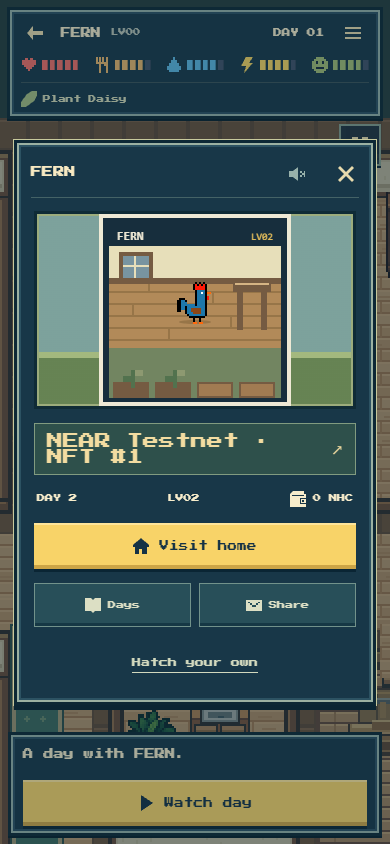
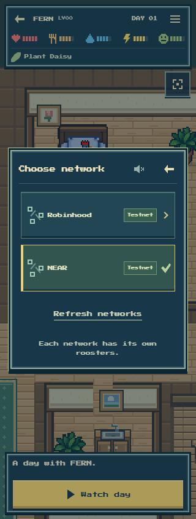
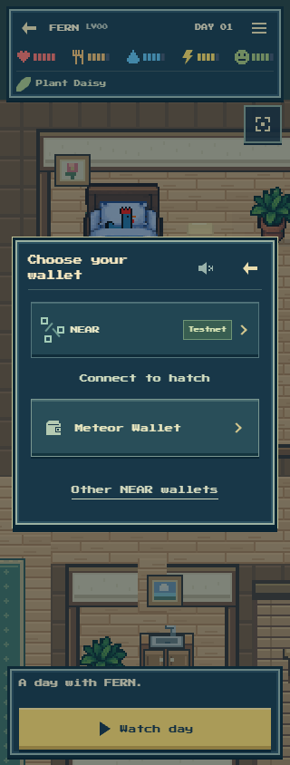

# Published native NEAR and Robinhood phone review

The published candidate at https://nearlyhuman.netlify.app was checked in one owned Codex Browser tab after the real native FERN Day 2 succeeded. The loaded entry was **/assets/index-BWmA2cQo.js**, from main **768aff93f3f59f721cf925eea3efb07da674fbe4**. This final review made no wallet connection, signature, quote, AI call, transaction or film playback.

The exact native FERN link loaded its public profile and home; its saved-life portrait decoded and its NFT link targeted the correct NEAR testnet explorer collection. The real network picker offered Robinhood Testnet and NEAR Testnet. Switching restored FERN's native context and preserved a separate Robinhood hatch draft. The native wallet chooser presented Meteor under the NEAR/Testnet header.

Ten actual captures covered 320, 390 and 430-pixel widths. The selected screens were inspected visually: headings and network rows fit, primary actions remain obvious, and controls stay inside the phone width. No page errors or app writes occurred. Full observations and source identity are in [final-phone-evidence.json](final-phone-evidence.json).

These post-release evidence files were saved locally. No additional production push or deployment was made.
