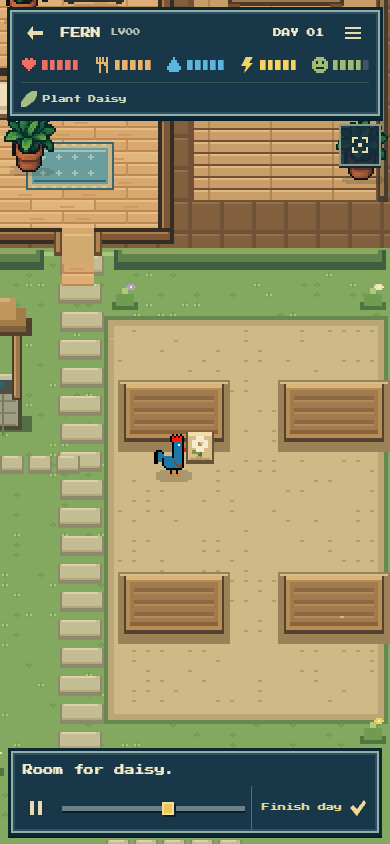
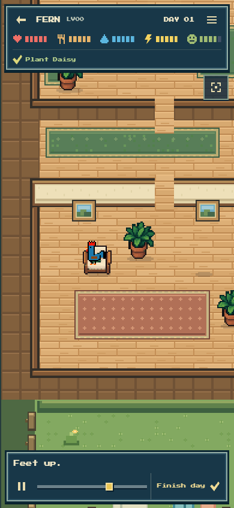
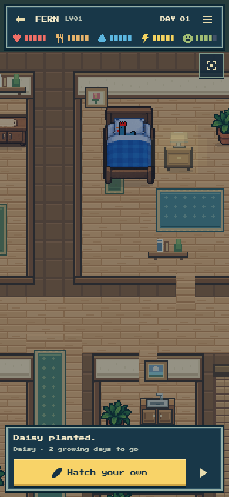

# Actual native FERN Day 1 playback

One uninterrupted, normal-speed watch of the real Meteor-minted FERN #1 saved day on local staging, at 390 × 844. This verifies the native saved film and renderer before the subsequent physical-inventory presentation refinement; it is not a hosted-production check.

- Completed naturally in 73.729 seconds; all 60 canonical slot receipts were shown.
- No pause, seek, finish shortcut, renderer setter, app write, wallet operation or AI call. The controlled page remained visible throughout.
- The exact packet object handed to the application and its result retained the same SHA-256 hashes before and after playback. The final renderer state equaled the canonical saved result. No page errors occurred.
- The request and commitment match the independently checked native day recorded in [actual-native-day.json](../actual-native-day.json). Full source pins and packet hashes are in [native-fern-day1-evidence.json](native-fern-day1-evidence.json).

The actual phone captures were inspected beside the approved house-and-care reference. The warm wood, bright garden, compact navy HUD and original generated blue-and-red FERN artwork read clearly. The planting contact, armchair seating and dusk completion are coherent. No rooster source artwork changed.

Follow-up from the owner's new feedback: healthy soil moisture currently uses a bottle/count badge that resembles stored water, and some supplies appear in hand without a physical storage pickup. Those presentation issues are being handled separately; this evidence does not claim they were already fixed.
