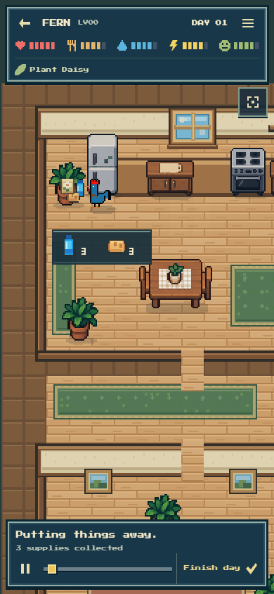
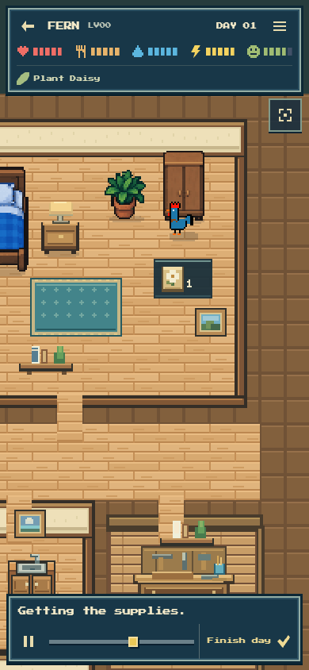
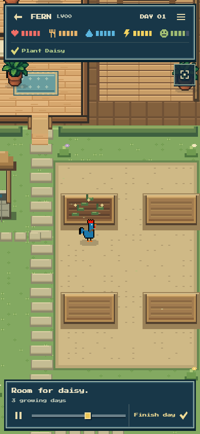
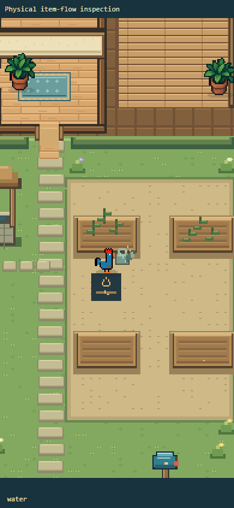

# Physical item flow refinement

Question: can a player understand where supplies come from, what the rooster carries, and what garden water means without another tutorial?

Actual FERN #1 Day 1 now shows its three delivered supplies at the mailbox, puts grouped food/drinks into the pantry and the seed into the supplies cupboard, then fetches the seed from that cupboard before carrying it to the garden. Food and care actions follow the same storage → pickup → carry → use sequence. Harvests and completed crafts return to the appropriate storage. All sublegs are presentation only: one canonical receipt and one impact callback still determine each action.

The healthy soil bottle ×2 badge was removed. Fresh planting already includes moist soil in the saved rules, without consuming a drinking-water bottle. Dry soil now has a distinct hollow-drop/cracked-soil cue, and irrigation shows the watering can filling at the well, visiting each dry bed, then returning the can. The well no longer advertises the indoor bottled-water balance.

Evidence: the real native film completed naturally in **92.036 seconds**, at normal speed and 390 × 844. It remained visible throughout, made zero writes, raised zero page errors, retained the exact saved packet/result hashes and finished at the canonical saved state. A read-only sample check confirms empty hands before the cupboard, a carried seed en route to the bed, and removal of that seed at the plant impact.

Twenty-eight representative consumed-item plans had reachable grouped storage pickups. Focused same-item-loss cases prevent an outage from making coffee appear to fetch two milk, while preserving a legitimate two-milk breakfast and the full wood recipe for a craft. Isolated representative bandage, craft and two-bed irrigation films each called the canonical impact exactly once, left the receipt unchanged and finished at its exact snapshot. These are synthetic rendering cases, not additional live financial days. See [physical-flow-evidence.json](physical-flow-evidence.json).

No canonical rooster artwork, economic state, AI decision, contract rule or token quantity changed.
