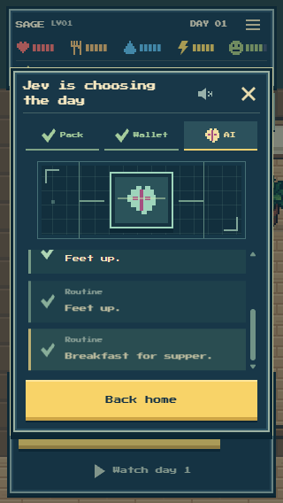
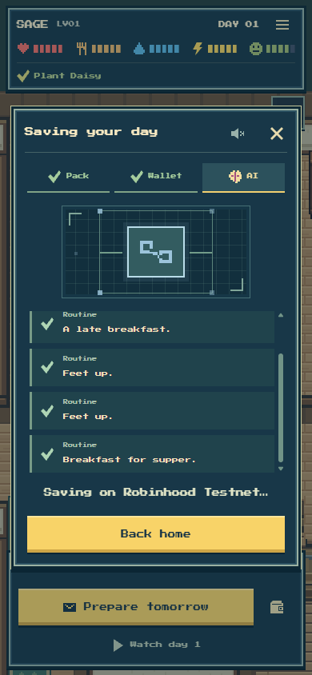

# Completed choices and the onchain save

Question: can players see Jev's actual decisions arrive without another click or a long explanation?

Both workers now persist a small validated progress entry after each completed model reply, including the dawn plan. Stable request hashes deduplicate resumed cached answers; the public projection contains only stage, finite-choice label and optional slot. No prompts, provider cache, keys, usage ledger or raw signed transaction are exposed. The feed never creates an answer or adds an inference call. Existing jobs without the field keep their original safe presentation.

The player sees completed choices arrive, followed by a distinct blue linked-block saving stage. A known save transaction links to that actual transaction. An incomplete attempt is labeled as being recorded rather than saying Jev is still choosing. The existing short poll remains; manual Check again appears for an error, a paused check or progress stale for20seconds. Back home stays the obvious main action.

Controlled rendering used the actual SAGE packet's choice descriptions with illustrative reply IDs and GET-only synthetic job progression, not another actual model request or public-chain write. At390x844,320x568 and explicit enlarged text, all labels remain readable and the controls stay reachable; no horizontal overflow, page errors or writes occurred. Review shortened the graphic on short phones, bounded the feed to viewport height and made its tail follow viewport changes. These captures prove presentation, not hosted inference; the final published real Meteor/day check is recorded separately.

