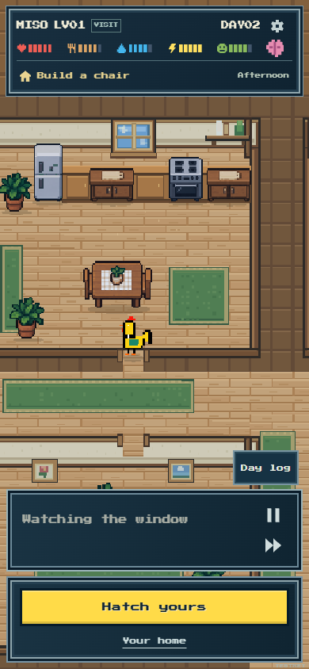

# Wave 1 — authoritative foundation

Completed 2 November 2026, approximately15:20–16:14 UTC. This is the first of five scheduled improvement waves; the sixth remains the final testnet publication. No external chain, wallet, AI credit or Netlify deployment was used. The existing live frontend remains unchanged.

## Result

The new [TypeScript kernel](../../../src/v2/README.md) and [contract-backed candidate](../../../contracts/v2/README.md) now derive biological and material outcomes from one inventory and a legal chronological trace. Four beds retain soil damage; finite crops/wood feed real recipes and domestic work; care/conditions/tombstones, phase loss, bedtime and legitimate death are derived. The controller accepts no supplied death flag, output stock or reward amount.

One main, five ordinary opportunities, physical pickup, two constrained acute responses and one four-unit shipment are enforced. A positive care witness is verified against an owned hypothetical snapshot and cannot credit its future supplies or days to the real life. The conservative witness builder works for representative onset families; it is not an optimal rescue search or a promise that Jev follows its path.

The candidate has signed EIP-712 paid admission, immutable verifier/action modules, actual six-decimal tokens, reserved firm quotes, lifetime issuance pressure, backed purses, direct pending/dead withdrawals and token-funded births. It is constructor-gated to testnet/local chains. No experimental founder/issuer/terminal shortcut was copied into it.

The [preparation bridge](../../../server/v2/preparation.ts) builds a canonical prefix, obtains post-onset legal choices, validates the full replay and returns a rich packet commitment. Its input is reconstructed from a paid receipt by [the acceptance reader](../../../server/v2/chain.ts), with controller/verifier/action-module code/role pinning. The reader compiles but still needs one small actual accept-only RPC integration assertion. A real Jev/durable budget provider is the next wave's integration work; the preparer itself performs no HTTP or signing.

## Evidence and corrections

- [State checks](state-checks.json):19 named checks including all21 valid stat allocations, kit limits, invalid quantities/NaNs and full-counter quote behavior.
- [Kernel checks](kernel-checks.json):20 independent scenarios produce82 expected state/point vectors. All82 passed cumulatively against the Solidity port; eight semantic rejection traces reject. The actual scoped captures preserve their provenance rather than pretending every controller-only metadata change repeated all82 cases.
- [Earlier controller capture](controller-initial.json):57 complete, verified biology/material days earn268.126360 real local token units, then pending withdrawal and a250-token birth succeed without injected products or currency.
- [Focused capture](controller-focused.json): authorization, replay, late settlement, expiry, illegal trace and arbitrary token-mint rejection paths.
- [Final controller capture](controller-final.json): a valid mishap care certificate, required nonzero rich-replay commitment, exact stored replay hash, compact-history expansion, ABI trace hash and resulting state all agree.
- [Backend preparation](preparation.json):seven scripted days through the actual kernel, six choice callbacks/day, first shipment on Day4, valid replay/history round-trip, malformed deadline rejected before provider use, illegal kit rejected, unavailable provider choice atomic, and mutated menu context/payload unable to change actual actions. No calls were made to Jev.
- [Rescue generator](rescue-checks.json):mood, sickness, mishap, outage and visitor examples validate with no actual-context leakage.

Independent review found and repaired missing living-day pickup, malformed empty-bed state acceptance, zero-token shipping, kit stock headroom, ambiguous Solidity branches, pre-cost chance/recovery drift, shipment padding, premature chair movement and mutable preparation menus. Runtime pinning now includes the action module. Persisted worker input is revalidated and cloned before choices. Choice recovery/cost/risk facts do not reveal a known lucky/unlucky future draw.

## Measured cost drove a real architectural fix

The initial full interpreter showed why a gas-only assumption needs measurement: signed requests consumed roughly0.75–0.94M gas and full finalization roughly1.92–2.31M before nontrivial care certificates. Storing a full ABI trace was a significant persistence cost.

The final controller stores one goal byte plus eight bytes/action, while retaining the canonical ABI trace hash, certificate hash and rich replay commitment. The last example stores49 bytes instead of1664, with exact expansion back to the committed trace. Its certificate-backed full settlement costs2,976,110 gas. This is an actual narrowed case, not a worst-case full-game ceiling.

Final runtime sizes:controller20,496 bytes, action module23,096, verifier23,689, token2045. All fit EIP-170, with limited remaining room. Full packing/optimization can be considered after a defined performance measurement; do not casually grow the verifier beyond its deployment limit.

**Release gate:**twice request-gas processing fees do not cover the observed relay finalization alone. The next fee quote must reserve actual relay execution plus inference/hosting allowance, with the accepted configurable multiplier retained. Do not infer a native/USD profit from local test gas. A certificate-heavy cost ceiling still needs a bounded estimate before funded public admission.

## Actual pixel baseline

Read-only Codex Browser captures of the current public build are [390px](images/baseline-guest390.png), [320px](images/baseline-guest320.png) and [430px](images/baseline-guest430.png). [The observation](baseline.json) records zero POSTs and no page errors. Only the run-owned tab was opened/closed; the owner's main Chrome/profile was untouched.

Compared with [the approved reference](../../../design/references/VR-01-approved-house-and-care.png), the navy/cream/wood character remains intact. The guest replay panel plus separate hatch dock consume substantial phone height; streamline that hierarchy when integrating V2. Preserve the room's visual clarity and continuous cropped camera, while enriching interactive kitchen/garden/workshop objects. These are V1 baseline screenshots, **not** evidence that the new V2 world has rendered yet. Wave3 must inspect actual candidate pixels.

## Handoff to wave 2

1. Exercise `readV2AcceptedTransaction` against one actual local accepted request, then connect durable reservations/checkpoints and real Jev. Reuse the existing budget-before-send/outbox discipline and preserve all historical ledgers. Never accept a browser-supplied frozen save as authority.
2. Build the Dawn plan/morning order and one bounded intention on top of canonical prefix choices, then compare actual model personalities over several days. Current prepared choices can run sequentially, but no real Jev was tested in this wave.
3. An explicit review keeping the same goal should refresh its next review day while preserving creation; sentinel255 means no review. Change both ports and version the semantics together when fixing this advisory behavior.
4. Candidate UI/API is not wired into V1. Integrate with a clear V2 presentation model; do not run V1 simulation or its two-plot codec over V2 snapshots. Preserve all four beds and actual canonical events.
5. Later waves own map/animation/public-life/purse UX, real testnet gas/AI play and the one final publication. There are no accepted V2 public jobs to drain yet. Before changing the hosted V1 target, drain its real obligations and preserve records.

Manual focused checks are `node --import tsx scripts/v2/check-state.ts` and `node --import tsx scripts/v2/check-kernel.ts`; generated fixtures are in ignored `TEMP/v2-checks/`. Compilation is `node scripts/v2/compile.cjs --artifacts`, using permanent sources and installed packages. Full application build passes and retains the existing frontend asset hash because routing has not yet switched. All owned local nodes/capture processes and run-owned browser tabs are closed. No intermediate main push occurred.
