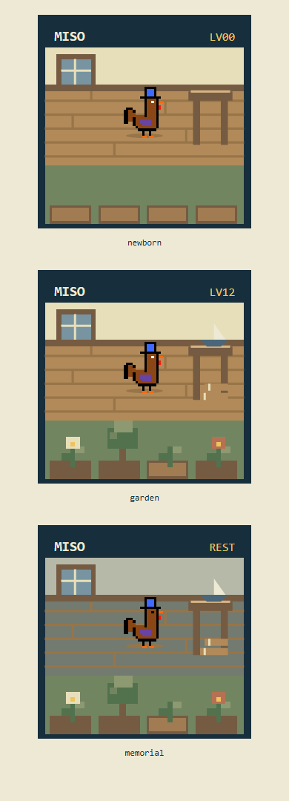

# Wave 2 — real Jev, intentions and durable preparation

2 November UTC /3 November Bangkok, approximately16:18–17:15 UTC. No public deployment or main push occurred. The real inference campaign used50 sends /5413 microUSD ($0.005413), with zero uncertain sends, inside a fixed30000-microUSD allocation. The older V1 spending/holds were preserved. All chain execution in this wave was local.

## What changed

The V2 mind now chooses a Dawn project, an existing-pantry morning order and a bounded intention, then smaller routines from canonical post-onset state. Stable tastes and rotating soft day preferences provide continuity without granting economic advantages. The afternoon project is revalidated; unavailable work becomes a quiet main rather than another purchased project decision. One plan plus five ordinary choices plus two acute responses stays within eight model choices.

The provider sees truthful whole-item costs, clipped/nominal gains, task chance versus exposure risk, exact targets, future planned recovery, saved wood and post-action wood balances. Prior compact history is bounded to two earlier days/six meaningful executed attempts each; it never invents a success bit. The same goal can now be explicitly reviewed with a new three-day review date while preserving creation; sentinel255 remains no review. Both ports match, with verifier rules hash `nearlyhuman-v2-kernel-2`.

The durable worker now composes **`issueV2DayQuote → acceptV2Job → prepareV2JevJob → submitPreparedV2Job`**, with failure/expiry reconciliation through `settleV2JobFailure`. A verified accepted receipt and canonical prior history construct the job. A browser cannot provide its own authoritative save/memory. Each paid HTTP call reserves first and caches against a stable logical opportunity plus the final request-body hash. A changed prompt/memory cannot silently buy a second answer at that same opportunity.

The actual signed relay uses the existing global wallet outbox namespace. Immutable packet storage precedes broadcast; exact raw bytes/nonce survive lost-ready persistence. A different older intent is recovered without attributing its success to the current job. Direct owner expiry/failure is adopted before attempting a new finalize; safe retry follows canonical terminal status, not a timer alone.

## Actual Jev critique loop

[The comparison](jev-comparison.json) preserves all phases:

| Actual local diagnostic phase | Sends | Charge |
| --- | ---: | ---: |
| MISO/PEEP, two days each, initial policy |20|2024 microUSD|
| One matched four-day refinement |20|2108 microUSD|
| MISO post-refinement Days3–4 |10|1281 microUSD|

The first sample needlessly topped up near-full food/water. The matched refinement consumed nine bread/water units instead of fifteen, with improved observed morale. MISO Day1 used water2/bread1 instead ofwater3/bread2 and finished72.36 morale instead of62.36; Day2 finished74.72 instead of54.72. Tiny safe top-ups were removed from the short menu while urgent care remained available, and whole-item/late-day recovery context became clearer.

MISO then chose breakfast before parcel collection, gathered its ready Daisy on Day4 and enjoyed it for morale. Shipping was not forced. These samples demonstrate an actual seed→growth→harvest/use story; different owner-supplied seeds and young limited affordances do not establish personality alone as the cause of differences.

The serving model was `typesafe/jev-1.13-20260917`. Paid samples exercised earlier policies1/2. **Final mind4 /preparation3** adds saving/waiting and Dawn safety corrections verified through focused checks without more paid calls. Do not label the earlier samples a final-policy paid resample.

The preserved [first day](fixtures/guest-miso-day1.json) and [first harvest](fixtures/guest-miso-day4.json) contain the original actual local packets/commitments and explicit diagnostic scope. They are not onchain NFT days. Use them for controlled renderer tests; replace public guest films with actual final-policy testnet NFT days before publication.

## Adversarial corrections that mattered

- **Waiting was missing.** A seven-wood rooster saving for a ten-wood chest was being forced into another spend/project. Dawn now always offers one quiet main, alongside useful projects, without forcing a wait.
- **Dawn rescues were being hidden.** Automatic shutdown before collecting water could kill a fragile rooster even though Pickup1→Douse2 was certified. After shutdown, delaying ordinary treatment until11 could likewise kill before10. Urgent pickup now comes first, all acute alternatives remain visible, and legitimate early care shares the existing Morning/five-routine budget.
- **The money cache needed two identities.** Final body SHA includes profile/history/Dawn questions, but a stable logical decision ID prevents changed bodies from opening fresh paid slots. Cached answers are free; uncertain sends retain their conservative charge and do not automatically resend.
- **Recorded menus must match actual model questions.** Filtering is canonical before request construction. Every recorded paid menu matched its actual criteria; a raw/no-plan double-filter hazard was fixed without invalidating those samples.
- **A prepared job can already be expired.** The worker now adopts canonical failed/expired requests and releases holds before trying a new finalize. It cannot leave an owner-expired job stuck as prepared.

Independent focused evidence is [budget](budget-checks.json), [worker](worker-checks.json), [facts](facts-checks.json), [Dawn before](dawn-before.json), [Dawn after](dawn-after.json), and [terminal](terminal-checks.json):14+4+10+3+2 cases/witnesses pass. Dawn now survives Pickup1/Douse2 with700 health, Treat1/Shutdown2 with1720, and a deficit breakfast with exactly five ordinary opportunities. These are explicit accepted-state boundary fixtures, not claims that every fixture was generated from birth.

The separate [actual local-chain worker proof](worker-local.json) passes17 focused checks: canonical receipt/runtime/module pinning, goal parity, crash/cache resume, packet-before-save, signed raw recovery without a second nonce, honest prior memory, onchain failure without biological advancement, native fee floor and funded quote retirement. It used six scripted callbacks/600 mock microUSD and zero real inference; its cost must not be added to the actual Jev bill.

## Public-read and art groundwork

The `/api/v2` read-only handler now supplies verified config, exact-world life/day/replay, metadata and dynamic SVG portraits. World-qualified requests cannot silently fall through to another collection. Replay packets must match the actual saved commitment, state, trace and certificate; private jobs, raw signed journals and provider caches are not public. Owner POST/wake/background dispatch integration remains next work.

The portrait keeps the appearance seed stable while deriving garden stage, held wood/crafts and remembered-life pose from saved state. A small actual-browser visual loop corrected floating workshop objects, an unreadable tree crown, floor detail and foot shadow. [This board](images/portrait-board.png) shows three explicit visual fixtures, not actual NFT balances or a finished public-life page.

The default two-argument `roosterSvg` behavior is preserved; a pose parameter enables the memorial image. The frontend still routes to V1. New public V2 runtime requires `NEARLYHUMAN_V2_RUNTIME_JSON` (identity/code hashes), `NEARLYHUMAN_V2_RPC_URL`, and explicit local opt-in only for31337; no live environment was changed.

## Funding and release gates

The research allocation is deliberately outside the preserved $0.90 V1 envelope. Current V2 pool100000 minus research allocation30000 leaves at most70000 for a public campaign. A40000 eight-send job hold means admission would stop after30000 cumulative public spending. **Do not weaken holds, overwrite caps or reset ledgers.** Before sustained public use, implement an explicit audited release of unused completed research allocation and/or quiescent V1 funding retirement/reallocation, preserving all actual charges, uncertain entries and active holds. The existing hardcoded schema intentionally rejects manual pool edits.

Native processing quotes separately cover buffered relay execution plus an explicit inference/hosting native allowance, while retaining the configurable multiplier. A doubled request-gas markup alone underfunds the observed full verifier. Current relay bounds are conservative testnet defaults, not a mainnet/USD profit promise.

## Next wave

1. Build the actual four-bed yard/workshop and continuous recorded animation using the new packet/state model. Do not feed V2 through the old two-bed simulation codec. Preserve the approved palette and protect phone playfield height.
2. Render the Dawn undertaking, persistent intention and local event changes through objects/feedback rather than paragraphs. A planned morning/project is intent, not proof it executed; actual receipts determine animation/history.
3. Wire authenticated owner quote/accept/wake/job routes and Netlify background/scheduled dispatch around the existing helpers. Recover accepted transactions whose browser acknowledgement was lost. This is a remaining public integration gate, not a missing financial kernel.
4. Preserve history return context: a replay's `packet.result.state` is that saved day, while `life.state/purse` may be current. Never substitute the default demo NPC for an exact world/token route.
5. After integration, run a final-policy real testnet day and capture actual phone flows. No further paid prompt sweep is justified now. The sixth wave retains the one final publication boundary.

The application build passes. Existing normal visuals remain unchanged except the compatible art helper; all owned local nodes and run-owned browser tabs are closed. Manual focused checks are the new `scripts/v2/check-budget`, `check-worker`, `check-choice-facts`, `check-dawn-care`, and `check-terminal` TypeScript scripts; outputs remain under ignored TEMP. Source and verified evidence are permanent, with no TEMP input dependency.
