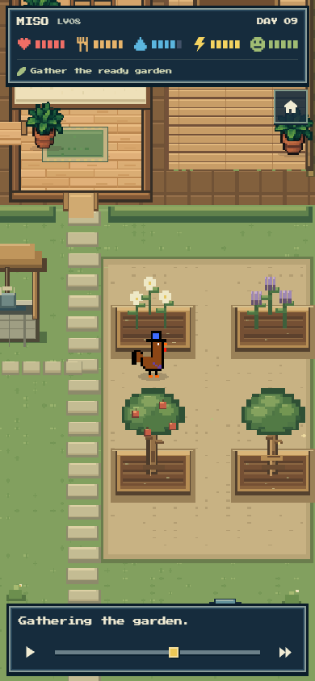

# Wave 3: a physical little home

The V2 kernel now has its own rendered house, four-bed yard and workshop. Its phone player follows recorded receipts through real walking, contact and local animation. The approved top-down wood/cream/moss art and navy pixel panels remain the direction; the camera shows a portion of the larger world rather than shrinking the entire house into a phone.

This wave also connects the existing funded worker to authenticated owner HTTP routes and the actual Netlify background/scheduled transport. No public deployment or additional paid inference occurred. The live V1 game is unchanged.

## What was built and reviewed

- `src/game/v2/` renders the connected house, doorstep, garden, well, workshop, mailbox, fence and road. Bread/water/wood/finished goods are views of the same canonical inventory. Navigation has no direct-line fallback through walls. Parcel collection walks outside, picks up the parcel and carries it back to the pantry.
- Four crop beds display distinct plants, stages, wet soil, blocked soil and finite repeat output. Harvesting and watering visit each actual occupied bed. The workshop displays wood and finished crafts. A large chest is carried to the outgoing mailbox rather than disappearing through a menu.
- `src/app/v2/` renders a small HUD, one primary watch action, contextual inspection and a pixel timeline. Ordinary quiet slots are condensed only in presentation; the original sixty receipts remain intact. Main work gets more dwell than a small routine. Normal playback never jumps between contacts; explicit timeline seeking may reposition the actor.
- Local walking, pose changes, tools, steam, watering, leaf motion, butterflies, recorded rain/visitors and night lighting make the home active without deciding new game outcomes. Needs and inventory update at the canonical impact, not merely when a planned destination appears.
- Entry routing supports `?v2=1` for the local candidate and exact world-qualified NFT links. The release flag remains off. Production builds remove the DEV diagnostic injection and contain no TEMP or diagnostic-fixture import.

PM inspected the actual phone garden, workshop, outgoing mailbox, bedtime, short phone and desktop images beside the approved reference. The independent [pixel review](PIXEL_REVIEW.md) records the observed defects, repairs and focused rechecks. Twelve reviewed captures and their exact diagnostic/scripted scope are in the [image manifest](images/manifest.json).

## Short critique loops

| Question | Evidence | Change | Result / decision |
| --- | --- | --- | --- |
| Is the rooster physically present throughout a day? | Actual MISO Day4 local Jev film: 64.657 seconds, 39 frames, connected bedroom-to-mailbox route and return. | Independent V2 navigation and sequential receipt promises; HUD-aware camera and correct bed depth. | Normal travel/contact completes before outcome. Face remains visible on reviewed phone widths. |
| Do four beds and a workshop feel different from repeated generic actions? | Controlled four-ready-bed film43.519 seconds; ten-wood large-chest film34.309 seconds. | Per-bed contact updates, watering circuit, held tools/crafts and outgoing parcel; rounded textured tree crowns. | Plants deplete in order, regrowing trees remain, chest appears at the bench and travels to the mailbox. These are visual boundary fixtures, not earned economics proofs. |
| Does presentation accidentally imply failures or noisy repeated work? | Quiet records had `success=false`; captions switched during every short bed hop. | Quiet gaps retain the last meaningful caption; one undertaking caption spans its approach/contact/work; notes remain impact-gated. | Focused rendered checks show no invented quiet failures or repeated title toggling. |
| Can an authenticated paid attempt survive a closed tab or corrupted preparation? | Actual isolated-chain HTTP proof, including a lost browser acknowledgement and changed frozen memory. | Durable quote/job dispatch, exact-timestamp acceptance recovery, and canonical quarantine expiry. | Three actual terminal requests preserve the life bytes; no AI sends, active job allowances or relay-gas holds remain. |

The responsive and visual review exercised320×568,390×844,430×932 and1440×900. The initial distorted canvas aspect, hidden sleeping face and invisible night layer were actual pixel defects and were fixed. Inspection now pauses the day; closing the card leaves an obvious Resume action. The timeline uses a square pixel thumb with a retained touch area.

A final [controlled-props check](controlled-props.json) switches directly from the preserved MISO Day4 film to a synthetic SPROUT Day1 life-only view, then back. It caught and removed stale film retention: the player now keys identity by world, NFT and request and reads controlled props directly. The rendered new life has its own name/day and one Prepare action, with no previous daily goal or Watch button. This test is presentation evidence, not a real mint.

## Owner and background integration

`server/v2/service.ts` now composes quote, accepted-transaction verification, preparation, canonical settlement and failure/expiry into a durable queue. It requires an explicit configured campaign; a browser cannot create or reset a funding allocation. Quote and relay roles are currently served by the same limited service account, verified against the runtime.

The owner endpoints are `/api/v2/quote`, `/accept`, `/wake` and authenticated `/job/{requestId}`. POSTs validate origin, JSON shape and size, then use the signed session owner. Browser-supplied final states, memory, journals or owner claims are never admitted. Duplicate acknowledged acceptance returns the durable existing job, including after terminal failure. Private raw signed transactions and provider caches stay outside API projections.

Netlify's authenticated background function accepts an explicitly versioned V2 job. Its scheduled reconciliation also preserves the V1 drain path. An accepted payment with no browser acknowledgement can be recovered from the durable quote and the exact canonical acceptance timestamp; this lookup makes no assumption about Robinhood block cadence. A quarantined paid request retains its diagnostics and can expire only after the actual chain deadline, releasing retry and holds after confirmed terminal status.

The focused [HTTP/service proof](service-local.json) used fresh isolated Anvil contracts and real wallet challenge/signature/session verification. It exercised quote idempotency, signed owner admission, asynchronous missing-provider failure, unchanged biological bytes, retry, authenticated job visibility, closed-tab recovery, quarantine and expiry. Its final durable readback found zero active job allowances, zero paid-provider entries and zero relay-gas holds. It used no public wallet, external chain or AI credit. Temporary harness/node/ledger files remain ignored; the owned node was stopped.

`scripts/v2/check-service.ts` independently passed18 focused HTTP security and exact-timestamp search cases without inference or transactions. The application build passed. No diagnostic globals, TEMP paths or guest fixture names appeared in its generated assets.

## Next wave and release gates

1. Build the actual first-use/owner wrapper around this player: guest-to-hatch, wallet connection, three-slot supply choice, pending day, next saved film, inventory/bed inspection, exact public-life/history view, purse withdrawal and token-funded birth. Retain the approved opening instead of introducing an unrelated website frame. Every dead end needs an actual way home or forward.
2. Give the new collection a bounded owner-portfolio lookup. The current controller has no owner enumeration; do not silently substitute V1 lists or rely solely on one device remembering minted IDs.
3. Preserve exact token/world and return context. A historical packet is that day's state; its attached public life/purse can be newer. Static newly minted and remembered lives must remain truthful homes without fabricated films.
4. Complete the explicit AI-budget migration/release before sustained public use. The completed research campaign still reserves30000 microUSD of the separate100000 V2 pool. Do not edit caps, weaken full-job holds or reset either V1/V2 financial ledgers.
5. Confirm the full UI/service path with final-policy real Jev and the new testnet collection in the later integration wave. Replace diagnostic guest films with an actual saved NFT day before publishing. Check the native relay reserve against the final heavy trace, not just request gas.
6. Wave6 retains the only planned main/Netlify push and hosted verification. Mainnet and an unfinished native NEAR player remain outside this release.

The candidate is useful local implementation, not yet the completed public owner game. The explicit release flag remains off until the remaining owner, funding and real testnet checks are complete.
