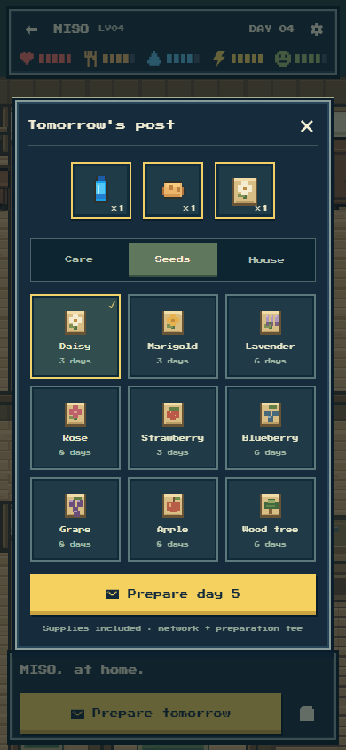

# Wave 4: one coherent player journey

The V2 world now has the owner and public-life flows around it: game-native title, guest watching, wallet connection, hatching, tomorrow's parcel, accepted-day recovery, saved films, belongings, public sharing, history, purse withdrawal and token-funded birth. The player stays inside the same warm pixel world and restrained navy cards. No website frame or dense economy dashboard was added.

This wave completed local implementation and adversarial browser/chain verification. It did **not** publish the site, deploy a public contract or buy more inference. The actual provider budget change was an audited unused-research release, with original entries and charges preserved.

## Evidence and short loops

| Question | Evidence | Change | Result / decision |
| --- | --- | --- | --- |
| Can a cold visitor become an owner and try a day? | Actual Codex Browser callbacks against isolated HTTP/Anvil contracts: TWEET#4 native mint, signed care admission, deliberate missing-provider failure, same-life retry. | Full wallet/owner journey, canonical job polling and explicit retry/recovery actions. | Two real local failed requests leave Day0, three bread/three water, identical biological hash and no pending lock. No invented day or refund. |
| Does recovery stay with the paid NFT? | Restoring TWEET#4 while guest MISO#1 was current initially opened the wrong next day. | Bind pending controls to their exact request/token/world before display or retry; retain original wallet identity and birth draft. | Actual cold return now opens TWEET#4 Day0 and prepares Day1. An independent two-life target test verifies another request without sending a transaction. |
| Are direct owner rights reachable during preparation? | A blanket unknown-payment guard also blocked confirmed-day withdrawal and expiry; an estimate failure then erased the matching UI job. | Verify the actual accepted request before retiring only its client acknowledgement; preserve unknown wallet intents and retain recovery controls through preflight errors. | Four controlled boundaries pass with zero sends: accepted-day withdraw/expire reach the correct estimate; unaccepted day/unknown mint reach none. Rejected expiry leaves Check day and Release available. |
| Does the interface remain clear on real phone sizes? | Actual320/390/430 screenshots, short320×360 visible-height experiment and150% computed-font stress. | Flexible home action fixes clipped purse; dialog input guard stops world click-through; scroll/selected day survives history return; delayed guest cannot remove a draft. | Reachable controls and preserved context. These are scoped browser checks, not universal mobile-keyboard/text-inflation claims. |
| Does the NFT actually own usable value? | Actual final-controller local proof:100 accepted scripted reducer days earn521.964786NHC; two250NHC births; deliberate death onDay103. | Bounded onchain owner enumeration and pinned-world wallet adapter; purse/wallet birth and direct withdrawal callbacks. |28 scoped checks pass, including withdrawal while pending, stale nonce rejection and actual withdrawal after death. Supply/burn/vault identities match. These are actual local transactions with scripted choices, not real Jev or hosted birth evidence. |

The [independent player review](PIXEL_REVIEW.md) records the defects, repairs and precise scope. The [sixteen-image manifest](images/ui-manifest.json) distinguishes actual browser callbacks, controlled layouts and a preserved actual local death snapshot. PM inspected the minted/recovered life, seed picker, dynamic public portrait, title sequence and expiry recovery pixels beside the approved game art.

The [wallet/controller review](CHAIN_REVIEW.md) records actual ownership, token and nonce evidence. An additional historical-nonce recovery proof locates a mint after4096 empty blocks without hundreds of manual scan clicks. The adapter verifies the actual runtime/modules/roles before writes, journals the exact wallet intent before broadcast, distinguishes replacement/cancellation and never treats a missing hash as permission to resend.

## What the player sees

The title uses the actual top-down world with a short presentation-only tile reveal and the existing cartridge logo/Start. Title scenery carries no public NFT or economic film claim. The actual saved guest replaces it when available. A first interaction remains in place if that retrieval is slow.

The daily parcel has three visible slots, one replaceable seed, distinct illustrated packets and3/6/8-day badges. Care, seeds and household supplies are small tabs; finished goods and wood cannot be chosen as gifts. Canonical inventory lives in Belongings and object inspection. Successful shipping briefly shows the committed NHC result; the playfield does not gain another permanent finance meter.

Public-life links show the canonical dynamic portrait, day, level and purse, with one Visit action and secondary Days/Share. Remembered lives retain their owner withdrawal path. Native hatch price appears in its payment control; the network/preparation detail remains a quiet footer. Token approval is a separate wallet action, with the name/stats/payment draft preserved through its receipt and reload. Tiny positive purse values remain visibly positive rather than rounding to zero.

Old bare NFT links and explicitly qualified V1 links retain their original route. New V2 links always include chain and collection. The V1 metadata endpoint now emits that original world explicitly, preventing an old token number from being silently reinterpreted as a new V2 rooster. Seven focused entry-selection boundaries passed. Three [rendered exact-world rejection checks](exact-world.json) also confirm that malformed links request no NFT/guest data and offer Back home, while a valid other-world link remains qualified through its rejected reads. It cannot silently become a current-world ID.

## Funding and operator preparation

The completed actual research campaign was permanently closed after all50 sends were complete and no job allowance was active. Its original30000microUSD limit,5413 actual charge and all answer entries remain unchanged. An immutable closure hash and reason release exactly24587 unused microUSD. A new fixed90000microUSD campaign, `nearlyhuman-v2-testnet-20261102`, now exists in the private local store. Effective V2 allocation is95413 of100000, leaving4587 unallocated; the preserved900000 V1 envelope is unchanged. This is allocation accounting, not a claim about a newly queried provider balance.

Six closure checks and an independent ten-case audit cover both send/close race orders, active/uncertain refusal, cached answers, interrupted release, immutable audits and the pool ceiling. The original fourteen budget checks still pass. [The actual release record](funding-release.json) contains no keys or provider answers.

The native fee baseline remains the two setting and retains its funded relay floor. Increasing the multiplier to three now increases that floor to1.5times instead of doing nothing when request gas is much smaller than finalization gas. Optional bounded native AI/hosting allowances are explicit wei settings. Nine integer fee cases pass; no exchange-rate or profit promise is introduced.

The new testnet deployment command defaults to public read-only preflight. That preflight found the funded owner/relay wallets and a viable first-module estimate; it broadcast nothing. Its explicit broadcast mode has an exclusive private lock, exact raw-signed sender/chain/nonce/destination/calldata/value/fee checks, canonical receipt/CREATE-address checks and resumable three-module/funding stages. `--pause-v1` can first fence original admissions under the same owner journal. The limited relay top-up target is0.0025testETH, within the observed owner funding.

The [Netlify cutover preparation](NETLIFY_CUTOVER.md) verified the existing CLI authentication, exact site and Blobs store read-only. Its cloud V1 ledger had33423microUSD spent,15 terminal jobs and no active holds or outbox, but **V1 admissions were still unpaused**. No cloud record or environment value was changed.

`import-netlify.ts` defaults to inspection. Actual import requires an onchain V1 pause, fresh cloud drain audit, quiescent local work and the exact reviewed manifest. It rejects differing/extra cloud V2 records and creates only missing exact records, pool last. It never copies/deletes V1 records or the global relayer outbox. A source-only persistent spending seal prevents a later local restart from spending a copied allowance. A partial import stays sealed and can resume with the same manifest. Cached reads remain available; unknown provider charges remain conservatively recorded. Four independent seal checks pass. Hosted-runtime misuse and in-flight jobless sends are rejected before copying. **No actual source seal or cloud import was executed this wave.**

The application build and strict operator-script type checks pass. Its production assets contain no diagnostic globals, TEMP paths or MISO fixture imports. The owned Vite servers, isolated integration host/Anvil node and run-owned browser tabs were closed. All implementation/evidence is permanent outside TEMP; scratch tooling/captures remain ignored.

## Wave 5 priorities and release boundary

1. Before any **public V2 relayer** activity, pause original V1 admissions and recheck the **cloud** holds/jobs/outbox after that fence. Local and cloud processes otherwise have independent journals for the same relayer wallet. Never infer cloud drain from the empty local store.
2. Deploy the final compiled V2 modules/controller on Robinhood testnet with `scripts/v2/deploy-testnet.ts --broadcast --pause-v1`; preserve its private raw journal and verified public record. Then run the fresh cloud drain audit. New controller deployment itself uses the owner wallet; AI settlement must wait for the shared-relay drain.
3. Configure a private local V2 runtime against that actual collection and the90000 campaign. Exercise final-policy real Jev choices and meaningful seed→growth→harvest/shipment days. Preserve actual costs, runtime identity, receipts and useful guest/public-life films. Do not substitute diagnostic or scripted days for the final public Jev guest.
4. Inspect the real phone owner flow and actual network/worker failure/completion, purse and production outcomes. Re-run only to resolve a defined new issue. Local100-day/birth proof already exists; do not repeat it merely to fill time.
5. Finish all local jobs, release quotes/holds, stop local workers and review the new import manifest. Wave6 owns the actual sealed cloud cutover, scoped production environment values, one main/Netlify push and hosted verification. Mainnet and a native NEAR player are not authorized/exposed here.

The candidate now has the local owner game. The default release flag remains off and the public site remains its prior version until the later tested release.
