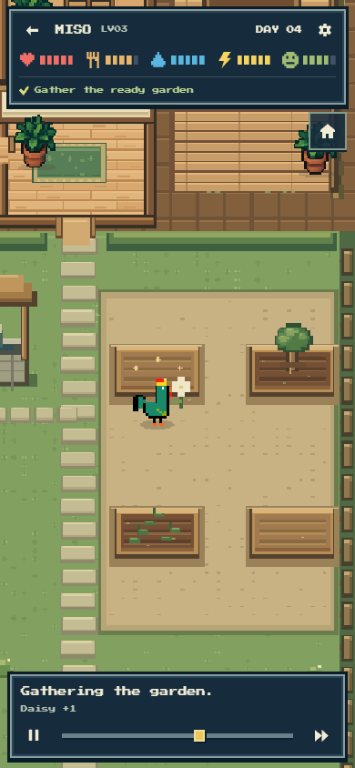
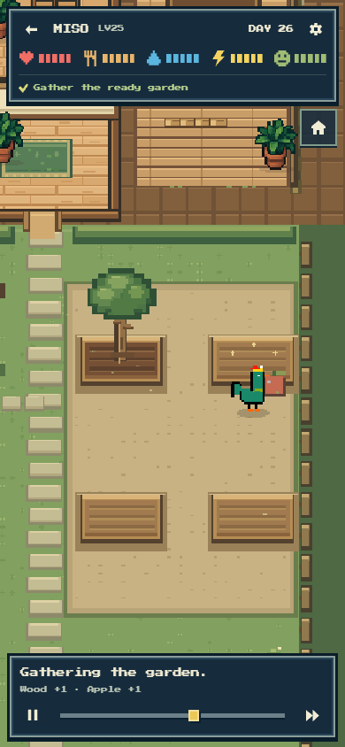

# Wave 5 independent actual-player review

Actual Robinhood testnet/Jev days now render as the same clean top-down game shown by the approved references. MISO's first planting day walks continuously through the house, doorway, front yard and mailbox, then returns inside before its ordinary care and single garden project. The later harvest day visibly removes its Daisy, retains a growing wood tree and Lavender, waters the remaining beds and returns to bed.

This review used the separate Codex Browser profile and a **GET-only local candidate host** against the actual deployed collection `0x30cb5213fa94020a95893ddb6b07470dbf7a9efc`, chain46630. The host never decrypts credentials, starts a worker or accepts an owner-write API request. This reviewer initiated zero wallet transactions and zero new inference calls. The mind/operator tasks own the actual paid preparation and settlement evidence.

These Day1/Day4 captures preceded the later mind5 budget-facts refinement. They are genuine earlier-policy testnet visual evidence, **not a substitute for the final-policy public guest or hosted release checks**. Their biological state/trace/commitment remains unchanged by the presentation refinements below.

## Actual playback and pixels

[The playback record](player-playback.json) binds both viewed films to their actual request IDs and replay commitments. MISO Day1 completed normal playback in68.645seconds, with no browser errors, warnings or application POSTs. It included mailbox collection and physical return, drinking, eating, one Daisy planting, leisure, another drink and bedtime. Its attached public life was alreadyDay2 when read; the film remained Day1.

The Day4 check explicitly sought to just before the main project, then played the entire remaining harvest→meal→well→two-bed watering→bed sequence normally in50.596seconds. No application error, warning or write occurred. The initial seek is not claimed as continuous morning playback. Daisy+1 and the final watering note matched the canonical receipts. The attached current public life wasDay8, separate from the recorded Day4 state.

Reviewed390×844,320×568 and430×932 rendered views beside VR-01. The warm wood, restrained moss garden, navy pixel panels, visible sleeping face and limited HUD remain aligned. The phone views had no horizontal overflow. A desktop Chrome frame-clock sample found no interval over50ms during the first full film; this is a scoped requestAnimationFrame observation, not a mobile-device or engine-FPS claim.

Twelve selected actual/control captures and their scopes are in [the image manifest](images/player-manifest.json). Raw full-film frames and downloaded public packets remain under ignored TEMP; the permanent records preserve event timings and selected images without making production depend on them.

## Short critique and repair loops

| Question | Actual evidence | Change | Focused result |
| --- | --- | --- | --- |
| Can a player close a nested card and continue? | Source review found menu→Purse→Close→menu→Close reusing `menu` as its own return destination. Pagination could similarly overwrite history's caller. | Close consumes the saved destination and resets the fallback to home; opening the same card no longer overwrites its caller. | The actual Day1 browser journey now completes menu→Purse→Close→menu→Close→home. No wallet action is involved. |
| Does the main project have enough visual weight? | In the first full film, the mailbox round trip occupied about23seconds; productive work itself held4seconds. The physical trip is part of the intended game. | Keep walking intact; productive main work now holds5.6seconds. Explicit QuietMain stays brief at2.2seconds and ordinary routines remain1.6seconds. | [A targeted actual Day1 seek/resume](player-main-polish.json) verifies the project approach and longer undertaking. The observed6.804second arrival-to-next-caption span also includes contact and a following quiet interlude; it is not the configured work duration alone. |
| Do held items fit the rooster? | The initial seed packet was nearly the height of the visible rooster. | Seed packets13–21 use scale0.78; parcels and finished crafts keep their previous scale. | The actual post-change carry shot leaves the rooster clearly visible beside its small packet. |
| Does longer garden work still feel alive? | The extended contact initially held one static garden pose until impact. | Plant/Harvest contact alternates existing garden/use textures with their one-pixel lean and two restrained soil/leaf pixels. Route points, needs, inventory, RNG and canonical impact timing are untouched. | [Two actual Day4 contact frames](player-gesture-inspection.json),260ms apart, show a small reach/pat rhythm. No full-film repeat was needed. |
| Does a quiet morning imply movement that never happens? | Actual Day1 chose an explicit Quiet before collecting the post, while remaining in bed. The caption said time to wander. | Use the neutral `Just a moment.` caption. | The text now fits a still ordinary pause anywhere in the house, without adding another instruction. |
| Can an older frozen guest accidentally offer an owner's next paid day? | Actual guest Day1 was attached to the current Day2+ life, while default loading had no explicit readingDay. | Derive historical context from the packet's own day as well as explicit history selection. Owners return to Latest home before preparing. Explicit visitor history can return latest; the anonymous default guest retains Hatch your own. | [Two controlled identity cases](player-frozen-guest.json) around the actual cached testnet snapshot pass with no signatures, transactions or inference. Belongings follows the recorded packet; profile/purse retain their current canonical context. |

The normal canvas interaction also works after the dialog input guard: a focused actual final-state seek and a lower-blanket tap opened Bed, and closing inspection retained Resume. An initial extra probe at a higher coordinate hit the sleeping-avatar area rather than the lower blanket and opened no card; it was not an application exception. The successful focused follow-up is preserved separately instead of repeating the50second tail.

## Final-policy actual Day26 follow-up

The final mind6 runtime (`0x047da3d3246af856a8f89d4608e2a094170560ffbf75644d9035a5b3dd31f374`) was then loaded from the permanent public deployment record. [The final-policy record](player-final-policy.json) binds actual NFT1 Day26 to request `0xf4cda833194b8e5337ee518b8fa1d3e049fa3ff1b3746f4a6fbfb813ca674962`, commitment `0xc56993c82077a88b07c8ea60c85d401e23b570dca91f56997e7839639fe9fd02`, and the exact replay response loaded by the browser.

An explicit seek to immediately before the main project avoided repeating the already reviewed morning. Normal playback then walked to both ready trees, showed small working gestures and produced the canonical `Wood +1 · Apple +1` in10.407seconds from the resumed approach. No browser error, warning or application write occurred. This is a targeted final-policy rendering check, not a claimed complete new day or a fresh hosted owner transaction.

The current public profile shows Day26, Level26, the dynamic home portrait and the real0NHC purse. A focused post-harvest seek followed by a real camera pan and workshop tap shows4wood and Toy boat×1. The settled Belongings card agrees with that stock and also shows the actual harvested fruit. Seven final-policy captures were added to the image manifest after viewing their pixels beside VR-01. The first Belongings capture caught its short opening transition; only the settled follow-up is preserved here. No application source changed in this follow-up, and no new inference, signature or wallet transaction was initiated by this reviewer.

## Remaining release evidence

No blocking visual/playback defect remains observed in this scoped review. Actual shipment/earning, the final chosen guest and hosted owner completion must retain their own honest evidence; this rooster's purse remains0 rather than an invented sale. The local read-only host loads public runtime at startup and can be restarted when the operator updates the serving policy; it is temporary review tooling and must not be shipped or used as an owner-write endpoint.
