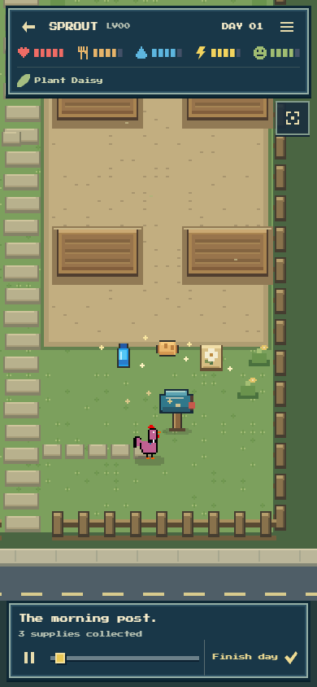
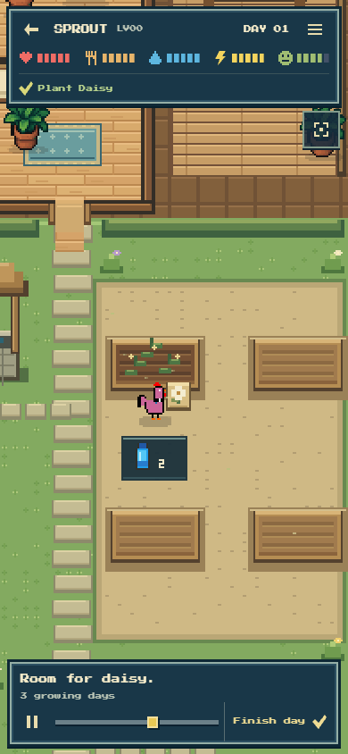
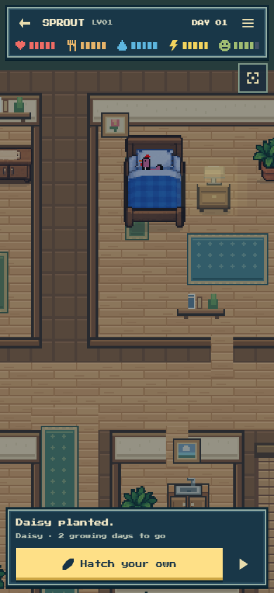

# Hosted SPROUT Day 1 playback

Verified on 2026-11-03T09:36:02.263Z at https://nearlyhuman.netlify.app, after the PM completed the actual funded mint and Jev day flow. This follow-up is a playback check; it did not submit another transaction or buy another inference.

- Published source: `5dfd62e`; Netlify deploy `6ae9a9c4612bd909d2dc69b7`.
- Expected live entry `index-CIeCo6tV.js` was present and asserted before watching.
- Actual public SPROUT **NFT #5, Day 1**, at **390×844**. One natural **1×** watch, **70.099 seconds**, with no pause, seek or Finish day.
- All **60** saved receipts retained. The exact parsed packet handed to the real application remained unchanged before/after playback, including its saved result. Final renderer state equals that canonical saved result.
- **699** read-only samples, **zero** hidden-tab samples, **zero** page errors, **zero** application writes.
- Ground-foot trajectory: **zero** wall overlaps outside the intentional bed climb; no movement over the defined speed bound.
- Only the run-owned tab was closed; the persistent Codex Browser profile and existing tabs were retained.

The three captures were inspected directly. The mailbox reveals the actual water, bread and daisy seed; planting shows sprouts, the completed intention and local moisture count; natural completion leaves SPROUT in bed at dusk with the daisy's remaining growth time. Original procedural rooster artwork is preserved.

| Mailbox | Daisy planted | Natural completion |
| --- | --- | --- |
|  |  |  |

Compact machine-readable evidence: [sprout-day1-playback.json](sprout-day1-playback.json). Full samples and tooling remain disposable in ignored `TEMP/player-feedback/hosted-world/`. No source change was needed after this hosted watch.
