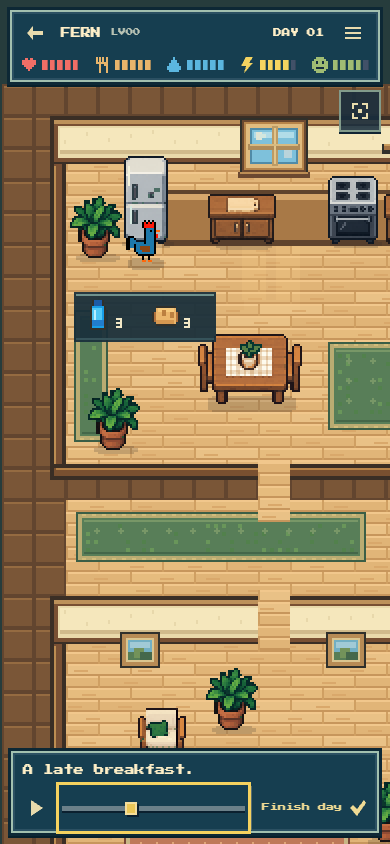
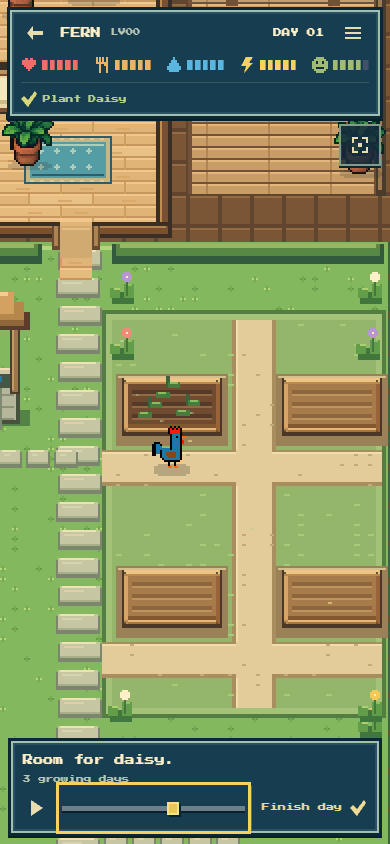
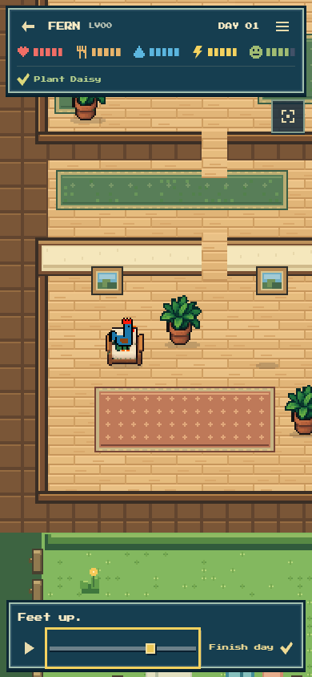

# Environmental color and material refinement

Question: can the house and garden feel warmer, happier and more legible while retaining the approved handheld-game style and the original rooster artwork?

The approved house-and-care reference and earlier actual phone captures showed the useful contrast: cream plaster, honey wood, dark material edges, blue bedding and clear greenery. The actual garden was dominated by a flat tan rectangle.

The final pass warms plank faces and cream walls, deepens their framing, and adds modest material-specific accents to actual furniture copies. Plants, window blues, textiles and small flowers provide cooler or brighter counterpoints. Garden beds have clearer raised joinery and soil contrast. Grass now sits around all four beds with narrow gravel lanes following the existing approach points, plus small decorative border flowers outside the productive beds. The well, sink and shelf details use restrained blue and green accents.

Actual production-source FERN Day 1 scenes were inspected at 390 × 844 using normal playback seeking for static art review. The workshop used presentation-only camera focus. These are real renderer captures with the saved packet, not concept images or a claim of another uninterrupted full-day watch. No page errors or app writes occurred.

All nine shipping furniture PNG copies retained their exact dimensions and every alpha value after the deterministic scenery compositor. Canonical rooster source hashes remain unchanged. No navigation geometry, planting slot, actor contact, item quantity or game rule changed. Production source has no dependency on temporary tooling.

Detailed alpha checks and source pins are in [evidence.json](evidence.json).
