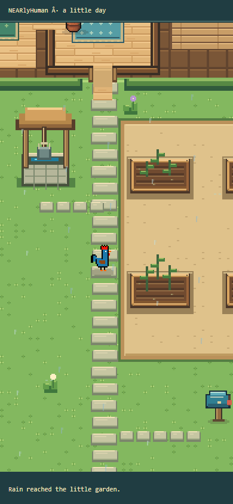
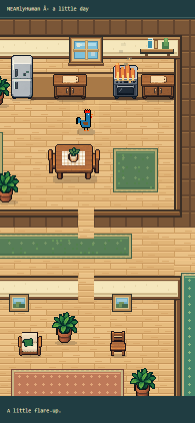
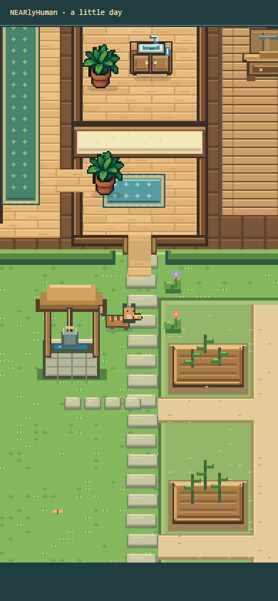
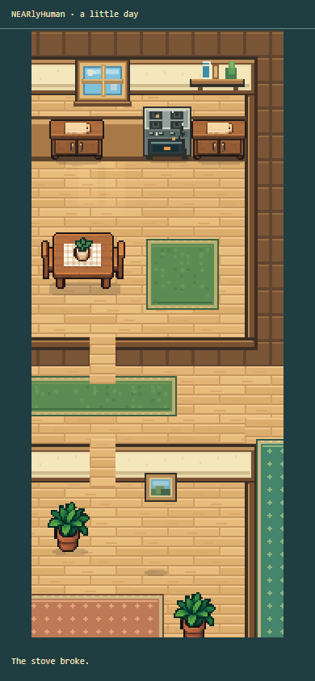

# Recorded events and a livelier world

The world now reveals weather and visitors at the recorded receipt impact. A day packet's future events are not used as advance scenery. Seeking rebuilds only the supplied past receipts; rain and visitors clear at their real phase boundary, and a restart clears the old life's atmosphere.

Rain has outdoor drops, ground splashes and window streaks. A sound window keeps the rain outside; a broken, unpatched, unbraced pane can drip. Seed-eaters remain small garden birds, while hungry visitors are distinct cats arriving along the path to the doorstep. Successful responses show the visitor leaving. An ignored visitor carries food only when the exact expiry receipt proves one extra pantry unit disappeared beyond that action's consumed ingredients; a tiny pantry icon−1 marks the real loss. Ambiguous changes never acquire an invented item or cause. Flames, smoke, dousing, breakages and outages have small located cues. Sunny insects stay out of storms and nighttime. Window light warms the floor without recoloring the procedural rooster.

The same pass fixed missing window-patch and brace art and removed the craft preview that depended on knowing success early. Work shows anonymous wood assembly until the actual finished item is recorded. The original rooster generators remain byte-for-byte unchanged.

A complete saved-day review then exposed an offscreen stove break. The impact caption now names the actual broken stove, cracked window or failing chair. If the affected fixture is outside the usable phone viewport, the camera makes a smooth 1.6-second glance and returns to the rooster. Actor position, route and simulation do not change. Pause freezes the glance, player focus wins, Find rooster cancels it, and seeking/restarting clears it. Ordinary proximity-stock chips stay hidden during that brief glance so clipped count fragments do not distract from the incident.

## Evidence and limits

The [compact proof](proof.json) records 16 pure event checks, a passing TypeScript check and 15 controlled browser cases with no browser errors or application API calls. The production renderer was checked at 390 × 844 and 320 × 568. The loop compared the earlier renderer with the new one, verified that events were absent before impact, checked the exact resulting snapshot and single impact, and exercised rain expiry, seek/reset and failed/successful visitor responses. A [two-case departure follow-up](visitor-departure-proof.json) checked proven beyond-recipe loss and an intentionally ambiguous multi-item loss. The [actual-receipt glance follow-up](fixture-glance-proof.json) reproduced a 156-logical-pixel phone playfield: camera X moved 6 → 88 → 9 while the rooster stayed at the pantry, the saved input stayed unchanged and the exact canonical snapshot was retained. Pause, manual follow and seek behaved correctly.

Rain, fire, outage, bird, cat and washout cases were **explicit synthetic scenarios**. They test visible timing and effects, not event frequency, inference quality or economic balance. The broken-stove case reused a **previously captured saved NFT #4 Day 1 receipt**, with its public block and commitment retained in [recorded-breakage.json](recorded-breakage.json). No new AI call, wallet operation or chain transaction was made for this review.

Rain and fire captures below are from the initial event pass, before the separate final garden grass insets and the small window-cue/craft-preview correction. Visitor and breakage captures are the later final doorstep/loss and offscreen-fixture follow-ups. Their surrounding frame is isolated capture chrome rather than the shipping UI. Final layout, complete-film and hosted UI review are recorded separately; the focused glance proof makes no new live-UI claim.

| Case | Actual rendered capture |
| --- | --- |
| Synthetic rain after its receipt lands |  |
| Synthetic stove fire after its receipt lands |  |
| Synthetic visitor departing the doorstep with one proven lost bread |  |
| Historical saved broken-stove receipt, camera glance after impact |  |

The focused permanent check is `scripts/v2/check-event-visuals.ts`. Permanent source and these records do not depend on the temporary browser fixture or captures.
