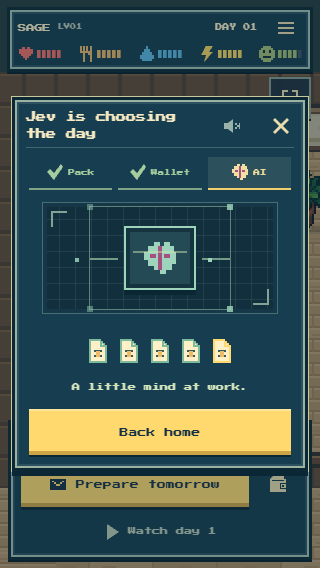

# Keep the day a surprise

Completed replies now leave sealed little thoughts. Loading accepts only the completed-response count, never a choice label, future event or itinerary. Each new thought has a short pixel arrival; the separate linked-block save remains visible. The day’s main project stays hidden until the rooster reaches its actual work. A craft shows anonymous assembly until its canonical result arrives.

Controlled phone checks deliberately supplied secret future labels in the real job DTO. At1,3and5completed replies, none appeared in visible text, ARIA or the project strip. Starting the saved film also kept the future project hidden.390x844and320x568 fit without horizontal overflow; no page errors, quotes, model calls or writes occurred. This is UI evidence with controlled GET responses, not another actual inference day. See report.json.

The actual saved NPC4 Day1 film then played naturally in81.047seconds, normal1x, with0hidden samples/errors/writes. Its exact packet and result objects remained unchanged and the renderer matched the canonical final state. This full watch exposed the offscreen stove-break weakness; the subsequent bounded actual-receipt glance check in ../events/ verifies that correction separately, without claiming another full-film run.

